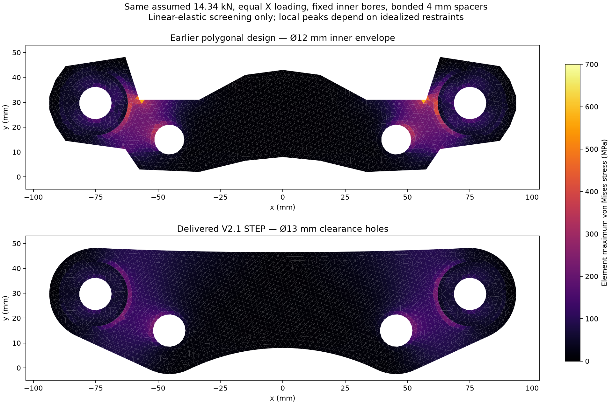

# Structural & Bolted-Joint Screening Summary (V2.1 Exact G1-Tangent 3/8" 1018 Steel)

**Date:** 2026-11-07  
**Disposition:** **Candidate requiring V2.1 physical fit check and complete assembly validation** (see [`independent_review_v2_1_2026-11-07/REVIEW.md`](independent_review_v2_1_2026-11-07/REVIEW.md), [`independent_review_v2_2026-11-07/REVIEW.md`](independent_review_v2_2026-11-07/REVIEW.md), and [`analysis_2026-11-07/STRUCTURAL_REVIEW.md`](analysis_2026-11-07/STRUCTURAL_REVIEW.md)).  
**Vehicle & Brake System:** 2002–2004 Ford Focus SVT Front Knuckle $\to$ 2010 Ford Mustang GT Front Rotor ($316 \times 30\text{ mm}$), Dual-43mm Caliper & Carrier  
**Material:** **AISI 1018 Cold-Rolled Steel Flat Bar, 3/8" ($9.525\text{ mm}$) Nominal Thickness** ($S_y = 370\text{ MPa}, S_u = 440\text{ MPa}, E = 205\text{ GPa}$ screening values; actual mill certificate required)  
**Verified V2.1 CAD Solid:** [`focus_svt_mustang_bbk_steel_bracket.step`](focus_svt_mustang_bbk_steel_bracket.step) (SHA-256: `6f57097922f5a15efb3da27714a69521b6ecd68713ded26432cea28f97e3d3f5`) + [`focus_svt_mustang_bbk_4mm_spacer.step`](focus_svt_mustang_bbk_4mm_spacer.step)

---

## 1. Revision Provenance: V1 (Historical) $\to$ V2 (Historical) $\to$ V2.1 (Current)

| Metric / Feature | Historical V1 Polygon (`b7c5b872...`) | Historical V2 STEP (`dc667682...`) | **Current V2.1 STEP (`6f570979...`)** |
| :--- | :--- | :--- | :--- |
| **Inner SVT Joint Retention** | Tapped M12 $\times$ 1.75 in $9.525\text{ mm}$ 1018 plate ($20.7\text{–}23.1\text{ kN}$ yield pullout vs. $51.4\text{ kN}$ preload) | $\varnothing 13.00\text{ mm}$ through-clearance + Class 10 nut + 300 HV $\varnothing 24\text{ mm}$ washer | $\varnothing 13.00\text{ mm}$ through-clearance + M12 $\times$ 1.75 Class 10 nut (**ISO 898-2 proof $= 1,050\text{ MPa} / 88.5\text{ kN}**) + ISO 7089 300 HV washer |
| **Outer Perimeter Tangency** | 15-station polygon with sharp $108^\circ$ shoulder notch at $X = \pm 57.5\text{ mm}$ | Upper notch removed; 4 lower line-to-arc junctions had $3.46466^\circ$ kink (`+ alpha` sign) | **All 8 junctions $0.000000^\circ$ tangent discontinuity** (`theta_n = theta_c - pi/2 - alpha` verified in OpenCASCADE) |
| **Inner / Outer Min Ligaments** | $6.49\text{ mm}$ inner ($\varnothing 12\text{ mm}$) $9.96\text{ mm}$ outer ($\varnothing 13\text{ mm}$) | $11.000\text{ mm}$ inner ($\varnothing 13\text{ mm}$) $11.966\text{ mm}$ outer ($\varnothing 13\text{ mm}$) | **Exact $11.000\text{ mm}$ inner** ($\varnothing 13\text{ mm}$) **Exact $12.000\text{ mm}$ outer** ($\varnothing 13\text{ mm}$) |
| **3D FEA `equal_X` ($2\text{ mm}$ mesh, fixed bores)** | Peak $= 685.8\text{ MPa}$ *(unconverged)* Web $= 410.9\text{ MPa}$ Disp $= 0.1491\text{ mm}$ | Peak $= 225.7\text{ MPa}$ *(historical V2)* Web $= 220.2\text{ MPa}$ Disp $= 0.0902\text{ mm}$ | **Peak $= 242.4\text{ MPa}$** **Web $= 226.0\text{ MPa}$** **Disp $= 0.0901\text{ mm}$** |
| **3D FEA `equal_X` ($3\text{ mm}$ mesh, back-face patches)** | Peak $= 625.3\text{ MPa}$ Web $= 539.3\text{ MPa}$ Disp $= 0.1416\text{ mm}$ | Peak $= 352.4\text{ MPa}$ *(historical V2)* Web $= 284.4\text{ MPa}$ Disp $= 0.0894\text{ mm}$ | **Peak $= 368.8\text{ MPa}$** **Web $= 291.4\text{ MPa}$** **Disp $= 0.0895\text{ mm}$** |
| **Physical Fit Status** | Tested on vehicle | Superseded by V2.1 | **Pending V2.1 full-thickness print check** ([`focus_svt_mustang_bbk_steel_bracket.stl`](focus_svt_mustang_bbk_steel_bracket.stl)) |

---

## 2. Fresh V2.1 3D FEA Screening Results ([`independent_review_v2_1_2026-11-07/FEA_RESULTS.md`](independent_review_v2_1_2026-11-07/FEA_RESULTS.md))

Solved directly on the frozen V2.1 STEP solid (`6f57097922f5a15efb3da27714a69521b6ecd68713ded26432cea28f97e3d3f5`) with $14.342\text{ kN}$ total load, $9.525\text{ mm}$ plate thickness, bonded $4.00\text{ mm}$ spacers, and four $\varnothing 13.00\text{ mm}$ holes (`split75_X` is a 75/25 unequal carrier ear load-sharing sensitivity; `left_only` is a 100/0 single-ear bound):

| Mesh Size | Restraint Idealization | Load Case | Peak von Mises Stress | Web Stress ($59 < |X| < 62\text{ mm}$) | Max Displacement | Screening Notes |
| :---: | :---: | :---: | :---: | :---: | :---: | :--- |
| **$3\text{ mm}$** | Fixed Bores | `equal_X` (50/50) | $231.2\text{ MPa}$ | $199.3\text{ MPa}$ | $0.0899\text{ mm}$ | Below $370\text{ MPa}$ assumed yield |
| **$2\text{ mm}$** | Fixed Bores | `equal_X` (50/50) | **$242.4\text{ MPa}$** | **$226.0\text{ MPa}$** | **$0.0901\text{ mm}$** | Global displacement settled within $0.26\%$ ($3\to 2\text{ mm}$) |
| **$3\text{ mm}$** | Fixed Bores | `split75_X` (75/25) | $328.8\text{ MPa}$ | $292.5\text{ MPa}$ | $0.1355\text{ mm}$ | 75/25 unequal load sharing |
| **$2\text{ mm}$** | Fixed Bores | `split75_X` (75/25) | **$363.8\text{ MPa}$** | **$324.3\text{ MPa}$** | **$0.1358\text{ mm}$** | Near $370\text{ MPa}$ assumed yield under 75/25 split |
| **$2\text{ mm}$** | Fixed Bores | `left_only_X` (100/0) | $485.1\text{ MPa}$ | $432.7\text{ MPa}$ | $0.1816\text{ mm}$ | Single-ear sensitivity bound |
| **$2\text{ mm}$** | Fixed Bores | `equal_Y` (50/50) | $264.1\text{ MPa}$ | $222.4\text{ MPa}$ | $0.0614\text{ mm}$ | Perpendicular load direction sensitivity |
| **$2\text{ mm}$** | Fixed Bores | `left_only_Y` (100/0) | $527.9\text{ MPa}$ | $415.3\text{ MPa}$ | $0.1225\text{ mm}$ | Single-ear perpendicular sensitivity |
| **$3\text{ mm}$** | Back-Face Patches ($R < 12\text{ mm}$) | `equal_X` (50/50) | **$368.8\text{ MPa}$** | **$291.4\text{ MPa}$** | **$0.0895\text{ mm}$** | Essentially at $370\text{ MPa}$ assumed yield at patch boundary |
| **$3\text{ mm}$** | Back-Face Patches ($R < 12\text{ mm}$) | `split75_X` (75/25) | **$486.5\text{ MPa}$** | **$393.1\text{ MPa}$** | **$0.1340\text{ mm}$** | Exceeds elastic yield assumption under 75/25 split |
| **$3\text{ mm}$** | Back-Face Patches ($R < 12\text{ mm}$) | `left_only_X` (100/0) | $646.7\text{ MPa}$ | $522.1\text{ MPa}$ | $0.1784\text{ mm}$ | Single-ear back-face sensitivity |

* **Engineering Interpretation & Scope:** Between the $3\text{ mm}$ and $2\text{ mm}$ meshes (`equal_X` / fixed bores), displacement changes by $0.26\%$, strain energy by $0.22\%$, peak stress by $4.84\%$, and web stress by $13.4\%$. While the equal-load fixed-bore case is below the $370\text{ MPa}$ yield assumption, the back-face patch peak ($368.8\text{ MPa}$) is essentially at assumed yield and uneven load sharing (`split75_X`) can exceed it. These idealized plate/spacer screenings omit bolt preload, contact friction/separation, carrier/knuckle compliance, actual pad-resultant moments, thermal effects, and fatigue; therefore, the part remains a candidate requiring assembly validation rather than a certified road-ready release.

---

## 3. M12 $\times$ 1.75 Coarse-Thread Fasteners, Washers, and Preload Verification

1. **Inner SVT Through-Bolted Joint (M12 $\times$ 1.75 Class 10.9 Bolt + Class 10 Nut + 300 HV Washer):**
   * **Nut Proof Load (ISO 898-2):** For M12 $\times$ 1.75 Property Class 10 nuts, ISO 898-2 specifies a proof stress of **$1,050\text{ MPa}$** ($\implies 84.3\text{ mm}^2 \times 1,050\text{ MPa} = \mathbf{88.5\text{ kN}}$ nominal proof load), exceeding the Class 10.9 bolt proof load ($830\text{ MPa} \times 84.3\text{ mm}^2 = \mathbf{70.0\text{ kN}}$).
   * **Applicable Coarse-Thread (M12 $\times$ 1.75) Nut Standards:**
     * **ISO 4032 Property Class 10:** Non-locking full-height hex nut ($m = 10.8\text{ mm}$), used with an **ISO 7089 Property Class 300 HV** hardened flat washer.
     * **ISO 7042 Property Class 10:** All-metal prevailing-torque **hex high nut** ($m_{\text{max}} = 12.3\text{ mm}$), used with an **ISO 7089 Property Class 300 HV** hardened flat washer.
     * **ISO 7044 (or DIN 6927) Property Class 10:** All-metal prevailing-torque **hex flange nut** for coarse pitch M12 $\times$ 1.75 *(note: ISO 12126 applies only to fine pitch and must not be referenced for M12 $\times$ 1.75)*.
   * **Average Bearing Pressure:** Under an illustrative $51.4\text{ kN}$ preload, an **ISO 7089 300 HV hardened flat washer** ($\text{OD} = 24.0\text{ mm}, \text{ID} = 13.0\text{ mm}, A = 319.7\text{ mm}^2$) has an average bearing pressure of **$160.8\text{ MPa}$** (and the $\varnothing 26/\varnothing 13\text{ mm}$ spacer has $129.1\text{ MPa}$).
2. **Remaining Validation Requirements Before Road Use:**
   * Verify physical fit and full stack clearance on the vehicle using the full-thickness $9.525\text{ mm}$ V2.1 model ([`focus_svt_mustang_bbk_steel_bracket.stl`](focus_svt_mustang_bbk_steel_bracket.stl)) with actual M12 $\times$ 1.75 hardware and $4.00\text{ mm}$ spacers.
   * Verify usable thread engagement depth and absence of bolt bottoming inside the Mustang GT caliper carrier.
   * Obtain the actual 1018 steel mill certificate (MTR), establish the friction-matched installation torque/preload for both joints, and complete assembly proof/fatigue validation.
