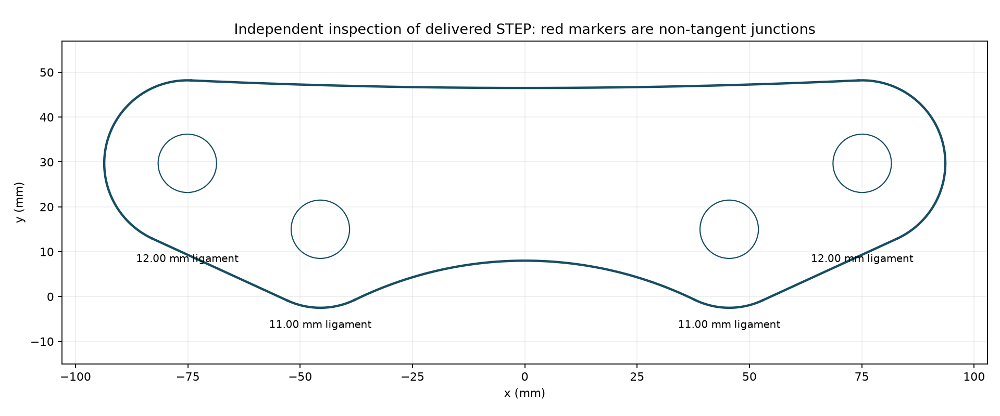
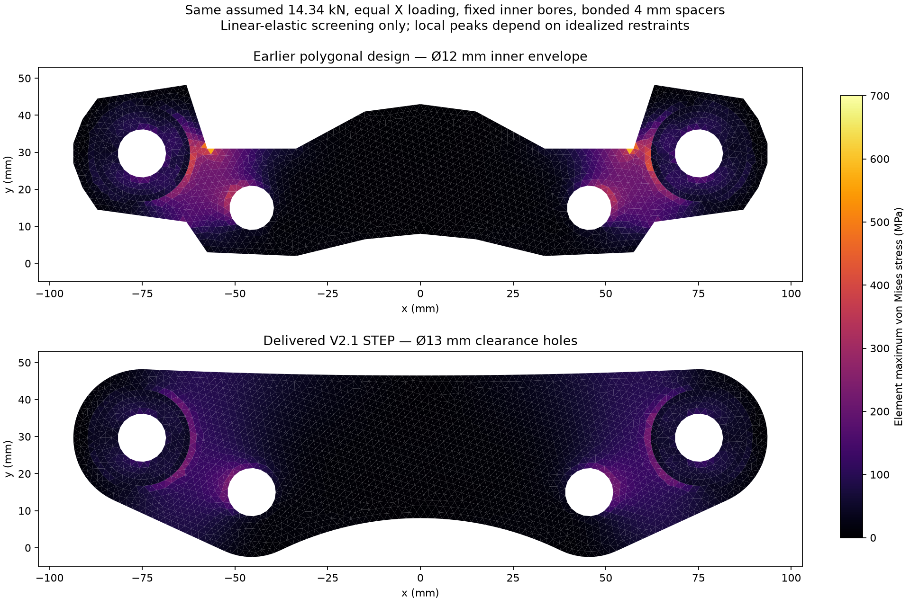

# Independent V2.1 correction review — 2026-11-07

**Disposition: the identified contour defect is corrected. The bracket remains a candidate pending fit and complete assembly validation.** This review closes the demonstrated geometry errors; it does not convert the conditional plate screening into a road-use approval.

**Final-check finding: the live folder became inconsistent during this review.** The corrected STEP, STL, DXF and gauge still match the frozen inputs, but `generate_step_file.py`, `bbk_adapter_parameters.json`, `MACHINING_SPECIFICATION.md`, `STRUCTURAL_ANALYSIS_1018_STEEL.md` and `README.md` reverted to earlier V2 contents. The live generator again uses **`+ alpha`**, and the live documents again contain the earlier fit approval, generic torque, nut-standard/proof-load and stale geometry claims. These changes were not made by this review. The correction table below describes the **initial frozen V2.1 submission**, not the subsequently regressed live documents. Reconcile the live source/documents before regenerating or issuing a fabrication package. Both states and their hashes are preserved in [input_snapshot](input_snapshot/), [late_live_snapshot](late_live_snapshot/), [concurrent_changes.json](concurrent_changes.json) and [concurrent_changes.diff](concurrent_changes.diff).

The reviewed STEP SHA-256 is `6f57097922f5a15efb3da27714a69521b6ecd68713ded26432cea28f97e3d3f5`. Delivered CAD and documents were frozen in [input_snapshot](input_snapshot/) before testing. The designer's files were not modified. This supplements the [V2 review](../independent_review_v2_2026-11-07/REVIEW.md); its unchanged load, material and assembly limitations still apply.

## Correction verification

| Prior finding | Independent V2.1 result |
|---|---|
| Four 3.46° lower-perimeter kinks | **Closed.** Direct derivatives of the imported STEP show all eight joins tangent within numerical precision. The tangent-normal sign is corrected. |
| Inaccurate minimum outer ligament | **Closed.** Direct closest-point checks give 11.000 mm inner and 12.000 mm outer ligaments around the Ø13 mm holes. |
| Incorrect drawing radii and coordinates | **Closed for the reviewed perimeter.** Updated dimensions agree with the delivered analytic profile. DXF arcs/lines and all four hole centers/diameters were checked against the STEP. |
| Coarse STL approximation | **Closed at the checked outline tolerance.** Largest sampled STEP/STL outline deviation is about 0.00466 mm, previously 0.105 mm. STL is watertight and consistently wound. |
| Incorrect fit approval | **Closed as a documentation issue.** Fit is now explicitly pending. The owner has reported a test print in progress, not a completed V2/V2.1 fit. |
| Wrong nut proof-stress diameter range | **Corrected.** The document now uses the previously checked 1050 MPa / approximately 88.5 kN M12 class 10 value. Actual purchased hardware still needs to match the selected specification. |
| Ø12.7 mm finished hole allowed against Ø12.95 mm minimum | **Closed.** The instruction now excludes finishing at 1/2 inch. |
| Universal 108–115 N·m installation torque | **Withdrawn.** The document now recognizes friction/preload sensitivity. A validated installation torque has not yet been established. |
| Old FEA values presented under the new revision | **Still needs provenance correction.** The submitted V2.1 summary carries forward the prior V2 results. Those numbers must be labeled historical; use the fresh results in this review for the new STEP hash. |
| Nut option standard | **One remaining specification error.** ISO 12126 is a fine-pitch flange-nut standard; it is not the appropriate ISO reference for the specified M12×1.75 coarse-thread option. |

For that last hardware correction, specify an actual **M12×1.75 class 10** product. If choosing the all-metal flange-nut option, ISO 7044 is the relevant coarse-thread standard to check; ISO 12126 concerns fine pitch. This does not invalidate the separate full hex-nut option. Dimensions and coating must come from the selected supplier product, not assumed equivalence between standards. [ISO 12126 scope](https://www.iso.org/standard/61529.html), [ISO 7044 scope](https://www.iso.org/standard/61526.html).

## Verified geometry and exports

The imported STEP contains one solid with four Ø13 mm holes at (±45.5, 15) and (±75.1, 29.7) mm. Thickness remains 9.525 mm, envelope 187.2 × 50.7 mm, and spacer location remains between the adapter and GT carrier. STEP volume is **67,674.5905 mm³**, independently confirmed by boundary integration. STL volume is **67,679.0888 mm³**, a difference of approximately 0.00665%.

The corrected shape retains the full upper bridge and enlarged inner bosses. Detailed geometry is in [step_geometry_audit.json](step_geometry_audit.json); STEP/DXF/gauge comparisons are in [export_checks.json](export_checks.json).

The maximum sampled outline change from V2 to V2.1 is only about **0.0338 mm**. The DXF agrees with the STEP outline to approximately 0.000018 mm in the sampled comparison. This is a localized tangent correction, not another large change to the bracket's fit envelope. Printed dimensional error and the actual hardware stack remain separate considerations.



The 4 mm rapid gauge checks the outline and hole alignment. It does **not** reproduce the full 9.525 mm plate stack: it is 5.525 mm thinner. Use the full-thickness fit model, or an accurately compensated stack, to check caliper centering, usable bolt engagement and nut/washer clearance. A plastic fit model does not validate tightening load or brake strength.

## Fresh structural checks

The unchanged, previously verified solver was rerun on the frozen V2.1 STEP at **3 mm and 2 mm mesh settings with fixed bores**, plus the **3 mm back-face restraint sensitivity**. Each model solves equal X, 75/25 X, single-ear X, equal Y and single-ear Y cases. The four-mesh-model V2 study remains historical context, not a substitute for these new solves.

All cases retain the same illustrative **14.342 kN** total load, bonded **4 mm spacers**, E = 205 GPa, ν = 0.29 and assumed yield strength 370 MPa. The owner has confirmed certified cold-rolled 1018, but the numerical mill-certificate strengths have not been supplied. The load derives from the previous 1350 kg / 1.2g / 78% front braking / 312.5 mm tire radius / 135 mm effective pad radius assumptions; it is not a verified maximum load envelope.

Results are in [FEA_RESULTS.md](FEA_RESULTS.md) and [results_summary.json](results_summary.json). Per-run files contain mesh counts, source STEP hash, equilibrium and residual checks. The solver and verification script are byte-identical to the earlier reviewed versions, so their [existing patch-test verification](solver_verification.json) is retained rather than rerun. New equilibrium/residual checks execute for every new load case.

| V2.1 load case | Restraint / mesh | Peak elastic stress | Maximum displacement |
|---|---|---:|---:|
| Equal X, 50/50 | Bores / 3 mm | 231.2 MPa | 0.0899 mm |
| Equal X, 50/50 | Bores / 2 mm | **242.4 MPa** | **0.0901 mm** |
| X, 75/25 | Bores / 2 mm | 363.8 MPa | 0.1358 mm |
| X, single ear | Bores / 2 mm | 485.1 MPa | 0.1816 mm |
| Equal X, 50/50 | Back-face patches / 3 mm | **368.8 MPa** | **0.0895 mm** |
| X, 75/25 | Back-face patches / 3 mm | 486.5 MPa | 0.1340 mm |

The 3-to-2 mm refinement changes equal-X/bore displacement by approximately **0.26%**, strain energy by **0.22%**, and peak stress by **4.84%**; the web-region maximum changes by approximately **13.4%**. Global displacement is stable at this screening level, but the local stress field is not demonstrated fully converged. At 2 mm, V2.1 displacement differs from V2 by less than 0.1%, while the peak is about 7.4% higher. Both geometry and tetrahedral mesh changed, so that peak difference must not be attributed solely to the tangent correction or read as a proven physical loss of strength. See [revision_comparison.json](revision_comparison.json).

Under the chosen 370 MPa yield assumption, the equal-X fixed-bore result is below yield, but the back-face peak is essentially at it, and uneven-load cases can exceed it. This supports **retaining the candidate/validation-pending disposition**, not declaring a whole-assembly pass. The earlier 225.7 MPa value is a V2 result and should not be presented as the measured result for this V2.1 STEP.



The fixed-bore and back-face supports remain artificial restraints. The model does not include bolt preload, clearance contact, slip/separation, carrier/knuckle flexibility, actual pad-resultant moments, temperature or fatigue. Local peaks at fixed surfaces or bonded spacer edges can be mesh/constraint sensitive. Neither the single-ear sensitivity nor the two support choices is a proven upper bound on all real assembly loads. Ratios of assumed yield to local elastic peak are not certified design safety factors.

## Remaining work

The earlier CAD tangency issue no longer calls for another outline correction. Remaining release work is primarily **assembly evidence and load validation**: complete the fit check with the actual thickness and hardware envelope; select specific hardware; verify carrier thread depth and bolt bottoming; establish preload/torque and friction assumptions; supply material-certificate values; establish the full brake load and fatigue cases; and validate the resulting joint/assembly model and manufactured parts appropriately.

Two document fixes remain straightforward: correct the fine-pitch flange-nut reference and attach each analysis result to the STEP revision actually solved. The existing “candidate requiring fit and assembly validation” disposition is appropriate. Removing the kinks does not remove the earlier uncertainty about clamp, contact and carrier load sharing.

Following the concurrent regression noted above, first restore/reconcile the intended V2.1 generator and document corrections from the preserved submission, incorporating these remaining findings. **Do not run the regressed generator against the verified exports.** There is no need to rerun this FEA merely because prose changed: the final checked STEP hash is unchanged. Any subsequently regenerated geometry must be checked by its new hash.

## Reproduction and traceability

Input hashes are in [input_hashes.json](input_hashes.json). Use the existing analysis environment (Gmsh 4.15.2, scikit-fem 12.0.2, NumPy/SciPy, Matplotlib, Shapely and trimesh, plus Gmsh system libraries):

```sh
python audit_step.py
python check_exports.py
python run_independent_fea.py --size 3
python run_independent_fea.py --size 2
python run_independent_fea.py --size 3 --support face
python summarize_results.py
```

The export comparison reads the prior V2 outline; the stress comparison reads the preserved original-bracket field. This review remains tied to the frozen input snapshot if live files subsequently change.
