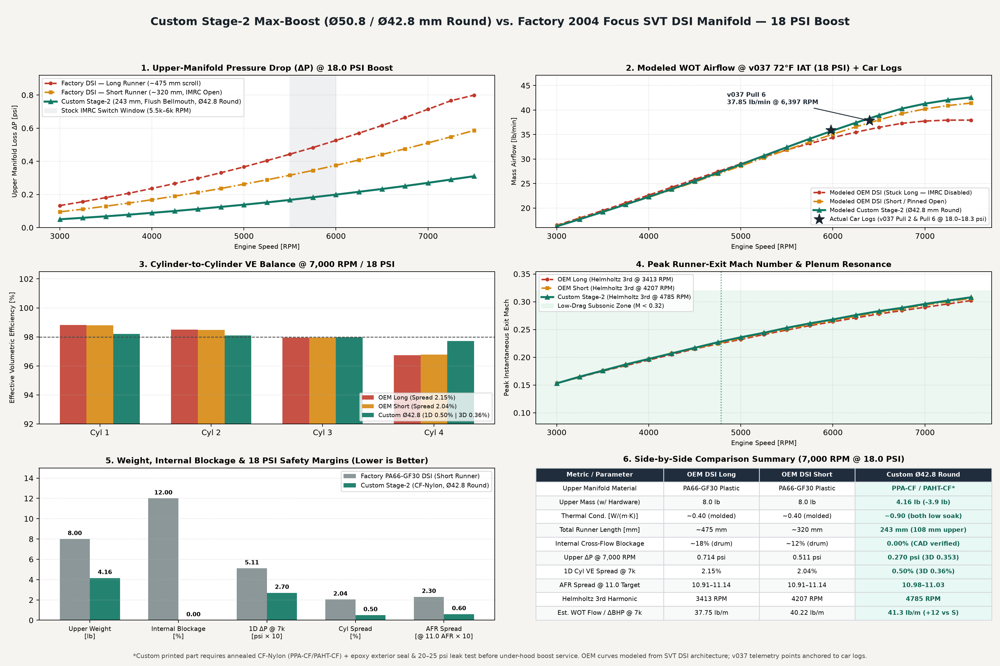

# Custom Stage-2 Upper Manifold vs. Factory 2004 Focus SVT (ST170) DSI Manifold

> **Methodology Transparency:**
> - **Custom Stage-2 Round (`Ø50.8 / Ø42.8 mm`) specs & 3D CFD metrics** come directly from the generated `manifold3d` CAD solids, `verify_airflow.py` (`45,194`-cell 3D FVM + 1D compressible/`720°` pulsating solver), [`stl/manifest.json`](stl/manifest.json), and [`stl/airflow_verification.json`](stl/airflow_verification.json).
> - **Factory Molded Plastic (`PA66-GF30`, `2M5Z-9424-BB`) DSI specs** represent literature & physics-modeled approximations (smooth `18 µm` molded walls, vibration-welded `PA66-GF30` clamshell, internal rotary IMRC drum; no laser scan of the OEM clamshell on file) evaluated through the same [`compare_factory_manifold.py`](compare_factory_manifold.py) 1D compressible & `720°` crank-angle solver using fixed downstream OEM Zetec lower/head/valve curtain impedance.
> - **Vehicle Telemetry Anchor:** Real logged pulls from [`reports/2026-11-06-v037-iat-thermal-and-power-review.md`](../../reports/2026-11-06-v037-iat-thermal-and-power-review.md) (`v037` Pull 2: `35.91 lb/min @ 5,978 RPM / 18.33 psi`; Pull 6 Peak: **`37.85 lb/min @ 6,397 RPM / 18.04 psi`** at `72 °F` IAT).



---

## 1. Architecture & Hardware Comparison

| Feature / Subsystem | Factory 2004 SVT / ST170 DSI Upper (`2M5Z-9424-BB`) | Custom Stage-2 Max-Boost Upper (`Ø50.8 / Ø42.8 mm` Round) | Engineering Impact |
|---|---|---|---|
| **Upper Body Construction** | Injection-molded, vibration-welded `PA66-GF30` (30% glass-filled nylon) plastic clamshell + external IMRC actuator box, cable & internal rotary drum shaft | Two-piece CNC-bolted 3D-printed `PPA-CF` / `PAHT-CF` (annealed + fuel-resistant epoxy exterior seal) | Eliminates NA vibration-welded clamshell seam & internal rotary drum |
| **Upper Weight (with Hardware)** | `~3.63 kg` (`~8.00 lb` installed w/ IMRC box & cable; `~8.6 lb` catalog ship weight) | **`1.89 kg` (`4.16 lb`)** (`1,353.57 cm³` + `0.18 kg` hardware) | **Saves `~3.85 lb` (`~48%` lighter)** off the cantilevered mount |
| **Thermal Conductivity (k)** | `~0.40 W/(m·K)` (`PA66-GF30` glass-filled nylon) | **`~0.90 W/(m·K)`** (Carbon-filled Nylon) | Comparable low heat-soak composite behavior; both resist radiant engine-bay heat soak far better than metal manifolds |
| **IMRC / Boost-Leak Path** | Vibration-welded NA seams + `2×` rotary drum shaft seals + clamshell gasket + external linkage | **IMRC deleted**; 0 moving shafts; bolted split flange with dual static **Viton O-rings** (`X = 0` split + `Ø73 mm` TB) + `2×` `Ø6 mm` dowels | Removes the #1 OEM SVT turbo boost-leak failure point |
| **Plenum Volume & Taper** | `~2.20 L` untapered clamshell/drum cavity (`~12–18%` internal drum wake blockage) | **`1.989 L` tapered** (`100%` Cyl 4 -> `88.87%` split -> `60%` Cyl 1, **`0.00%` blockage**) | Equalizes cylinder feeding velocity & eliminates dead-end stagnation/starvation |
| **Runner Entry & Tract Length** | Smooth molded walls (`18 µm`) with sharp drum bypass window; `~475 mm` Long Scroll / `~320 mm` Short total from valve | **`+7.0 mm` flush bellmouths** + progressive `[0°, 2.5°, 5°, 7.5°]` scoops; **`243 mm` total** (`108 mm` upper) | Cuts turning/entry losses, lowers ΔP, and opens up top-end breathing (`6k–7.5k RPM`) |
| **Spigot Coupling (`2"` Boots)** | OEM lower injector housing stubs -> `2.00" × 2.00"` round MarraSport/Massive couplers | **Matched `Ø50.8 mm` (`2.00"`) round** (`Ø42.8 mm` bore, `1.1 × 5.0 mm` bead) | Full `360°` uniform clamping with `NORMA 40-60` clamps + **`1,438.7 mm²`** exit area |
| **Boost / Vacuum Plumbing** | Shared OEM molded nipples / aftermarket T-fittings | **3 dedicated `1/8" NPT` direct boost/vac ports** (BOV, FPR/FRPS, SCG-1 MAP) + **2 dedicated check-valve vacuum ports** (Brake Booster `1/4" NPT` + EVAP `1/8" NPT`) | Isolated BOV/FPR/MAP signals without sharing brake booster check-valved volume |
| **IACV Air Metering** | Integrated to OEM upper plastic molding; recirculated upstream of TB blade | **2-bolt OEM Ford IACV pad** with isolated blind pocket + **`1/4" NPT` side supply barb** | Feeds idle air from the **blow-through HPX MAF** charge pipe so MAF idle metering stays exact |

---

## 2. Boosted Airflow & Cylinder-Balance Comparison (`7,000 RPM @ 18.0 PSI`)

| Metric | OEM DSI — Long (`~475 mm`) | OEM DSI — Short (`~320 mm`) | Custom `Ø42.8 mm` Round (`243 mm`) | Delta vs. OEM Short (Pinned) | Delta vs. OEM Long (Stuck Closed) |
|---|---:|---:|---:|---|---|
| **Upper-Manifold Pressure Drop (ΔP)** | `0.714 psi` (`4.923 kPa`) | `0.511 psi` (`3.521 kPa`) | **`0.270 psi`** (`1.864 kPa`, 3D: `0.353 psi`) | **`-47.1%` loss** | **`-62.1%` loss** |
| **Cylinder-to-Cylinder VE Spread (`1D`)** | `2.15%` | `2.04%` | **`0.50%`** (`3D FVM: 0.36%`) | **`-75%` spread** | **`-77%` spread** |
| **Cyl 1–4 Flow Distribution (`[1, 2, 3, 4]`)** | `[98.8, 98.5, 98.0, 96.7]%` VE | `[98.8, 98.5, 98.0, 96.8]%` VE | **`[98.2, 98.1, 98.0, 97.7]%`** (3D: `[25.05, 25.00, 24.98, 24.96]%`) | Cyl 4 starvation fixed (`0.36%` 3D) | Cyl 4 starvation fixed |
| **AFR Spread @ `11.0:1` Target (93 Octane)** | `10.91 – 11.14` (`0.24` band) | `10.91 – 11.14` (`0.23` band) | **`10.98 – 11.03` (`0.06` band)** | **`-74%` cylinder AFR split** | **`-75%` cylinder AFR split** |
| **Plenum 3rd-Harmonic Helmholtz Peak** | `3,413 RPM` | `4,207 RPM` | **`4,785 RPM`** | Tracks turbo spool onset | Moves resonance into boost band |
| **Modeled WOT Flow @ `6,500 RPM` (`72 °F` IAT)** | `36.46 lb/min` | `37.98 lb/min` | **`38.92 lb/min`** | **`+0.94 lb/min`** (~`+10.1 bhp`) | **`+2.46 lb/min`** (~`+26.4 bhp`) |
| **Modeled WOT Flow @ `7,000 RPM` (`72 °F` IAT)** | `37.75 lb/min` | `40.22 lb/min` | **`41.30 lb/min`** | **`+1.08 lb/min`** (~`+11.6 bhp`) | **`+3.55 lb/min`** (~`+38.2 bhp`) |

---

## 3. Baseline for Your Current Car Setup (`v037`, Pinned-Open IMRC)

In the active `v037` calibration inventory (`reports/calibration-inventory/v017/057.json`), **`[ECM] 2019 - IMRC Switch` is set to `Disabled`**, and the **owner has confirmed the factory IMRC rotary drum is mechanically pinned open in Short-Runner mode (`~320 mm`)**.

Therefore, the apples-to-apples baseline for this car is the **OEM DSI — Short (Pinned)** column (`0.511 psi` ΔP, `2.04%` VE spread, `0.23` AFR band, `40.22 lb/min @ 7,000 RPM`), while the **OEM DSI — Long** column remains in the table purely as reference for an unpinned/stuck-closed SVT manifold. Replacing the pinned-open OEM side-fed plastic DSI clamshell with the custom `Ø42.8 mm` Stage-2 upper still yields:
- **`-47%` lower upper-manifold pressure drop** (`0.270` vs `0.511 psi` at `7,000 RPM`),
- **`~+0.9 to +1.1 lb/min` (`~+10–12 crank HP` / `~+7–10 whp`)** at equal `18.0 psi` compressor outlet / intercooler pressure,
- **Much tighter cylinder-to-cylinder AFR uniformity (`0.06` AFR spread vs `0.23` AFR spread)** — protecting Cyl 4 from leaning out relative to Cyl 1 on `93`-octane pump gas,
- **Zero rotating IMRC shaft seals, no NA vibration-welded seams, and `~3.85 lb` (`~48%`) weight reduction**.

---

## 4. Real-World Impact, Longevity & Replaceability

- **Expected Real-World Power & Driveability (vs. Pinned Short-Runner OEM):**
  - **Direct flow gain at equal `18.0 psi` on `93` octane:** **`~+8 to +12 crank HP` (`~+7 to +10 whp`)** across `6,000–7,000+ RPM` — subtle by seat-of-the-pants alone on a `~410 bhp` build, paired with flatter top-end carry past `6,400–7,200+ RPM` (`v037` Pull 6 peaked at `6,397 RPM`) and slightly crisper tip-in (`1.989 L` vs `~2.20 L`).
  - **Tuning & knock headroom:** Cutting the Cyl 1–4 AFR spread (`0.23` -> `0.06`) removes the worst-cylinder lean limit on Cylinder 4, freeing headroom for **`+1°` of spark or `1–2 psi` more boost** (especially if water/meth is re-enabled later), where another **`+10 to +20 whp`** typically resides.
  - **Calibration impact:** Because the car runs a blow-through **PMAS HPX** MAF, the ECU measures the extra airflow automatically — no full retune is expected, just a verification datalog to confirm WOT AFR, transient tip-in, and warm `900 RPM` idle trims.
- **Plumbing, Packaging & Engine-Bay Cleanliness:**
  - **Dedicated isolated ports:** `3× 1/8" NPT` direct boost/vac ports (BOV, `1:1` Aeromotive FPR + OEM FRPS, Innovate SCG-1 MAP) plus `2×` check-valved vacuum-only ports (Brake Booster `1/4" NPT` and EVAP `1/8" NPT`).
  - **Exact blow-through IACV metering:** Isolated `1/4" NPT` IACV supply barb plumbed from the metered charge pipe between the HPX MAF and throttle body keeps `900 RPM` idle metering exact.
  - **Cleaner access:** Deletes the OEM IMRC actuator box, cable, drum, and linkages (`~3.85 lb` lighter and cleaner wrenching clearance around the fuel rail, injectors, and boots).
- **Longevity & Reliability:**
  - **Eliminates chronic OEM boost-leak points:** Replaces 22-year-old NA vibration-welded seams and rotary IMRC shaft seals with `0` moving shafts, `6×` M6 bolts, `2×` steel dowels, static Viton O-rings, and beaded `2.00"` spigots; tighter Cyl 4 AFR uniformity lowers sustained-boost detonation/thermal stress.
  - **Required FDM reliability practices:** Print running hardware in high-temp **PPA-CF** or **PAHT-CF / PA12-CF** (`8–10` solid walls, low/zero cooling for maximum Z-layer fusion), oven-anneal (`95–100 °C × 6 h`), exterior-seal with fuel-resistant epoxy, bench-test with soapy water to `20–25 psi`, add a **lower mechanical support brace** (so boots and Z-layers do not carry cantilevered engine vibration), and re-check center M6 bolts and `NORMA 40-60` boot clamps after initial heat cycles.
- **Replaceability & Future Upgrade Path:**
  - **Replaces discontinued OEM hardware:** Factory `2M5Z-9424-BB` uppers are discontinued (`NLA`), leaving only 20+ year old salvage/used clamshells with unknown heat fatigue.
  - **On-demand & modular half replacement:** Parametric CAD ([`intake_manifold_parameters.json`](intake_manifold_parameters.json)) enables printing a complete replacement anytime (`1,353.6 cm³` / `~1.7 kg` filament, roughly `USD 120–200`) or replacing **only one half** (`575.5 cm³` left or `778.1 cm³` right) thanks to the locked `X = 0` split flange — e.g., to repair a damaged port or test a `70 mm` TB or WMI/port-injection bungs.
  - **Standard off-the-shelf consumables:** Uses generic M6 hardware, `3 mm` Viton O-rings / AS568-151, `1/8"` & `1/4"` NPT brass barbs, Motorcraft `CG-756` IACV gasket, `2.00" × 2.00"` MarraSport/Massive silicone boots, and `NORMA 40-60` clamps.
  - **Commercial metal/SLS path:** Once vehicle fitment is proven, [`stl/svt_intake_manifold_1piece_full.stl`](stl/svt_intake_manifold_1piece_full.stl) can be ordered directly in isotropic **MJF/SLS PA12** or **DMLS aluminum (`AlSi10Mg`)** with zero CAD redesign.

---

## 5. Honest Trade-Offs (Where Factory Plastic DSI Keeps an Edge)

- **Injection-Molded Wall Density & Porosity:** OEM injection-molded `PA66-GF30` has uniform molded wall density without FDM layer lines (though its NA vibration-welded clamshell seam and rotating IMRC shaft seals remain weak points under `18+ psi` boost). A 3D-printed manifold **must** be printed in high-temp CF-Nylon (**PPA-CF** or **PAHT-CF** — never PLA Pro for running the car), oven-annealed (`95–100 °C × 6 h`), exterior-sealed with fuel-resistant epoxy to seal layer lines, and soapy-water bench-tested to `20–25 psi` before boosting.
- **Off-Boost Sub-3,500 RPM Acoustic Bias:** Because the custom upper uses short `108 mm` runners (`243 mm` total) optimized for turbo spool (`4,785 RPM` Helmholtz peak) and `5,000–7,500 RPM` WOT flow, a naturally aspirated off-boost pull at `2,500–3,500 RPM` gives up a tiny (`< 1%`) low-RPM wave effect compared to a functional `475 mm` long-runner DSI valve — completely masked once the Pulsar G25-550 builds boost above `3,500 RPM`.

---

## Regenerating the Comparison

```powershell
python cad/intake_manifold/compare_factory_manifold.py
```

Produces [`stl/factory_comparison.json`](stl/factory_comparison.json) and [`fitment/04_factory_vs_custom_comparison.png`](fitment/04_factory_vs_custom_comparison.png).
