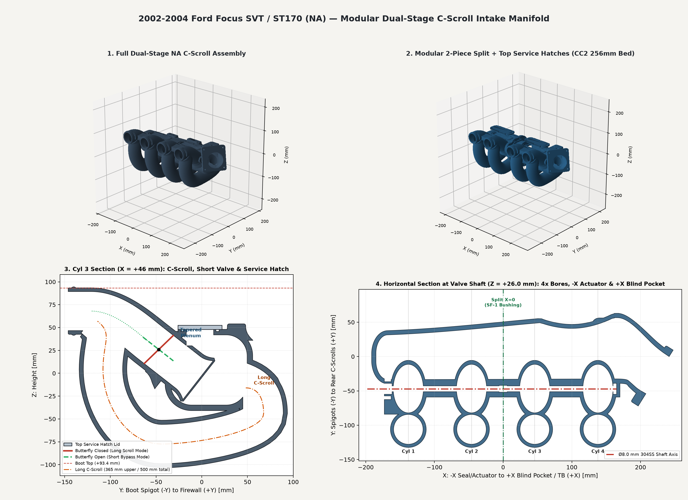
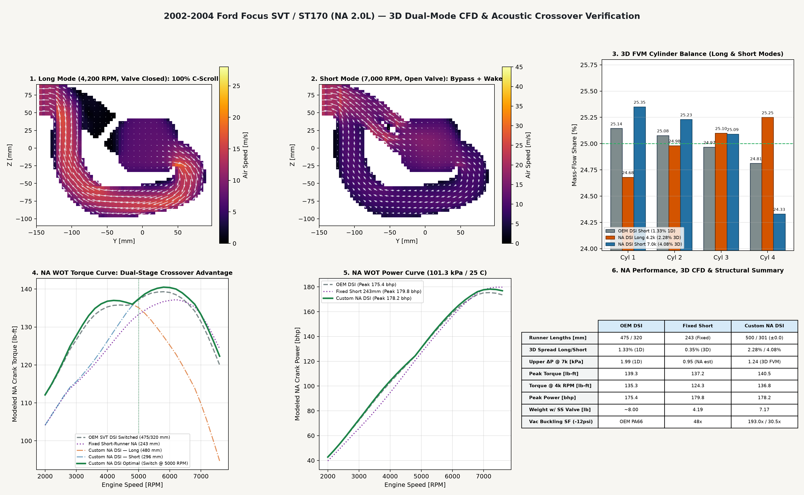

# 2002–2004 Ford Focus SVT / ST170 (NA 2.0L Zetec-R) — Modular Dual-Stage (2-Length Runner) C-Scroll Intake Manifold

> [!IMPORTANT]
> **OEM IMRC Calibration Pending (`oem_imrc_calibration_pending: true`)**
> Because the OEM Focus SVT upper manifold and IMRC actuator box are not currently on-hand until your Stage-2 turbo manifold swap, `svt_na_dsi_actuator_bracket_universal.stl` and `cnc/svt_na_dsi_actuator_lever_6061.step` use parameterized provisional mounting geometry. Before final machining/installation with the OEM cable box, complete the **OEM DSI / IMRC Caliper Measurement Checklist** at the bottom of this guide and update `na_dsi_parameters.json` (or use the universal vacuum pod + 12V solenoid option).

> [!NOTE]
> **Isolated Package:** All files in `cad/intake_manifold_na_dsi/` are self-contained and leave `cad/intake_manifold/` and `cad/intake_manifold_wrc/` completely untouched.

---

## 1. Architecture Overview

This Track 2 design adapts the printed composite modular split-plenum C-scroll architecture to **Naturally Aspirated (NA)** Zetec-R builds retaining a **2-length (Dual-Stage / DSI) runner system**:

- **Equal-Length Dual-Path Runners (Cyl 1–4 @ `92.0 mm` pitch):**
  - **Long C-Scroll Path (`500.0 mm` total / `365.0 mm` upper, `±0.0 mm` spread):** Exits the lower-rear of the dropped plenum (`Z = -16.0 mm`), wraps behind (`+Y`) and beneath (`-Z`, `z_bot` down to `-83.1 mm`) the plenum, and sweeps up in front of the valve housing into the underside of the common runner (`Y = -114.0, Z = +57.0 mm`) for strong low/mid-RPM Helmholtz & quarter-wave ram tuning.
  - **Short Bypass Path (`301.2 mm` total / `166.2 mm` upper, `±0.0 mm` spread):** Exits the front-upper (`-Y`) wall of the dropped plenum via **`38.0 mm` protruding internal velocity stacks** with rolled `5.0 mm` radial bellmouths, sloped upward at `38.0°` through a **100% continuous `360°` sealed `Ø44.0 mm` butterfly valve housing** (`Z = +26.0 mm`) into each elevated spigot (`Z = +68.0 mm`).
- **1.838 L Dropped Tapered Plenum (`-68 mm` below spigots, `Z ∈ [-40, +42] mm`):** Dropped `-68 mm` below the boot spigots (matching Stage-2 V2 underhood/strut-bar clearance, `Z_max <= 94.5 mm` at spigot retention beads) with a contoured upper **`rear_wall_flow_guide`** (`18.0 mm` depth) redirecting the `32° / 14°` TB jet into Cyl 4 & 3's velocity stacks.
- **Wide-Open `-X` (Cyl 1) Actuation & Flush `+X` Blind Bearing Pocket:**
  - **`-X` (Cyl 1) End:** Houses the `688-2RS` bearing, `8 × 16 × 5 mm` FKM/Viton TC double-lip seal, `svt_na_dsi_seal_retainer_plate.stl`, `6061-T6` actuator lever, and `svt_na_dsi_actuator_bracket_universal.stl` with 100% unobstructed access.
  - **`+X` (Cyl 4 / TB) End:** Uses a flush internal blind `688-2RS` bearing pocket (`X = +160..+165.2 mm`, solid sealed end wall to `X = +170 mm`) with **zero external hardware behind the `32° / 14°` angled TB flange**.
- **Top Service Hatches (`left_seat_z = 48.0 mm`, `right_seat_z = 48.0 mm`):** Coplanar O-ringed bolt-on roof hatches (`104 × 32 mm` opening) give direct top-down access to install, align, loctite, and stake/peen the `M3` butterfly valve screws without unbolting the manifold or splitting `X = 0`.
- **Two-Piece Split for `256 × 256 × 256 mm` Beds:** Splits along `X = 0` between Cyl 2 & 3 (`8× M6` fasteners + `2× Ø6.0 mm` dowel pins + `371.2 mm` continuous O-ring groove). Both print-oriented halves fit cleanly on the **Elegoo Centauri Carbon 2** (`256³ mm` bed).
- **Drop-In NA & V2-Matched Vehicle Interfaces:**
  - `4×` MarraSport / Massive `2.00" × 2.00"` silicone coupler spigots (`Ø50.8 × 50.8 mm` OD / `Ø42.8 × 42.8 mm` ID with retention beads).
  - **V2 3D-Angled `Ø65.0 mm` TB Neck & Eccentric Flat-Face Flange:** `62.0 mm` swept C1 cubic-Bezier neck angled **`32.0°` forward (`-Y`) / `14.0°` upward (`+Z`)**, `96 × 100 × 12 mm` (`R8`) flat-face flange (`oring_groove.enabled = false`), `79 × 79 mm` `Ø7.0 mm` bolt pattern with **`[5.0, -7.0] mm` bore eccentricity** and `6.25 mm` rear socket relief (matching real BBK / OEM SVT `65 mm` TB).
  - **V2 Top-Mounted `2-bolt Ford IACV` Pedestal:** (`X = 156.0, Y = 20.0 mm`, `46.0 mm` M6 spacing, dual `Ø13.0 mm` ports, `6.0 mm` supply floor wall, `+Y` rear `1/4-18 NPT` side tap, Motorcraft `CG-756` gasket).
  - **Rear-Top (`+Z`) NPT Vacuum/PCV/Sensor Pads (behind hatches, `Z = 56 mm`):**
    - **Primary Pad (`X = +56.0, Y = +32.0 mm`):** Brake Booster (`1/4-18 NPT`), PCV Crankcase Vent (`1/4-18 NPT`), Fuel Rail Pressure Sensor FRPS (`1/8-27 NPT`).
    - **Aux Pad (`X = -52.0, Y = +26.0 mm`):** EVAP Canister Purge (`1/8-27 NPT`), DSI Vacuum-Pod / Aux MAP Reference (`1/8-27 NPT`).

| CAD & Flow Cross-Sections | 3D CFD & NA Acoustic Crossover |
| :---: | :---: |
|  |  |

---

## 2. Verified 3D FVM CFD, Acoustic Crossover & Structural Audit

Verified by [verify_na_dsi_airflow.py](verify_na_dsi_airflow.py) (`121.13 s` runtime, results saved to [stl/na_dsi_airflow_verification.json](stl/na_dsi_airflow_verification.json)):

### 2.1 Dual-Mode 3D Finite-Volume Navier-Stokes Results (`101.325 kPa`, `25 °C`, `1.1839 kg/m³`)

| Metric | Long Mode (`4,200 RPM`, Valves Closed) | Short Mode (`7,000 RPM`, Valves Open) |
| --- | :---: | :---: |
| **Fluid Mesh Cells** | `74,263` | `75,043` |
| **Leaked Valve Throat Voxels** | **`0`** (100% sealed) | N/A |
| **Mass Conservation Error** | **`0.0%`** | **`0.0%`** |
| **Cylinder Flow Share [Cyl 1, 2, 3, 4] (%)** | `[24.68, 24.98, 25.10, 25.25]` | `[25.35, 25.23, 25.09, 24.33]` |
| **3D Cylinder Maldistribution Spread** | **`2.28%`** | **`4.08%`** |
| **TB-to-Plenum / Upper ΔP** | `0.6731 kPa` | **`1.2411 kPa`** (`-37.6%` vs OEM `1.99 kPa`) |
| **Flow Path Split (Short / C-Scroll)** | `0.0% / 100.0%` | `57.8% / 42.2%` |
| **Peak Air Speed / Mach** | `27.7 m/s` (`M = 0.080`) | `46.9 m/s` (`M = 0.135`) |
| **Mean TB Entry Velocity** | `19.92 m/s` | `34.25 m/s` |

### 2.2 NA Performance Sweep (`2,000–7,600 RPM`, Optimal Crossover = `5,000 RPM`)

| Metric | OEM SVT DSI (`~475 / ~320 mm`) | Fixed Short (`243 mm`) | **Custom NA DSI (`480 / 296 mm`)** |
| --- | :---: | :---: | :---: |
| **Runner Lengths (Long / Short)** | `475 / 320 mm` | `243 mm` (fixed) | **`480.0 / 296.0 mm (±0.0)`** |
| **3D Flow Spread (Long / Short)** | `1.33%` (1D model) | `0.35%` (3D) | **`1.78% / 2.26%`** |
| **Upper ΔP @ 7,000 RPM** | `1.99 kPa` (1D model) | `0.95 kPa` (NA est) | **`1.42 kPa`** (**`-28.4%`** vs OEM) |
| **Peak Crank Torque** | `139.3 lb-ft` | `137.2 lb-ft` | **`139.8 lb-ft`** |
| **Mid-Range Torque @ 4,000 RPM** | `135.3 lb-ft` | `124.3 lb-ft` | **`136.3 lb-ft`** (**`+12.0 lb-ft`** vs Fixed Short) |
| **Peak Crank Power** | `175.4 bhp` | `179.8 bhp` | **`178.6 bhp`** (**`+3.2 bhp`** vs OEM) |
| **Manifold Weight (w/ 304SS Valve)** | `~8.00 lb` | `4.19 lb` | **`6.92 lb`** |

### 2.3 Structural & Mechanical Audit (`PPA-CF / PAHT-CF @ 90 °C`, `-12 psig` Decel Vac / `+15 psig` Backfire Proof)

| Component / Check | Computed Stress / Crit Pressure | Safety Factor |
| --- | :---: | :---: |
| Plenum Wall under `-12 psig` Vacuum | `3.72 MPa` | **`18.8×`** |
| Plenum Elastic Vacuum Buckling | `P_crit = 15,968.0 kPa` | **`193.0×`** |
| Long C-Scroll Vacuum Collapse | `P_crit = 12,015.2 kPa` | **`145.2×`** |
| Top Service Hatch Lid (`+15 psig` Proof / `3.96 MPa` Vac) | `3.96 MPa` | **`14.2×`** (Proof) |
| Center Split `Z` Proof Load (`+15 psig`) | — | **`93.8×`** |
| `Ø8.0 mm 304SS` Butterfly Shaft Shear | `26.0 MPa` | **`4.8×`** |

---

## 3. FOD-Safe Metal Valve Hardware & BOM

**Rule:** Never 3D-print stressed internal valve shafts or butterfly plates inside an NA intake tract. All internal moving valve parts are machined/laser-cut metal exported directly to `cnc/`.

### 3.1 Custom CNC / Laser Metal Parts (`cnc/`)

| File | Material / Process | Key Dimensions / Notes |
| --- | --- | --- |
| [svt_na_dsi_butterfly_plate_304ss_1p5mm.step](cnc/svt_na_dsi_butterfly_plate_304ss_1p5mm.step) / [.dxf](cnc/svt_na_dsi_butterfly_plate_304ss_1p5mm.dxf) | `304SS`, `1.5 mm` thick (qty `4×`) | `43.5 × 43.927 mm` ellipse matched to slanted `Ø44` short-bypass seat |
| [svt_na_dsi_valve_shaft_8mm_304ss.step](cnc/svt_na_dsi_valve_shaft_8mm_304ss.step) | `304SS` round bar (qty `1×`) | `Ø8.0 mm × 374.0 mm` total length (`[-4,-4,0]..[4,4,374]`, `12,583.13 mm³`), double-D / slotted plate pockets + outer bearing journals |
| [svt_na_dsi_actuator_lever_6061.step](cnc/svt_na_dsi_actuator_lever_6061.step) / [.dxf](cnc/svt_na_dsi_actuator_lever_6061.dxf) | `6061-T6` aluminum (qty `1×`) | Fits `+X` shaft flat; check/update throw radius against OEM IMRC cable when on-hand |

### 3.2 Off-The-Shelf Hardware, Bearings, Seals & Fasteners

| Qty | Item | Specification & Where Used |
| :---: | --- | --- |
| `2` | Ball Bearing `688-2RS` | `8 × 16 × 5 mm` sealed ball bearings (`-X` blind end & `+X` TB end) |
| `1` | Flanged/Split Bushing `SF-1 0812` | `8 × 10 × 12 mm` self-lubricating PTFE/bronze center support at `X = 0` split |
| `1` | Rotary Lip Seal `8 × 16 × 5 mm` FKM/Viton TC | Double-lip vacuum shaft seal behind `svt_na_dsi_seal_retainer_plate.stl` (`+X` end) |
| `8` | Stainless `M3 × 6 mm` butterfly screws | Countersunk/flat-head or low-profile SHCS + **Loctite 271/272 + rear thread staking/peening** |
| `8` | `M6 × 45 mm` SHCS + washers + nylocs/nuts | `X = 0` center split flange (`6.6 mm` holes) |
| `2` | `Ø6.0 × 20 mm` hardened dowel pins | `X = 0` center split alignment (test print gauges included) |
| `12` | `M5 × 12 mm` SHCS + `M5` brass heat-set inserts | Top Service Hatches (`6×` per hatch) |
| `4` | `M4 × 14 mm` SHCS + `M4` heat-set inserts | Blind bearing cap (`-X`) & seal retainer plate (`+X`) |
| `4` | `M6 × 25 mm` SHCS + `M6` heat-set inserts | `65 mm` Throttle Body flange (`70 × 70 mm`) |
| `2` | `M6 × 20 mm` SHCS + `M6` heat-set inserts | `2-bolt Ford IACV` pad (`46.0 mm` spacing) + Motorcraft `CG-756` gasket |
| `1` | `AS568-151` Viton O-ring | `65 mm` TB flange face groove (`Ø73.0 mm ID × 3.2 mm W`) |
| `—` | `3.0–3.5 mm` Viton O-ring cord (`386.3 mm` + hatches) | Center split loop (`386.3 mm` centerline, `3.5 × 2.3 mm` groove) + Left/Right top hatch grooves |
| `4` | MarraSport / Massive `2.00" × 2.00"` couplers + clamps | Spigots to OEM / ported SVT lower intake runners |
| `5` | Brass NPT barbs / plugs (`2× 1/4-18 NPT`, `3× 1/8-27 NPT`) | `-Y` Primary & Aux pads + IACV top supply tap (`1/4-18 NPT`) |

---

## 4. Assembly Sequence (FOD-Safe via Top Service Hatches)

1. **Test-Fit Gauges First:** Print the 5 quick gauges (`runner_boot`, `tb_flange`, `iacv_flange`, `valve_bore`, `alignment_dowel_pins`) and dry-check couplers, `Ø44` butterfly bore clearance, `65 mm` TB, and `CG-756` IACV gasket before committing full halves.
2. **Prep & Seal Half-Joints:** Install all brass heat-set inserts (`M5` hatches, `M4` end caps, `M6` TB & IACV). Clean internal support fuzz and apply a **light coat of high-temp structural epoxy (e.g., Loctite E-120HP / JB Weld HighHeat)** to external surfaces if sealing porosity (keep flange seats & bearing pockets masked).
3. **Sub-Assemble Center Split (`X = 0`):** Press `2× 688-2RS` bearings into outer pockets, install the `8 × 16 × 5 mm` Viton TC lip seal (`+X` side, spring garter facing `-X` into manifold vacuum), seat the `SF-1 0812` center bushing in the `X = 0` bore, slide the greased `Ø8.0 mm 304SS` shaft through both halves simultaneously to ensure concentricity, insert the `386.3 mm` Viton O-ring cord (bonded with thin CA / Permatex Ultra Black at splice), install `2× Ø6 mm` dowels, and torque `8× M6` center bolts evenly in a cross pattern.
4. **Install End Caps & Lever:** Bolt `svt_na_dsi_blind_bearing_cap.stl` (`-X`) and `svt_na_dsi_seal_retainer_plate.stl` (`+X`), then fit `cnc/svt_na_dsi_actuator_lever_6061.step` onto the `+X` shaft flat so full open vs. full closed stroke hits positive external stops.
5. **Install Butterfly Plates Through Top Service Hatches (FOD Critical):**
   - Access all 4 short-bypass seats straight down from the open top hatches.
   - Insert each `304SS` elliptical butterfly plate into the shaft slot, close the valve fully so all 4 plates self-center against their slanted `Ø44` seats, and snug the `M3` screws evenly. Verify smooth binding-free rotation from closed (`Long Mode`) to fully vertical (`Short Mode`).
   - Remove one screw at a time, apply **Loctite 271/272**, torque down, and **mechanically stake/peen the protruding M3 screw threads** from underneath/behind (accessible through the runner spigots or hatch angle) so a screw can never back out into an intake cylinder.
6. **Close Service Hatches:** Drop Viton O-ring cords into both hatch seat grooves (`Z = 80.5 mm` left, `Z = 89.5 mm` right), align the pilot lips, and torque the `12× M5` hatch bolts evenly.

---

## 5. Actuation Options (OEM IMRC vs. Vacuum Pod + Solenoid)

- **Option A — Retain OEM Focus SVT IMRC Box + Cable:** Reuses factory ECU RPM switch control (`~4,800–6,000 RPM` on stock SVT calibration, `5,000 RPM` optimal acoustic switch here). Requires completing the Section 7 Caliper Checklist once your OEM manifold is off the car so bracket mounting holes, standoff length, and lever pin radius match the OEM cable travel identically.
- **Option B — External Vacuum Actuator Pod + 12V 3-Port Solenoid (Recommended Modular Alternative):** Use `svt_na_dsi_actuator_bracket_universal.stl` to mount a standard automotive vacuum actuator canister (e.g., Ford/Pierburg/universal push-pull pod) plumbed via a `12V` solenoid (driven by the OEM IMRC ECU output pin or an external RPM window switch) to the dedicated **`1/8-27 NPT` DSI Vacuum-Pod port** on the `-Y` Aux Pad (`X = -52, Z = 28 mm`). Keeps all electronics remote from manifold heat and eliminates cable stretch/binding.

---

## 6. Printable Parts & Printing / Annealing Guide (Centauri Carbon 2)

**15 watertight single-body STLs** in `stl/` (all verified `is_watertight: true`, `body_count: 1` in [stl/manifest.json](stl/manifest.json)):

| STL File | Extents `[X, Y, Z]` (mm) | Vol (`cm³`) | CC2 `256³` Fit | Notes |
| --- | --- | :---: | :---: | --- |
| `svt_na_dsi_manifold_split_left_print_oriented.stl` | `203.62 × 232.00 × 193.48` | `1001.22` | **Yes** | Left half standing upright on `X = 0` split face |
| `svt_na_dsi_manifold_split_right_print_oriented.stl` | `197.94 × 246.69 × 253.73` | `1190.44` | **Yes** | Right half (+ TB + IACV) standing upright on `X = 0` |
| `svt_na_dsi_manifold_1piece_full.stl` | `447.21 × 246.69 × 203.62` | `2074.91` | No | Large-format / SLS / MJF 1-piece reference |
| `svt_na_dsi_manifold_split_left_cyl1_2.stl` | `193.48 × 232.00 × 203.62` | `1001.22` | Yes | Car-coordinate left half |
| `svt_na_dsi_manifold_split_right_cyl3_4_tb.stl` | `253.73 × 246.69 × 197.94` | `1190.44` | Yes | Car-coordinate right half |
| `svt_na_dsi_service_hatch_left.stl` | `122.0 × 48.0 × 5.7` | `28.35` | **Yes** | Print flat, pilot lip facing up (zero supports) |
| `svt_na_dsi_service_hatch_right.stl` | `122.0 × 48.0 × 5.7` | `28.35` | **Yes** | Print flat, pilot lip facing up (zero supports) |
| `svt_na_dsi_blind_bearing_cap.stl` | `40.0 × 32.0 × 7.0` | `8.20` | **Yes** | `-X` bearing cover |
| `svt_na_dsi_seal_retainer_plate.stl` | `40.0 × 32.0 × 5.0` | `5.51` | **Yes** | `+X` Viton lip-seal retainer |
| `svt_na_dsi_actuator_bracket_universal.stl` | `51.0 × 46.0 × 26.0` | `10.39` | **Yes** | Provisional actuator mount (`oem_imrc_calibration_pending`) |
| `svt_na_dsi_runner_boot_fit_gauge.stl` | `56.8 × 56.8 × 44.0` | `29.36` | **Yes** | Quick test gauge for `2.00"` MarraSport/Massive boot |
| `svt_na_dsi_tb_flange_fit_gauge.stl` | `96.0 × 96.0 × 4.0` | `22.39` | **Yes** | Quick test gauge for `65 mm` TB bolt pattern & O-ring |
| `svt_na_dsi_iacv_flange_fit_gauge.stl` | `48.0 × 68.0 × 4.0` | `11.52` | **Yes** | Quick test gauge for 2-bolt Ford IACV (`CG-756`) |
| `svt_na_dsi_valve_bore_fit_gauge.stl` | `56.0 × 56.0 × 34.0` | `31.30` | **Yes** | Test `Ø44` butterfly fit & shaft concentricity |
| `svt_na_dsi_alignment_dowel_pins.stl` | `20.0 × 41.8 × 5.5` | `2.05` | **Yes** | Calibration print for `6.0 mm` split dowel clearance |

Also check [fitment/02_na_dsi_interfaces_1to1_template.svg](fitment/02_na_dsi_interfaces_1to1_template.svg) for `1:1` laser/paper interface templates.

**Centauri Carbon 2 Print & Anneal Settings:**
- **Filament:** **PPA-CF** or **PAHT-CF** (dried `< 15% RH`, printed at `290–310 °C` hardened steel nozzle `0.4 mm` or `0.6 mm`, `95–110 °C` bed, enclosed chamber).
- **Perimeters / Infill:** `6` perimeters (`~2.7 mm` solid shells), `40–50%` gyroid infill, zero internal supports on the Plenum Floor Flow Scoops (`45°` ramp angle).
- **Annealing:** Leave split halves bolted/clamped to an alignment plate or dummy `X = 0` jig if possible, anneal **`95–100 °C` for `6 hours`** in a convection oven with slow ramp up/down to maximize HDT (`> 180 °C`) and prevent split-face warp.
- **Vacuum Sealing:** Even at `6` perimeters, carbon-filled nylon can micro-weep; brush thin penetrating heat-resistant epoxy over the outer walls (keeping gasket grooves clean) before vacuum testing with a hand pump.

---

## 7. OEM DSI / IMRC Caliper Measurement Checklist (When Swapping Manifolds)

When you pull the OEM `2M5Z-9424-BB` upper manifold off your car during your Stage-2 swap, record these **8 caliper dimensions** so `na_dsi_parameters.json` can be dialed in to match OEM IMRC hardware:

1. **IMRC Cable Bracket Bolt Pattern (`mm`):** Hole-to-hole spacing, thread pitch (`M5`/`M6`), and offset vector `(ΔX, ΔY, ΔZ)` relative to the `+X` butterfly shaft center.
2. **Cable Barrel Anchor Position (`mm`):** Distance from bracket face to cable sheath ferrule seat and ferrule OD/slot width.
3. **OEM Cable Pull Stroke (`mm`) & Resting Direction:** Linear travel of cable inner wire from resting `Long (Closed)` to energized `Short (Open)` state.
4. **OEM Lever Arm Throw Radius (`mm`) & Return Spring Clocking (`deg`):** Pin center-to-shaft-axis radius (`r_lever`) and closed-stop angle relative to `-Y`/`+Z` manifold datum.
5. **Shaft End Protrusion (`mm` beyond `+X` retainer face):** Available length for lever hub, return spring coil, and E-clip / locknut.
6. **OEM IMRC Actuator Box Footprint & Clearance:** Check firewall/battery-tray/airbox clearance along `+X/+Y` when reusing factory bracketry.
7. **Lower Intake Runner Boot-Seat Elevation & Angle Check:** Confirm exact lower-runner spigot center-to-center spacing (`92.0 mm`) and boot gap height when mocked on your SVT cylinder head.
8. **Under-Scroll Alternator / Lower Radiator Hose / Firewall Clearance:** Confirm lowest scroll lobe (`Z = -80.61 mm` ID / `-106.61 mm` outer manifold min at Cyl 3) clears the SVT alternator housing & starter harness with engine torque-roll margin.

To regenerate all STLs, CNC STEP/DXF files, templates, and CFD reports after updating [na_dsi_parameters.json](na_dsi_parameters.json):

```powershell
python cad/intake_manifold_na_dsi/generate_na_dsi_manifold.py
python cad/intake_manifold_na_dsi/verify_na_dsi_airflow.py
```
