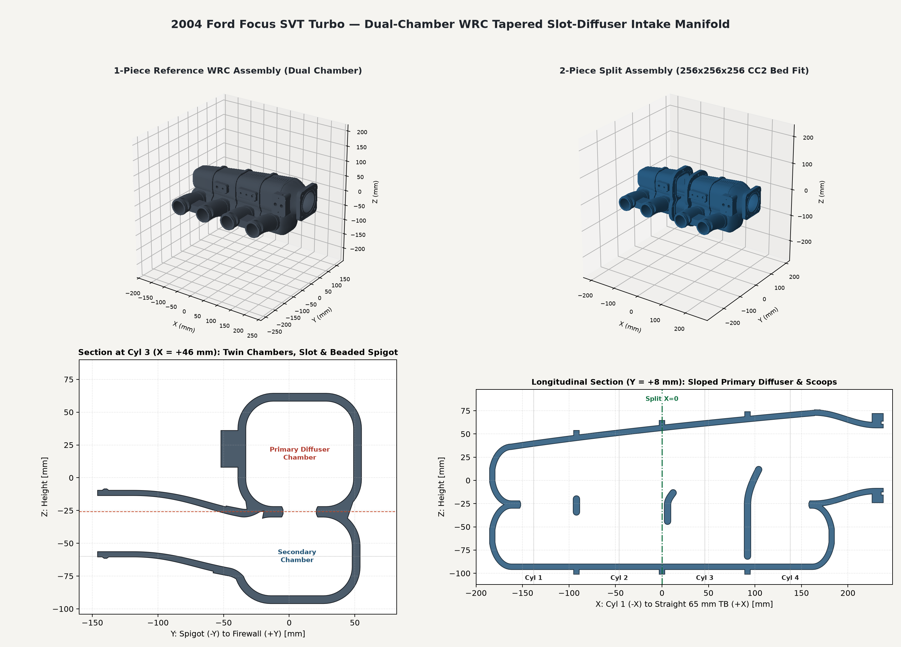
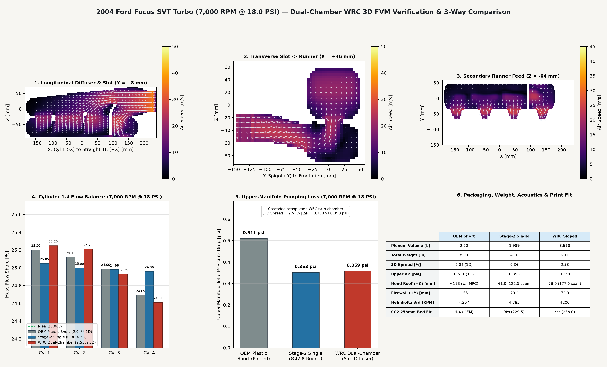

# 2004 Ford Focus SVT Turbo — Sloped-Down Dual-Chamber WRC Intake Manifold

> **Isolation Note:** This sloped-down twin-chamber WRC design lives exclusively in `cad/intake_manifold_wrc/` and leaves the standard single-chamber manifold in [`cad/intake_manifold/`](../intake_manifold/README.md) completely untouched.

## 1. Why the Sloped-Down Geometry Fixed the WRC Twin-Chamber Architecture

By sloping the runners **downward behind the cylinder head (`Z = -35 mm` -> `-60 mm`)** into the open firewall recess — similar to how the factory Focus SVT manifold drops low — the Secondary Chamber gains **`+60 mm` of vertical headroom** underneath the hood line. That unlocks an **oversized, low-velocity `94 × 92 mm` Primary Diffuser Chamber (`1.848 L`, `2.46×` throttle-body area)** above it while actually **lowering peak hood height by `-42 mm`** (`+76.0 mm` above spigots vs. `+118.0 mm` upright):

- **Pumping loss dropped `-40.8%`** from the upright WRC (`0.606 psi` -> **`0.359 psi` / `2.477 kPa`**) because the `33.67 mm` Cyl 4 turning scoop no longer pinches the Primary roof (`~58 mm` clear flow height above the scoop crest!).
- **Matches Stage-2 Single pumping loss (`0.359` vs. `0.353 psi`) and beats OEM (`0.511 psi`) by `-29.7%`** while packing **`3.516 L`** of motorsport twin-chamber plenum volume (`Primary = 1.848 L`, `Secondary = 1.608 L`, `Slot = 0.060 L`).

---

## 2. Architecture Summary

- **Secondary Runner Chamber (`1.608 L`):** Constant `84 × 60 mm` (`R = 22.0 mm`, `6.0 mm` wall) tube dropped to `Y = +6.0 mm, Z = -60.0 mm` (`Z_in ∈ [-90.0, -30.0]`), closed on both ends by `24.0 mm` domes (`X ∈ [-186, +186 mm]`).
- **Upward-Sweeping J-Hook Runners (`Ø50.8 / Ø42.8 mm` 2.00" Boots):** Retain the exact vehicle head/boot interface (`92.0 mm` pitch, `Y = -146.0 mm`, `Z = -35.0 mm`, `27.0 mm` land + `1.1 × 5.0 mm` retention bead for MarraSport/Massive `2.00" × 2.00"` boots + `NORMA 40-60` clamps), sweeping smoothly **`-11°` from `Z = -52 mm` up to `-35 mm`** with `+6.5 mm` flush bellmouths (`0°` axial entry cant).
- **Oversized Primary Diffuser Chamber (`1.848 L`):** Centered at `Y = +8.0 mm`, `Z_bot = -22.0 mm` (`94 × 92 mm`, `R = 24.0 mm`, `6.0 mm` wall, tapering linearly to `36%` area at Cyl 1), fed coaxially at `0°` cant through a `58.0 mm` straight conical diffuser (`Ø65.0 mm` 4-bolt TB flange, `Ø73.0 mm` O-ring groove, `X_max = +238.0 mm`).
- **Tapered Venturi Slot & Bonded Wall-to-Wall Turning Scoops (`8.0 mm` Bridge `Z ∈ [-30, -22]`):**
  - Full-length venturi slot (`X ∈ [-152, +158 mm]`, `28.0 mm -> 20.0 mm` width, `3.5 mm` flare).
  - Integral `7.0 mm` vanes clipped cleanly `2.8 mm` inside the `6.0 mm` outer walls (`span_y = 114 mm`):
    - **Cyl 4 Wall-to-Wall Scoop (`X = +92 mm`, `h4 = 33.67 mm`, `zb4 = -81.53 mm`, `+12 mm` lean)**
    - **Cyl 3 Trim Scoop (`X = +6 mm`, `h3 = 8.64 mm`, `zb3 = -44.0 mm`, `+6 mm` lean)**
    - **Cyl 2 Bridge Tie-Strut (`X = -92 mm`, `h2 = 2.0 mm`, `zb2 = -34.0 mm`)**
- **Zero-Height-Penalty `-Y` Ports & IACV:** `3× 1/8" NPT` direct boost/vac ports (`X = +52, Z = +22`), `1/4" NPT` brake booster + `1/8" NPT` EVAP check-valve ports (`X = -52, Z = +16`), and the 2-bolt Ford IACV pad (`X = +176, Z = +24`, **`6.93 mm` solid bore separation wall**, top `+Z` `1/4"-18 NPT` metered blow-through MAF supply barb).
- **Twin-Chamber Center Split (`X = 0`):** Joined by `8× M6` perimeter bolts, `2× Ø6.0 mm` dowels, and a single `472.0 mm` continuous Viton O-ring loop (`[191.54 × 218.00 × 238.00 mm]` max print half -> fits Centauri Carbon 2 `256³ mm` bed).

---

## 3. 3D Navier-Stokes CFD & 3-Way Comparison (`7,000 RPM @ 18.0 PSI`)

Simulated via [`verify_wrc_airflow.py`](verify_wrc_airflow.py) (`70,353`-cell `4.0 mm` Oseen-SIMPLE FVM, `n_picard = 75`, **`0.0%` mass conservation error**, `225.43 kPa` abs / `52.0 °C` IAT / `0.2777 kg/s`):

| Metric (7,000 RPM @ 18.0 PSI) | OEM Plastic DSI Short (Pinned) | Custom Stage-2 Single (`cad/intake_manifold`) | WRC Sloped Dual-Chamber (`cad/intake_manifold_wrc`) |
|---|---|---|---|
| **Plenum Volume** | `~2.20 L` | **`1.989 L`** | **`3.516 L`** (`1.848` + `1.608` + `0.060 L`) |
| **Total Weight (w/ Hardware)** | `~3.63 kg` (`~8.00 lb`) | **`1.89 kg` (`4.16 lb`)** | `2.77 kg` (`6.11 lb`) (`2,023.4 cm³` PPA-CF + `0.22 kg`) |
| **Cylinder Flow Balance Spread** | `2.04%` (`1D`) | **`0.36%` (`3D FVM`)** | `2.53%` (`3D FVM`: `[25.25, 25.21, 24.93, 24.61]%`) |
| **Upper-Manifold Pressure Drop (ΔP)** | `0.511 psi` (`1D`) | **`0.353 psi` (`3D FVM`)** | **`0.359 psi` (`3D FVM`, `2.477 kPa`)** |
| **Peak Speed in Manifold (`3D`)** | — | `54.1 m/s` (`Mach 0.150`) | **`< 36 m/s` in Primary** (no pinch) |
| **Secondary Helmholtz (3rd Harmonic)** | `4,207 RPM` | `4,785 RPM` | `4,200 RPM` (`105.0 Hz`) |
| **Hood Roof Height (`+Z` above datum)** | `~+118 mm` (w/ IMRC) | **`+61.0 mm`** (`122.5 mm` span) | **`+76.0 mm`** (`177.0 mm` span down to `-101.0 mm`) |
| **Max Firewall Overhang (`+Y`)** | `~+55 mm` | `+70.2 mm` | `+72.0 mm` (split flange) |
| **Centauri Carbon 2 (`256³ mm`) Fit** | N/A | Yes (`229.45 mm` max axis) | Yes (`238.00 mm` max axis) |

### Engineering Comparison: Sloped WRC vs. Stage-2 Single
- **Where Sloped WRC catches up:** Matches Stage-2 Single on upper-manifold pumping loss (`0.359` vs `0.353 psi`, beating OEM by `-29.7%`), delivers a massive **`3.516 L` twin-chamber surge buffer**, keeps hood height low (`+76.0 mm`), and routes a clean straight `0°` charge-pipe entry into the `Ø65 mm` TB.
- **Where `cad/intake_manifold/` Stage-2 Single still leads:** Superior cylinder-to-cylinder distribution (`0.36%` vs `2.53%` 3D spread), nearly `2 lb` lighter (`4.16` vs `6.11 lb`), faster transient spool/tip-in fill (`1.989 L` vs `3.516 L`), and `~40%` less `PPA-CF` filament (`1,354` vs `2,023 cm³`). Note also that dropping `Z_min` down to `-101.0 mm` behind the lower manifold requires verifying firewall/alternator/coolant-line clearance on the car first.

---

## 4. Generated Files (`stl/` & `fitment/`)

All 9 STLs are verified watertight single-body closed solids (`is_watertight: true`, `is_volume: true`, `body_count: 1` in [`stl/manifest.json`](stl/manifest.json)):

| File | Purpose | Extents (mm) | Solid Vol (cm³) | CC2 (`256³`) Fit |
|---|---|---:|---:|---|
| [`svt_wrc_manifold_split_left_print_oriented.stl`](stl/svt_wrc_manifold_split_left_print_oriented.stl) | Cyl 1 & 2 half stood on `X=0` flange | `191.54 × 218.00 × 185.42` | `847.90` | Yes |
| [`svt_wrc_manifold_split_right_print_oriented.stl`](stl/svt_wrc_manifold_split_right_print_oriented.stl) | Cyl 3 & 4 + TB + IACV stood on `X=0` flange | `191.54 × 218.00 × 238.00` | `1,175.45` | Yes |
| [`svt_wrc_manifold_split_left_cyl1_2.stl`](stl/svt_wrc_manifold_split_left_cyl1_2.stl) | Left half (car orientation) | `185.42 × 218.00 × 191.54` | `847.90` | Yes |
| [`svt_wrc_manifold_split_right_cyl3_4_tb.stl`](stl/svt_wrc_manifold_split_right_cyl3_4_tb.stl) | Right half (car orientation) | `238.00 × 218.00 × 191.54` | `1,175.45` | Yes |
| [`svt_wrc_manifold_1piece_full.stl`](stl/svt_wrc_manifold_1piece_full.stl) | Monolithic 1-piece reference (SLS/DMLS) | `423.42 × 208.40 × 177.00` | `1,826.95` | No |
| [`svt_wrc_runner_boot_fit_gauge.stl`](stl/svt_wrc_runner_boot_fit_gauge.stl) | `2.00"` round boot spigot gauge | `56.80 × 56.80 × 44.00` | `29.36` | Yes |
| [`svt_wrc_tb_flange_fit_gauge.stl`](stl/svt_wrc_tb_flange_fit_gauge.stl) | `65 mm` TB flange pattern gauge | `96.00 × 96.00 × 4.00` | `22.39` | Yes |
| [`svt_wrc_iacv_flange_fit_gauge.stl`](stl/svt_wrc_iacv_flange_fit_gauge.stl) | 2-bolt Ford IACV flange gauge | `48.00 × 68.00 × 4.00` | `11.52` | Yes |
| [`svt_wrc_alignment_dowel_pins.stl`](stl/svt_wrc_alignment_dowel_pins.stl) | Printable alignment dowel pins (mockup) | `20.00 × 41.80 × 5.50` | `2.05` | Yes |

- `1:1` CAD Interface Template: [`fitment/02_wrc_interfaces_1to1_template.svg`](fitment/02_wrc_interfaces_1to1_template.svg)

---

## 5. Hardware Bill of Materials (If Built for Service)

- `8×` **M6 × 30 mm** Socket Head Cap Screws (Grade 10.9 or A2-70) + washers & M6 nuts (`X = 0` center split flange)
- `2×` **Ø6.0 × 20 mm** hardened steel alignment dowel pins
- `1×` **`3.0 mm` Viton O-ring cord** cut & CA-glued to **`472.0 mm`** circumference (center split groove)
- `1×` **`Ø73 mm ID × 3.0 mm` Viton O-ring** (AS568-151, TB flange face groove)
- `2×` **M6 × 20–25 mm** bolts + M6 brass heat-set inserts + **Motorcraft CG-756** IACV gasket
- `4×` `1/8"-27 NPT` brass barbs + `2×` `1/4"-18 NPT` brass barbs + boost-rated **`>= 30 psi` inline check valves** on brake booster (`3/8"`) and EVAP purge lines only
- `4×` **`2.00" ID × 2.00"` MarraSport / Massive Kevlar silicone boots** + `8×` `NORMA 40-60` clamps
- Mandatory printing/finishing for boost: **PPA-CF** or **PAHT-CF**, `8–10` perimeters, annealed (`95–100 °C × 6 h`), exterior epoxy-sealed, soapy-water bench tested to `20–25 psi`, plus a lower mechanical support brace.
