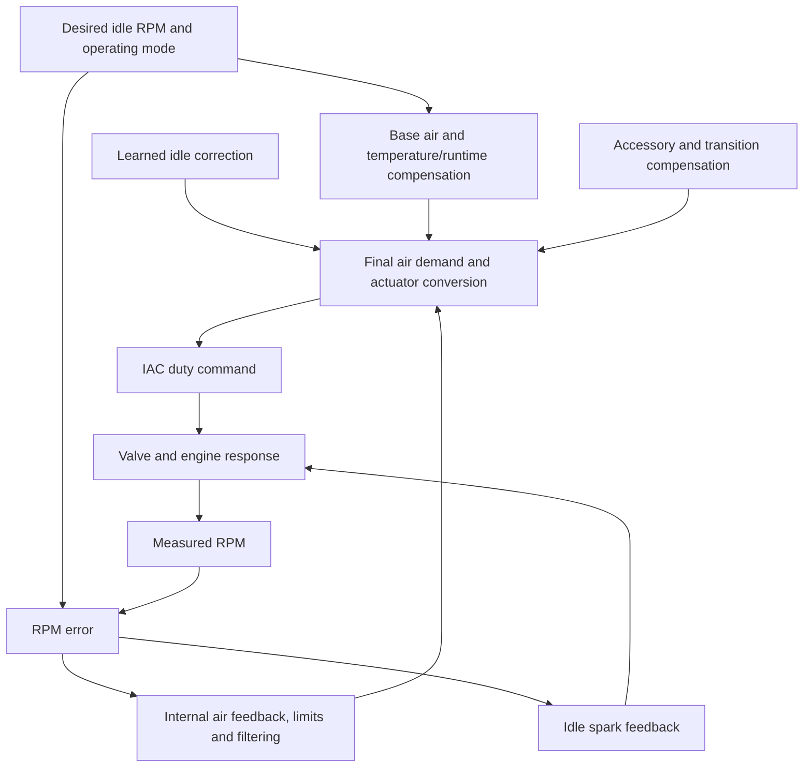

# Idle-air control: exposed settings versus internal control

Research update2026-10-31. No new calibration, firmware patch or ECU action.

## Finding

Missing Editor entries do not imply a missing ECU controller. Our recordings
show continuously changing idle-air correction and duty while inRPM Ctrl mode.
However, those observations alone cannot identify the exact algorithm, gain
values, arithmetic order, or which correction initiates an oscillation.

A definition provider's [Black Oak SCP listing](https://trentstuning.com/FordBlackoak1472KSCP.php)
identifies FN_IAC_KP/FN_IAC_KI, FN854/FN855/FN856, ID_DB_CAL, TC_IDI__A,
IDNERR_TC, PSIBRM/PSIBRN and UPDISC/UPDATM. These cover candidate correction,
gain, deadband, filtering, limiting and adaptation controls. Its separate
[CAN listing](https://trentstuning.com/FordBlackoak1472K.php) names TC_OVER/TC_UNDER.
Do not assume identical implementations. The SCP page mixes1472K/2048K wording
and supplies no verified UJAHAS3 mapping. Symbols are research leads, not editable
addresses or validated values. No definition purchase or external contact made.

## Conceptual control path

This diagram combines exposed settings, measured signals and general control
architecture; it is not recovered UJAHAS3 source code or a verified summation.

Ford's [PCED description](https://www.fordservicecontent.dealerconnection.com/pubs/content/~WVX2/~MUS~LEN/15/VX21026.HTM)
explains that the PCM regulates bypass airflow with IAC duty while observing
RPM. This is a1999 general architecture reference, not anSVT-specific transfer
function. Commanded duty is not valve-position feedback.

## What we can identify in this car

| Function | Current exposed setting or recorded signal | Limit of evidence |
| --- | --- | --- |
| Target | ECM44218/44217, nominal950RPM | Logged desired944; target is stable during dips |
| Base air | ECM44242/44239 | Shapes baseline demand; not controller gain |
| Warmup correction | ECM44243/44240 | Final runtime row200s; no180F step |
| Eligibility | ECM44213/12262, VSS44214 | Do not reinterpret200/30 as gain values |
| Air correction | STIT2240, LTIT2231 | Exact relation to every hidden controller term unverified |
| Actuator output | IAC2082 | Command only, not measured opening or airflow delivery |
| Spark feedback | ECM47996=1.000, floor44582=-6 | A parallel torque correction; not an IAC gain |
| Mode/source | Scanner12200 plus newly added19049 | New21-channel combination needs live validation |
| MAF filtering | ECM44325/12002=enabled/0.11 | Aircharge estimation; not an idle-air-integrator substitute |

[HP Tuners' generic Ford documentation](https://www.hptuners.eu/help/vcm_editor_parameters_ford_eng_idle.htm)
separates base airflow, temperature/runtime compensation and feedback response.
It does not establish which feedback implementation is used in this exact ECU.

## Implication for tuning

We should not insist that a single hidden scalar must exist under the generic
integrator-time label. This strategy may schedule gains through multiple tables.
We also cannot conclude the output is controlled only by the visible base-air
table because the feedback parameters are missing from Editor.

The defensible next definition request is to confirm the SCP symbols above for
UJAHAS3, identify their axes/units/current values, and show how the short-term
correction, learned correction and duty conversion relate. Request a verified
Editor mapping, not a raw patch. Existing logs cannot uniquely recover these
gains because inputs are asynchronous and valve/engine disturbances are unknown.

A control-response experiment can follow that mapping or an independently
verified actuator test. Merely changing base air can shift the operating point
but does not directly test excess feedback gain. Keep v019 MAF unchanged during
this investigation. The current evidence does not establish that a failed IAC
or any single control term is responsible.
