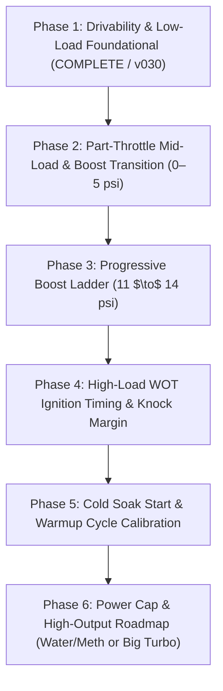

# Focus SVT Turbo — Master Tuning Roadmap & Logging Protocols

- **Vehicle:** 2004 Ford Focus SVT 2.0L Zetec Turbo
- **Engine Specs:** 10.2:1 Compression, forged pistons, hardened rods
- **Turbo Hardware:** Pulsar G25-550 clone, external wastegate (~10 psi base spring), Innovate SCG-1 boost controller
- **Fuel System:** Return-style fuel system, Aeromotive 1:1 regulator, 60 lb/hr Siemens injectors, 43 psi base differential, 93 octane pump gas
- **Active Calibration:** `v029` (tested) $\to$ `v030` (prepared candidate)

---

## 1. Project Phase Roadmap

---

### Phase 1: Drivability & Low-Load Foundational (CURRENT STATUS: 95% COMPLETE)
* **Milestones Achieved:**
  - **Rolling Idle Hang (100% Eliminated):** Positive decay rates in `[ECM] 32984` allow engine to glide directly through 1,300–1,500 RPM to target 950 RPM idle in $< 1\text{ s}$.
  - **Engine Braking & DFCO:** Lowered VSS thresholds to 14/10 mph (`[ECM] 44491/44492`) with 1.25s delay.
  - **Steady Cruising Airflow:** Scaled MAF 0.90V–1.20V by +3.0% in `[ECM] 12163`, centering cruising STFTs between -0.8% and -2.0% with zero lean drift.
  - **Decel Overrun Pops:** Populated Row 4 (100 ECT) in `[ECM] 44605`, dropping decel spark to -2° to -3.2° ATDC.
* **Pending in `v030`:**
  - Raising `[ECM] 44607` to 2,400 RPM to eliminate low-speed tip-in torque control spark chops.
  - Bumping Column 11 (0.699V) by +6% to eliminate the 0.70V–0.88V tip-in lean gap.
  - Deepening decel retard to -4° (3k) and -6° (4k–6k) with 1.75s DFCO delay for crisp, safe crackle.

---

### Phase 2: Part-Throttle Mid-Load & Boost Transition (0–5 psi)
* **Objective:** Ensure silky smooth acceleration when passing or climbing hills at 25%–50% throttle, transitioning from closed-loop vacuum into open-loop positive manifold pressure.
* **Key Parameters:**
  - `[ECM] 12163` MAF Transfer Curve across `1.50V to 2.40V` (flow range: $0.40 - 1.50\text{ lb/min}$).
  - `[ECM] 32731` Open Loop Fuel TPS Threshold vs. RPM (ensuring open loop triggers right as boost enters positive pressure, preventing closed-loop lean cruise under boost).
* **Logging Protocol:**
  - **Maneuver:** 3rd gear rolling hold at 2,500 RPM, then roll into 35%–45% throttle and hold for 5–8 seconds, allowing boost to build to 3–5 psi without going to WOT.
  - **Target Metrics:** Lambda must transition smoothly from 1.00 down to $0.82–0.85$ as manifold pressure crosses 0 psi; STFT must freeze (open loop); spark advance must remain stable without torque control intervention.

---

### Phase 3: Progressive Boost Ladder & Wastegate Duty Mapping
* **Objective:** Carefully dial in maximum safe boost on 93 pump gas with the Pulsar G25-550 clone.
* **Current Baseline:** 6% WGDC produces `11.2 – 12.4 psi` peak boost ($29.8\text{ lb/min}$ airflow) with zero boost cut interventions.
* **Ladder Steps:**
  1. **Step 1 (v030 / v031):** 6% WGDC verification (target 11.5–12.0 psi).
  2. **Step 2:** 7% WGDC (target ~12.5–13.0 psi).
  3. **Step 3:** 8% WGDC (target ~13.5–14.0 psi — approaching realistic knock margin cap on 10.2:1 compression with 93 pump gas).
* **Logging Protocol:**
  - **Maneuver:** 3rd gear pull from 2,500 RPM to 6,200 RPM at 100% throttle on a straight, clear, safe road.
  - **Safety Boundaries:**
    - Boost Cut: SCG-1 set at **16.0 psi / 100% cut**.
    - Wideband Lambda: Must remain $\le 0.76$ ($\approx 11.2\text{ AFR}$ or richer) above 8 psi.
    - Fuel Pressure: Fuel rail pressure differential must stay $\ge 38\text{ psi}$ (FRP sensor voltage $\ge 2.70\text{ V}$).
    - Knock Retard: Must remain $0.0^\circ$.

---

### Phase 4: High-Load WOT Ignition Timing & Knock Margin
* **Objective:** Optimize spark advance under boost to achieve maximum torque without encroaching on detonation.
* **Current Timing:** Running $8.2^\circ$ at 3,500 RPM ramping to $13.0^\circ–14.0^\circ$ at 5,500–6,300 RPM at 11–12 psi.
* **Strategy:**
  - Keep spark conservative ($11^\circ–13^\circ$ at peak power) until fuel trims and boost are 100% locked down.
  - Verify knock sensor background noise across high-RPM sweeps.

---

### Phase 5: Cold Soak Start & Warmup Cycle Calibration
* **Objective:** Perfect engine behavior from ice cold ($< 60^\circ\text{F}$) to fully warm ($190^\circ\text{F}$).
* **Logging Protocol:**
  - Connect laptop and logger before turning the key in the morning.
  - Start logging KOEO, crank engine, and allow it to idle in neutral untouched for 10 minutes until radiator fan turns on.
  - Track: Cranking fuel pulsewidth, cold fast-idle taper, closed-loop entry time, and O2 heater activity.

---

### Phase 6: Long-Term Power Upgrades
* **Roadmap Options:**
  1. **Water/Methanol Injection:**
     - Enables running 16–18+ psi on the G25-550 without knock on 10.2:1 compression by dropping charge air temps by 40°–60°F and raising effective octane.
  2. **Turbo Upgrade (Comp CT3 6868 or mid-frame G30):**
     - For targets above 400 whp, swapping to a larger turbine drops exhaust manifold backpressure significantly, allowing massive top-end power at lower boost levels.

---

## 2. Standardized Logging Channels & Profiles

All sessions must use the verified 18-channel VCM Scanner profile paired with SCG-1 Logger:

| Channel # | Channel Name | Units | Operational Purpose |
| :---: | :--- | :---: | :--- |
| **1** | Engine RPM | rpm | Engine speed, shift points, acceleration rate |
| **2** | Idle Desired RPM | rpm | Target idle setpoint (950 RPM warm) |
| **3** | Throttle Position ADC (Absolute) | counts | Pedal position (180=closed, 966=WOT) |
| **4** | Fuel Pressure Sensor | V | Rail pressure monitor (2.70–3.00V = 38–42 psi diff) |
| **5** | Engine Coolant Temp | °F | Thermal state / table lookup row selector |
| **6** | Control Module Voltage | V | Alternator/battery charging voltage |
| **7** | Timing Advance | deg | Commanded spark advance |
| **8** | Spark Source | enum | Borderline, MBT, Decel, Torque Control, CSER |
| **9** | Fuel Source | enum | Stoich, Power Demand Enrich, Injector Cut |
| **10** | Mass Airflow | lb/min | Calculated airflow into cylinders |
| **11** | Idle Air Solenoid DC | % | IAC valve duty cycle |
| **12** | O2 Voltage B1S1 | V | Upstream narrowband switching behavior |
| **13** | Closed Loop Active | Yes/No | Closed loop status |
| **14** | Short Term Fuel Trim Bank 1 | % | Closed-loop fueling corrections ($\pm 25\%$) |
| **15** | Idle Adapt (STIT) | lb/min | Short-term idle air trim |
| **16** | LTIT PN/ACoff | lb/min | Long-term idle air learned trim |
| **17** | Mass Airflow Sensor | V | Raw MAF voltage input (0.20V to 5.00V) |
| **18** | Open Loop FMEM | enum | Fault management / limp mode status |
| **SCG-1** | Wideband Lambda / AFR | $\lambda$ | Real-time exhaust air-fuel ratio |
| **SCG-1** | Boost Pressure | psi | Manifold gauge pressure (vacuum to boost) |
| **SCG-1** | Commanded WGDC | % | Boost solenoid duty cycle |
