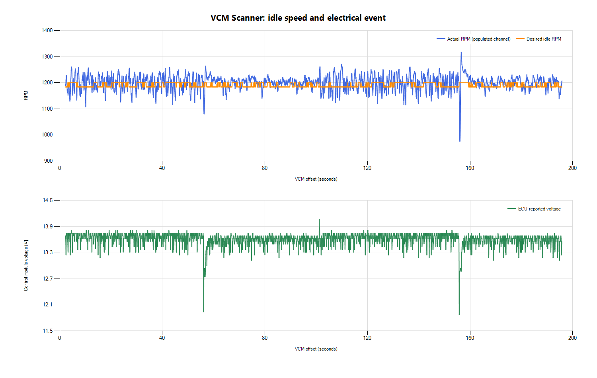
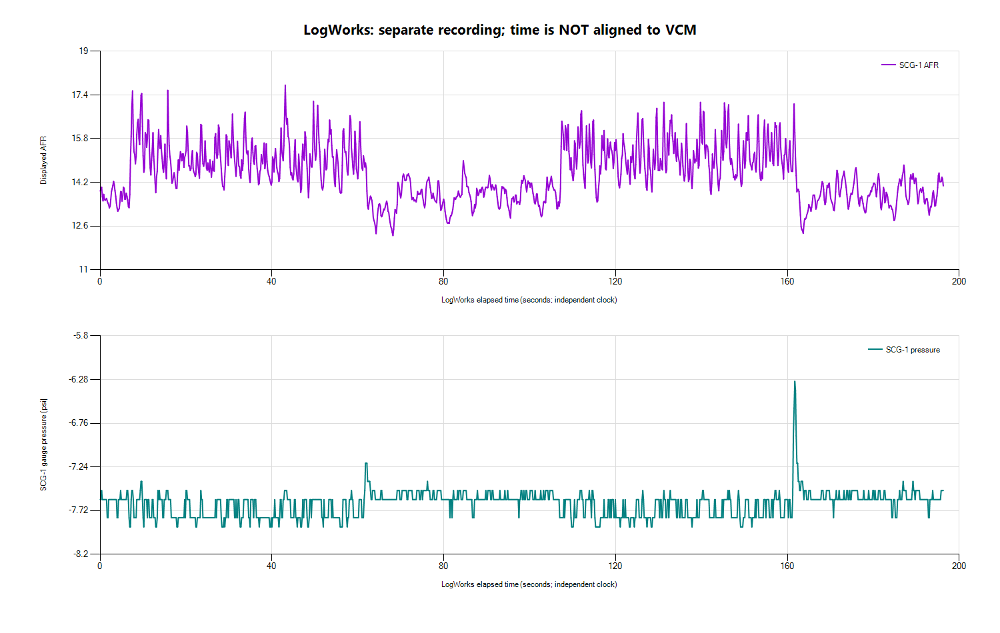

# First idle log review — 2026-10-26

The ECU is commanding approximately 1,200 rpm and the engine generally follows
that target. The first calibration review should examine why that idle target
is requested and why closed-loop fuel control reports inactive. A brief voltage
drop and RPM dip also warrant investigation. These logs do not yet support a
specific MAF, injector, idle-air, or ignition correction.

## Inputs and limits

Original desktop files were copied without modification to
`logs/2026-10-26-idle-01/`: VCM `logfile1.csv` and `Logfile1.hpl`, plus LogWorks
`Realtimelog1.csv`. No native LogWorks recording was found in that folder.
Private input hashes and calculated statistics are retained under `.local/`.
Raw recordings remain excluded from Git.

- VCM: 8,333 exported rows spanning offsets 2.203–195.854 s (193.651 s).
- LogWorks: 2,398 rows spanning 0–196.362 s; SCG-1 RPM is zero throughout.
- These recordings are **not aligned**. Their similar lengths do not establish
  a common start time. No cross-log, point-by-point fuel correction was calculated.
- Summary statistics describe exported rows; interpolated/repeated values do
  not imply each channel was measured at the CSV row frequency.
- Reported channel labels and states have not been independently verified
  against every controller definition or physical sensor.

## ECU idle behavior

| Measurement | Result |
| --- | --- |
| Actual RPM, populated RPM channel | Mean 1,200; central 90% approximately 1,153–1,241; range 975–1,318 |
| Desired idle RPM | 1,184–1,200; mean 1,190 |
| Actual minus desired RPM | Mean +10 rpm; central 90% approximately -39 to +50 rpm |
| Coolant | 186–196 F |
| Intake air temperature | 88 F throughout |
| Idle control mode | RPM Ctrl throughout |
| Idle speed source | Idle RPM Adder vs. IAT throughout |
| Throttle state | Closed throughout |
| A/C requested | No throughout |
| MAF | Mean 0.755 lb/min; range 0.620–1.067 |
| Ignition advance | Mean 9.5 degrees; range 0.75–31.75 |

There are two exported Engine RPM columns. The first is entirely blank; the
second is populated throughout. Thus ECU RPM logging works. Use the populated
channel for analysis and for comparison with the future SCG-1 tach signal.

**Interpretation:** high average idle is largely consistent with the requested
target, rather than an engine continuously overshooting a much lower target.
Review the actual calibration's base desired idle, temperature/startup adders,
and the IAT-related contribution before selecting a lower target. The source
label alone does not reveal the size of a particular table's contribution.
HP Tuners documents IAT-dependent adders as additions to desired idle RPM;
exact available parameters depend on the controller/calibration.
[HP Tuners Ford idle reference](https://www.hptuners.eu/help/vcm_editor_parameters_ford_eng_idle.htm)

## Fuel-control state and measured AFR

VCM reports **Closed Loop Ready = Yes**, **Closed Loop Active = No**,
**Closed Loop with O2Fault = OK**, and **Fuel Source = Power Demand Enrich**
throughout this warm-idle recording. Commanded mixture, in the CSV's lambda
units, averages 1.009 and ranges approximately 1.000–1.015.

These states justify inspecting open/closed-loop configuration, enable
conditions and enrichment thresholds in the existing tune. They do not prove
which setting is responsible, that the upstream O2 sensor is healthy, or that
closed loop should be enabled without reviewing the calibration.
[HP Tuners Ford fuel-loop reference](https://www.hptuners.eu/help/vcm_editor_parameters_ford_eng_fuel_loop.htm)

In its own recording, the SCG-1 reports displayed AFR averaging **14.52**,
with a median of **14.44**, central 90% approximately **13.14–16.27**, and
extremes **12.25–17.86**. The trace has sustained changes as well as short
fluctuations; its overall mean hides that variation. Gauge pressure averages
-7.64 psi, with recorded solenoid duty zero throughout.

Do not turn these separate-recording averages into a percentage MAF correction.
Confirm AFR display scaling, sensor condition and calibration, exhaust sealing,
and the unknown water/meth state. Innovate specifically notes that exhaust
leaks and some other installation/engine conditions can produce falsely lean
light-load readings.
[SCG-1 manual, oxygen-sensor placement](https://manualmachine.com/innovatemotorsports/scg1/1540157-user-manual/)

## Electrical/load event

ECU voltage averages 13.61 V. There are brief drops near VCM offsets 56 s and
156 s. Around 155.74–155.79 s it reaches **11.875 V**. At 156.014 s,
actual RPM reaches **975.25**, while desired idle remains **1,200**. Timing
increases and spark source briefly changes from Idle Feedback to Base / MBT.

This establishes temporal association within the VCM log, not the cause.
The owner subsequently confirmed that the **radiator fan** switched on around
2 minutes 35 seconds into the Scanner recording. This supports investigating
fan-start electrical load and idle compensation at that event. It does not
establish a wiring or calibration fault, or identify the cause of the earlier
voltage drop near 56 seconds.
Check supply/ground behavior, especially with the relocated battery and electric
power steering, before attempting to compensate through calibration. A scanner
voltage sample alone does not diagnose the alternator, wiring, or battery.

## Data gaps for the next log

- Idle Air Solenoid DC and Idle Adapt (STIT) are absent from this CSV, despite
  earlier on-screen readings. Verify whether they exist in the HPL or whether
  the next channel configuration/export needs correction.
- STFT and LTFT are absent from the CSV. The recorded LTIT values are idle-air
  adaptations, **not fuel trims**.
- MAF voltage, MAF counts, calculated MAP, air load, fuel pressure, fan duty,
  A/C clutch state, relative TPS, and the other RPM column are blank.
  Listed channels are not proof of usable readings.
- Engine Run Time is fixed at 255 s; do not use it as a synchronization clock.
- Fuel Pump Actual DC is approximately 0.27 while commanded duty is approximately
  27, despite both CSV units being percent. Do not infer a pump failure from
  this discrepancy; check parameter scaling and the return-system conversion.
- The column named Borderline Knock is an advance-related channel here, not
  established measured knock retard. It is not evidence of detonation.

## Next review order

1. Preserve and inspect the calibration currently in the ECU. Review desired
   idle/adders and the reported open-loop/enrichment behavior. No tune changes
   were made in this review.
2. Verify the missing idle-control channels, and investigate the voltage/load
   disturbances. Record accessory/fan activity during the next session.
3. With SCG-1 RPM connected, verify its scale against the working ECU RPM
   channel. Record recognizable shared RPM changes and compare timing at more
   than one point before joining logs. Account for AFR transport/sensor delay
   separately from clock alignment.
4. Establish repeatable warm idle and measured lambda before selecting specific
   calibration edits. Keep boost-control and power changes for the later stages.
