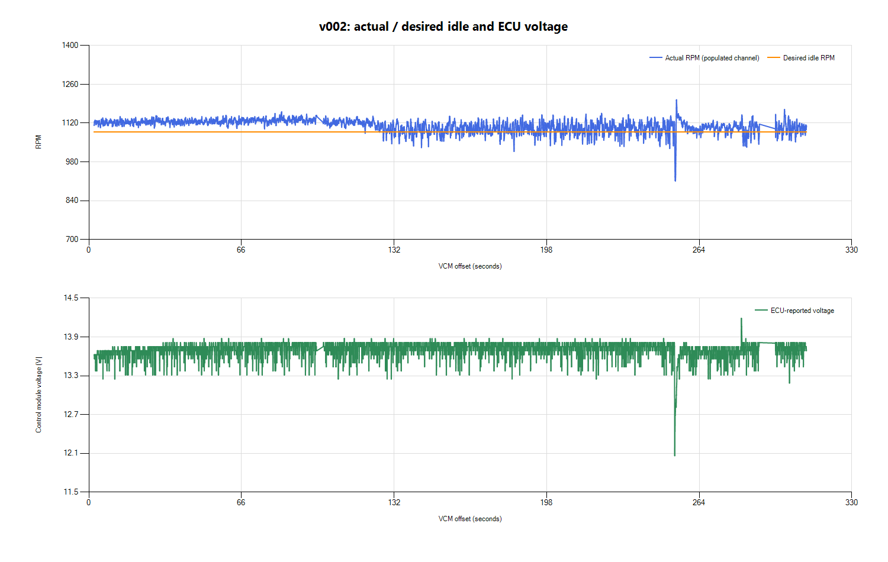
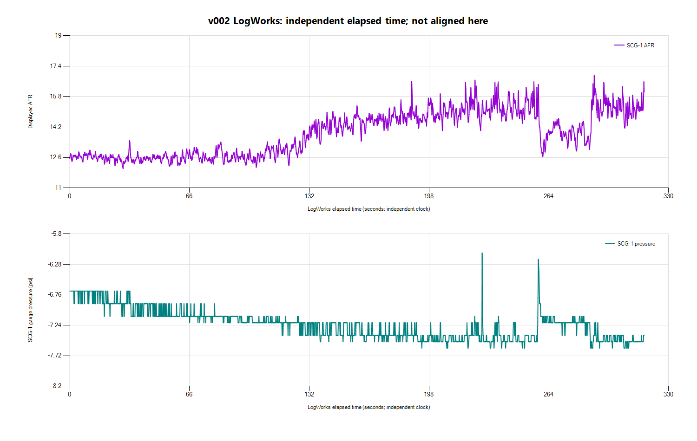

# v002 idle test review

**Keep v002 as the current test baseline for now; do not lower the idle target
again yet.** The engine follows the lower target, with slightly narrower warm
RPM variation in this recording. The electrical/load disturbance and AFR
variation remain unresolved. No additional tune was created from this log.

## Recordings and timing

The desktop `logfile2.csv`, `Logfile2.hpl`, `Realtimelog.log`, and newly exported
`Realtimelog2.csv` were copied to `logs/2026-10-26-v002-idle-01/` without replacing
the first session. Copies are private/ignored by Git; this report and plots are
versioned. The reviewed tune is v002: the owner reports the write completed.

- Scanner: **308.238 s**, offsets 2.187–310.425, 12,626 exported rows.
- LogWorks: **316.621 s**, 3,866 rows; SCG-1 RPM and WGDC are zero throughout.
- Scanner Creation Time: **2026-10-26 16:25:48**, with no timezone in the CSV.
- Two native LogWorks Unix timestamp candidates, at byte offsets 55477 and
  58721, decode to **2026-10-26 16:25:44 UTC**.
- The resulting candidate mapping is **LW elapsed = VCM offset + 4 s** for this
  session. The earlier session's six-second mapping was not reused.

A provisional paired CSV and provenance JSON are saved alongside the recordings.
Their clock origin/timezone assumptions are still not confirmed in the LogWorks
session dialog. Cross-application latency, clock drift and AFR sensor/transport
delay have not been calibrated. Broad warm-window comparisons are useful here;
sample-by-sample fuel corrections are not justified by the timing evidence.
The SCG pressure excursion near 258.294 s would map to VCM 254.294 s, about
0.59 s after the ECU RPM minimum. Different signals need not peak together;
this is contextual support, not independent proof of exact alignment.

## Warm-idle comparison

The table uses Scanner rows with coolant **186–196 F** in each session, avoiding
the cooler start of v002. These are exported-row statistics, not proof of equal
channel sampling rates or a controlled repeatability experiment.

| Metric | v001 baseline | v002 test |
| --- | ---: | ---: |
| Mean actual RPM | 1,200.3 | 1,103.5 |
| Logged desired RPM | 1,184–1,200 | 1,088 |
| Actual RPM, central 90% | 1,152.5–1,241.3 | 1,064.8–1,138.3 |
| Actual minus desired, mean | +9.9 rpm | +15.5 rpm |
| Actual minus desired, central 90% | -39.5 to +50.0 rpm | -23.3 to +50.3 rpm |
| RPM standard deviation | 28.0 | 24.1 |
| Lowest actual RPM | 975.3 | 911.3 |
| Mean ECU voltage | 13.61 V | 13.70 V |
| Lowest ECU voltage | 11.88 V | 12.06 V |
| Mean MAF | 0.755 lb/min | 0.717 lb/min |
| Mean intake temperature | 88 F | 82.3 F |
| Mean coolant in comparison | 190.8 F | 188.8 F |

The average engine speed decreased about **97 rpm**. The saved calibration was
verified at 1,100-rpm setpoints; the logged desired RPM is the runtime value and
must not be silently relabeled as 1,100. Its reason for differing from the
editor setpoint has not been established.

The narrower central spread is encouraging, but temperature differences and
post-write adaptation are confounders. The idle-air long-term correction in the
test is much closer to zero and changes over the recording; this is not the
same adaptive state as the baseline. These logs do not prove that the idle
controller gains or AFR regulation improved because of the RPM change.

## Warm-up and AFR

This recording begins at **166 F coolant** with the engine already running.
It includes further warm-up, not a complete cold start or cranking capture.
Coolant first reaches the comparison band at about VCM **80.8 s** and later
moves in and out of that band.

The full SCG recording averages **13.88 displayed AFR**, with range
**12.00–16.91**. That full-record mean is not a valid direct comparison to the
fully warm first log. Using the candidate clock to select the same coolant
band gives approximately:

| SCG observation | v002 provisional warm window |
| --- | ---: |
| Mean displayed AFR | 14.44 |
| Median | 14.61 |
| Central 90% | 12.55–15.76 |
| Range | 12.08–16.91 |

The first recording averaged 14.52 displayed AFR overall while already in the
186–196 F coolant band. The similar means hide substantial variation in both
recordings; v002 did not resolve that variation.

Changing the assumed new-session offset from four seconds to two or six seconds
changes the warm-window mean only to about **14.43–14.46 AFR**. Thus the broad
observation of variable warm AFR is not dependent on selecting exactly four
seconds. This sensitivity check does not establish precise transient alignment.
AFR display scaling and its relationship to fuel stoichiometry still need
verification before calculating lambda-based errors.

Scanner reports **Closed Loop Active = No** throughout. Closed Loop Ready is
Yes during the warm comparison, Fuel Source remains Power Demand Enrich, and
the logged commanded lambda averages about **1.0039**. From the prior tune
inspection, LTFT is disabled and cold/warm/hot closed-loop delays are 254 s.
Those settings and enable/enrichment conditions warrant inspection before
another fueling calibration change. Do not infer the exact cause from the
source label alone.

## Load event remains

At VCM **253.356–253.661 s**, ECU voltage falls below 12.8 V, reaching
**12.0625 V**. At **253.704 s**, actual RPM reaches **911.25**, with desired
idle still **1,088**. It subsequently overshoots as high as **1,204.25 rpm** in
the surrounding window. This resembles the baseline's owner-confirmed fan-start
event, but fan engagement in the new session has not yet been confirmed.

Absolute minimum RPM is lower than before because the target is lower. The
underspeed relative to target is smaller (-177 versus -225 rpm), but a single
event is not enough to claim improved load response. Check the voltage/load
behavior before lowering the target further or changing general idle gains.

## Logging improvements and remaining gaps

- Actual ECU RPM works. The other RPM column remains blank.
- MAF voltage/counts, calculated MAP, load and A/C clutch status now have data.
- Fuel Pressure reports **40.0 psi throughout**. That constant equals the tune's
  reference value; it is not verified physical rail or differential pressure.
- Fan PWM duty is **zero throughout**, so it did not identify fan engagement.
- Engine Run Time remains fixed at **255 s** and is not a usable timing clock.
- Absolute TPS is blank; relative TPS and closed-throttle state are available.
- Idle-air solenoid duty, short-term idle-air adaptation, STFT and LTFT still
  are **absent from this CSV's channel headers**. We need to verify their
  recording/export before attempting a detailed idle-air or trim analysis.
- The long-term idle-air corrections (LTIT) are not fuel trims.

## Next steps

Keep the 1,100-rpm test as the baseline unless drivability is worse. Record the
owner's assessment of vibration, hunting and fan recovery. Confirm whether the
new event at about 4:13 was the radiator fan. Review closed-loop entry and
enrichment settings in the current calibration, and establish usable idle-air
channels before selecting a further edit. Keep dual logs for every revision;
the arriving PROLINK+ can provide a common measured-AFR trace for alignment.

No v003 file or ECU write was made during this analysis.
