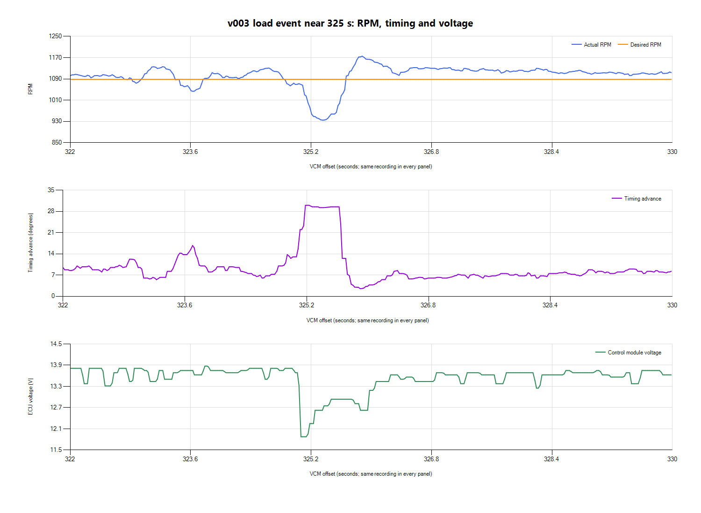
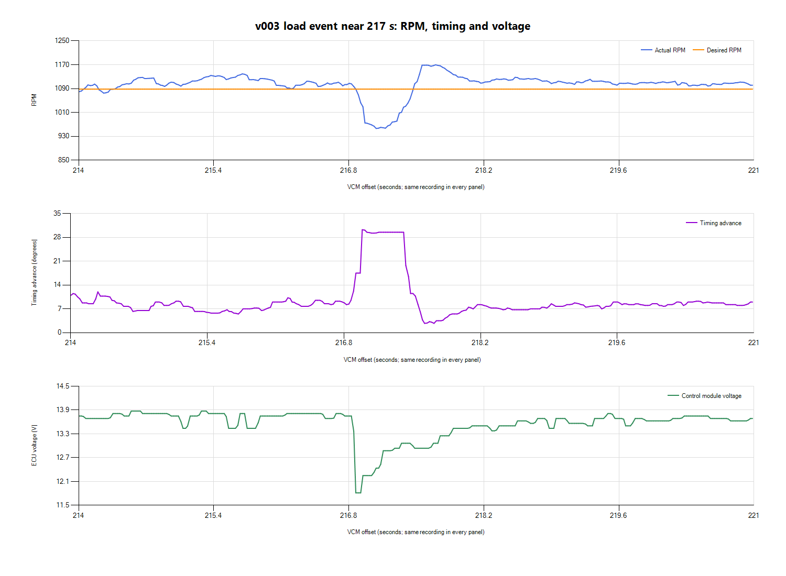

# v003 review: timing swings and RPM drops

The timing changes largely match **idle-speed feedback correcting RPM**. In
the two largest disturbances, voltage falls, RPM falls, timing advances sharply
while the controller changes spark source, then timing is pulled back as RPM
recovers and overshoots. That is evidence of a corrective response, not a reason
to freeze timing or increase the whole spark table.

The owner reports v003 felt a little better but the disturbance remains
noticeable. The measured RPM variation narrowed modestly, but fan electrical
inrush and mixture variability remain. The temporary pathway is still a test;
its compensation effect has not been independently established.

## Inputs and clock mapping

Desktop VCM `v003.csv`/`v003.hpl` and LogWorks `v003.csv`/`v003.log` are preserved
under `logs/2026-10-26-v003-idle-01/`. Scanner spans 359.867 s, beginning at
178 F coolant. This is a warm-engine recording, not a full cold-start capture.
LogWorks spans 366.756 s; its RPM and WGDC remain zero.

VCM Creation Time is 2026-10-26 **17:15:49**, with no CSV timezone label.
Two Unix timestamp candidates at native LogWorks byte offsets **63756** and
**67000** decode to **17:15:47 UTC**. The session-specific provisional mapping
is therefore **LW elapsed = VCM offset + 2 s**, assuming the metadata fields
represent the same PC clock and session origins. A paired CSV and provenance
JSON were saved with the recordings. Sampling latency, drift and AFR transport
delay remain unvalidated; no point-by-point fuel correction was calculated.

The timing/RPM/voltage sequence below uses only VCM data, so it does not depend
on synchronizing LogWorks. CSV rows can contain interpolated/asynchronously
acquired channel values; their row timestamps do not establish sub-sample
causality.

## Why timing changes

HP Tuners' Ford documentation describes idle spark settings and an idle spark
minimum used when reducing RPM. Spark is one way the ECU changes engine torque
while controlling idle.
[Ford spark reference](https://www.hptuners.eu/help/vcm_editor_parameters_ford_eng_spark_advance.htm)

In warm v003 samples where Spark Source is **Idle Feedback**:

| Actual RPM relative to target | Median timing | Exported rows |
| --- | ---: | ---: |
| More than 50 rpm below | 18.3 degrees | 33 |
| 10–50 rpm below | 12.4 degrees | 1,212 |
| Within approximately +/-10 rpm | 9.8 degrees | 3,645 |
| 10–50 rpm above | 7.5 degrees | 7,195 |
| More than 50 rpm above | 4.8 degrees | 187 |

This is the expected corrective direction: more advance when speed is low,
less when speed is high. It does not prove the gain/airflow calibration is
optimal, or that all hunting is harmless. The relatively small number of large
underspeed samples also limits conclusions from that bin.

For the larger RPM dips, Spark Source briefly becomes **Base / MBT**, with
median timing 29.5 degrees in that source. Treat that as a source transition,
not an independently diagnosed fault or proof of knock. The logs do not provide
a verified measured-knock-retard channel; the Borderline Knock advance reference
should not be interpreted as measured knock retard.

## Disturbance near 325 seconds

| VCM time | RPM / target | Timing | ECU voltage | Spark source |
| --- | --- | ---: | ---: | --- |
| 324.855 s | 1,086 / 1,088 | 10.0 deg | 13.81 V | Idle Feedback |
| 325.065 s | 1,069 / 1,088 | 13.0 deg | 11.88 V | Idle Feedback |
| 325.159 s | 1,000 / 1,088 | 23.2 deg | 11.95 V | Base / MBT |
| 325.303 s | 940 / 1,088 | 29.5 deg | 12.63 V | Base / MBT |
| 325.807 s | 1,161 / 1,088 | 3.7 deg | 12.81 V | Idle Feedback |
| 328.058 s | 1,118 / 1,088 | 6.8 deg | 13.69 V | Idle Feedback |

The event minimum is 934.5 rpm, between the tabulated sample times. A similar
event near **216.872 s** reaches 11.8125 V and about 956 rpm. Both occur at
194 F with A/C requested No, consistent with the earlier fan-start pattern,
although the exact new event times were not independently marked by the owner.
Actual fan-state confirmation is absent from the available channels.

The bypassed fan circuit is a plausible major disturbance source. Larger fan
motor/alternator load and supply changes can occur together; the logs cannot
separate their contributions or locate a wiring voltage drop. Airflow response,
mixture consistency and injector voltage compensation can also matter, but
their individual contributions have not been established here.

## v002 versus v003

Coolant-matched Scanner samples use 186–196 F for both tests.

| Metric | v002 | v003 |
| --- | ---: | ---: |
| Mean actual RPM | 1,103.5 | 1,100.5 |
| Logged desired RPM | 1,088 | 1,088 |
| RPM central 90% | 1,064.8–1,138.3 | 1,067.7–1,129.5 |
| RPM standard deviation | 24.1 | 20.1 |
| Minimum observed RPM | 911.3 | 934.5 |
| Minimum ECU voltage | 12.06 V | 11.81 V |
| Mean intake temperature | 82.3 F | 77.5 F |
| Mean LTIT AC-off correction | -0.0275 lb/min | -0.1039 lb/min |

The smaller observed RPM spread and higher minimum agree with the owner's
subjective slight improvement, but intake temperature, adaptive state and event
repeatability differ. Desired idle remains 1,088 rpm and the idle-source label
remains **Idle RPM Adder vs. IAT**, so no fan-specific target increase was
demonstrated. Unlogged idle-air changes cannot be ruled in or out. Retain v003
only as the documented temporary test; do not call the bypass compensated fully.

With provisional two-second clock pairing, the SCG warm-window mean displayed
AFR is about **14.21**, central 90% **12.66–15.32**, with range **12.16–16.80**.
Mixture still varies substantially. Closed Loop Active remains No and Fuel
Source remains Power Demand Enrich. These observations still require a fuel-loop
review and do not justify a blanket MAF or spark correction.

## Next actions and IMRC

1. Keep the temporary fan-stage test and hardware repair status explicit. Obtain
   idle-air solenoid duty/STIT and usable fan-state data if available, and verify
   battery/underhood voltage during engagement. These channels remain missing
   or unusable in the exported recordings.
2. Continue investigating closed-loop entry/enrichment and repeatable fueling.
   Do not suppress the observed spark corrections merely to make the timing
   trace look steady; they may be helping the engine recover.
3. After idle/fueling stability, investigate **IMRC / dual-stage intake** as the
   owner requested: confirm the actual installed hardware, actuator/linkage and
   supported command/position information before considering strategy changes.
   No IMRC diagnosis or calibration change is made here.

No new tune revision or ECU write was performed during this review.
