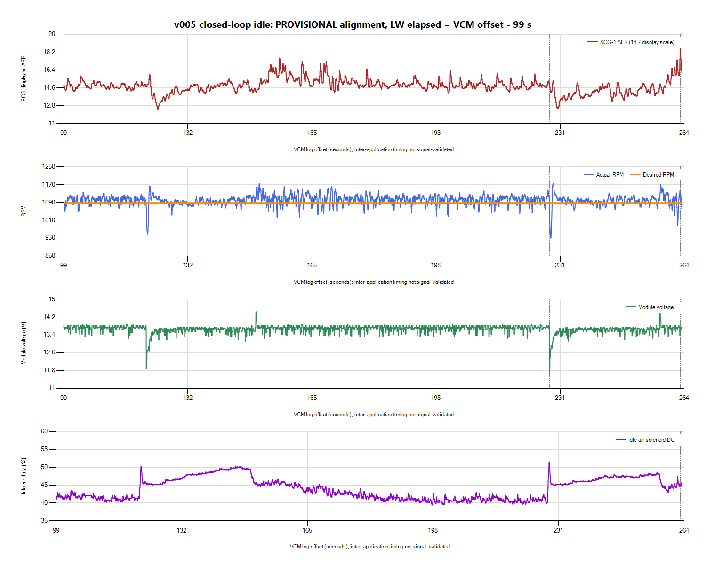

# v005 closed-loop idle with delayed LogWorks recording

**Closed-loop entry is sustained, but idle load disturbances and measured
mixture excursions remain.** The delayed wideband capture can evaluate the
later warm idle only; it cannot reconstruct the earlier startup mixture.
No tune change, MAF correction or ECU write was performed in this review.

## Session preservation and identity

Inputs are under `logs/2026-10-26-v005-closed-loop-01/`:

- `VCM/v005-warm.hpl` and `v005-warm.csv`: separate continuation after the
  [startup recording](2026-10-26-v005-startup-review.md).
- `LW3/v005-delayed.log` and `v005-delayed.csv`: saved by the owner. Both
  contain the older v004 **Session 1** and current v005 **Session 2**.
- `LW3/v005-session2-only.csv`: extracted Session 2 for analysis, with source
  exports preserved. Session 1 was excluded from every current-session result.
- Input SHA-256/size manifest, provisional alignment JSON and paired CSV.

The original desktop v004 native log still matches the archived v004 hash.
Current ECU calibration identity is owner/session-attributed, not read back.
Scanner was stopped for preservation and then resumed into another separate
continuation. LogWorks command automation returned Win32 Access denied; the
initial stop/save requests did not take effect there. The owner subsequently
stopped and saved LogWorks. This review did not restart LogWorks or establish
a live integrated display; the plotted comparison uses the saved overlap.

## Delayed-start alignment

VCM Creation Time is **19:53:04** with no CSV timezone. Two Unix timestamp
candidates in the saved native LogWorks file, at offsets **147520/151044**,
decode to **2026-10-26 19:54:43 UTC**. On the same-clock/session-origin
interpretation, LogWorks began **99 seconds later**:

`LW Session 2 elapsed = VCM offset - 99 seconds`

VCM spans 2.415-263.449 s (11,224 rows). Session 2 spans 0-364.62592 s
(4,452 rows). The candidate overlap covers VCM approximately **99-263.449 s**
and LW **0-164.449 s**, with 2,008 actual wideband samples and 7,070 paired
Scanner rows. The paired CSV chooses nearest wideband samples; repeated
wideband values are not independent observations.

Alignment remains **provisional**: native timestamp semantics, CSV timezone,
cross-application latency, drift and wideband/exhaust transport delay are
unvalidated. There is no usable shared measured-AFR trace or LogWorks RPM
signal to validate timing. No prior session offset, file-save time, first-row
alignment or visual curve shifting was used. No pointwise fueling corrections
were calculated. Wideband data beyond this overlap is not attributed to the
saved Scanner segment.

## What the recorded overlap shows

| Measurement | Result |
| --- | --- |
| CL Active / Ready | Yes throughout the entire VCM segment |
| Fuel Source / OL Conditions | Stoich / No throughout |
| SCG displayed AFR, overlap | Mean **14.796**, median **14.79**; central 90% **13.61-16.08**; range **12.47-18.83** |
| RPM, overlap | Mean **1,099.6**, central 90% about **1,067-1,131**; range **929.5-1,175** against **1,088** desired |
| Module voltage, overlap | Mean **13.664 V**; range **11.6875-14.4375 V** |
| Idle-air duty, entire VCM segment | **39.41-52.52%**, mean **44.41%** |
| STIT, entire VCM segment | Approximately **-0.300 to -0.052 lb/min**; this is idle-air adaptation, not fuel trim |

LogWorks' native menu state confirms AFR display and the **Gasoline (14.7)**
display reference are selected. That identifies the AFR display scale; it
does not establish actual fuel ethanol content, sensor calibration or a
commanded AFR. The saved tune's stoichiometric AFR was previously inspected
as 14.64, so displayed SCG AFR must not be treated as identically scaled ECU
command. Commanded lambda and usable fuel trims are missing here.

For context only, full Session 2 AFR averages **14.838**, central 90%
**13.77-16.10**, range **12.35-18.83**. These full-session statistics include
roughly 200 seconds after the end of the first saved VCM overlap and are not
a temperature/load-matched comparison to earlier v004 recordings.

## Disturbances, rather than an average-only verdict

The overlay shows two pronounced module-voltage/RPM dips accompanied by
increased idle-air duty. Around VCM **228.182 s**, module voltage reaches
**11.6875 V**; RPM reaches **929.5** at **228.510 s**, then recovers and
overshoots. Idle-air duty rises to roughly 51-52%. This same-VCM association
does not depend on LogWorks alignment. Duty is an electrical command, not a
measured-airflow trace; voltage compensation may contribute to its response.

The fan PWM channel reports zero at the larger event. The pattern is
consistent with the previously reported fan/electrical-load problem, but
that channel does not confirm actual fan engagement on this modified wiring.
Do not label the event positively fan-caused without independent observation.

The largest displayed lean excursion occurs at LW **163.92192 s**, candidate
VCM **262.92192 s**, peaking at **18.83 AFR**. The episode at or above 17 AFR
lasts approximately **0.328 s** on the raw wideband timebase. RPM dipped to
**988** near VCM 262.263 s and recovered; module voltage around the AFR peak
is approximately **13.69 V**, so this is separate from the deepest voltage
dip. Neither the candidate delay nor this one event proves mixture caused
the RPM dip, or that an instrument artifact explains the AFR excursion.

The average AFR is near the selected display reference, but transient
variation and low-RPM disturbances still matter. No global MAF/injector
adjustment is justified by this mean or by a short spike alone.

## Coverage and next work

This saved VCM segment has usable RPM/target, temperatures, voltage,
high-resolution load, STIT, idle-air duty and loop states. O2 heater command
changes On/Off and heater fault remains OK. Commanded lambda, actual timing
advance, upstream O2 voltage, raw TPS, fuel pressure and the separate OL Active
channel are empty; fuel trims are absent. Availability remains session-specific,
not a declaration that those channels are unsupported. LogWorks RPM and WGDC
remain zero and cannot serve as synchronization or control-validation signals.

Keep v005 restricted to stationary idle. Confirm the remaining electrical
load disturbance and actual fan operation, and the separate cranking supply
problem from the startup review. Obtain usable upstream O2/trim/command data
as channels populate, plus continued measured wideband when evaluating mixture.
Review repeatable load transitions with event notes and new session-specific
timing before changing idle-air compensation or fuel tables. Closed loop is
now observable and sustained; overall mixture quality, startup behavior and
off-idle enrichment are not accepted or validated by that flag alone.
