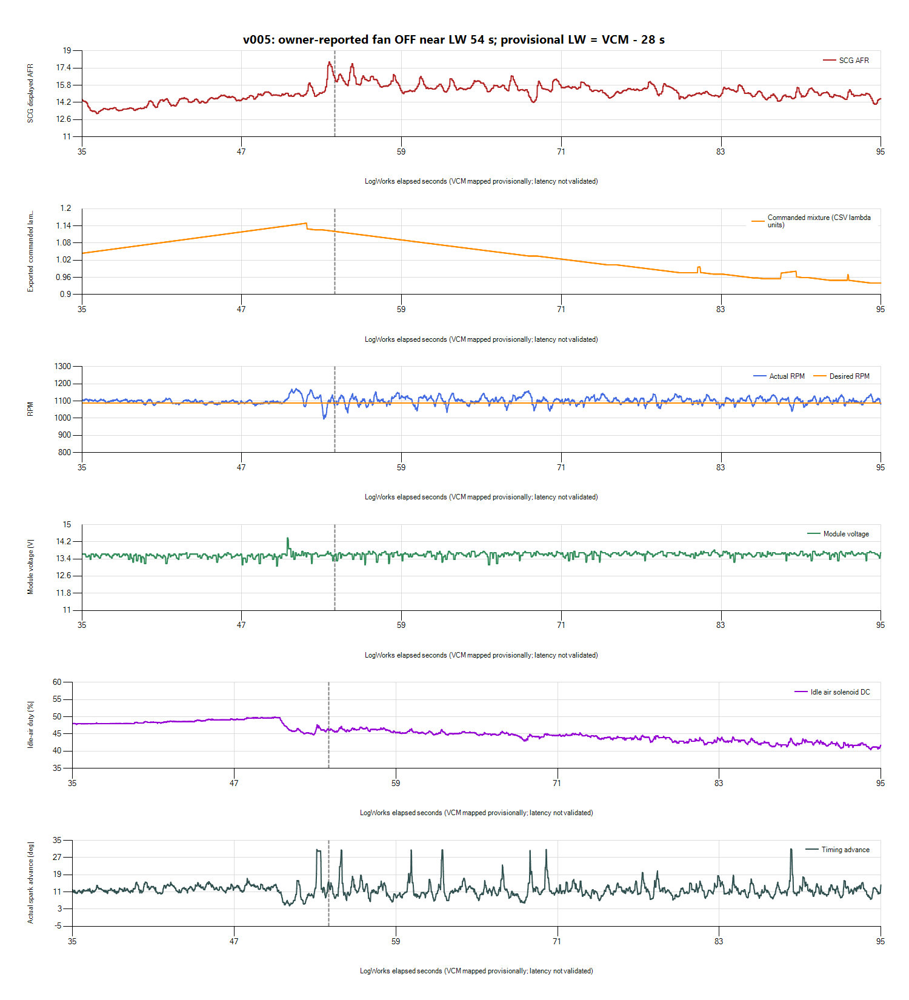
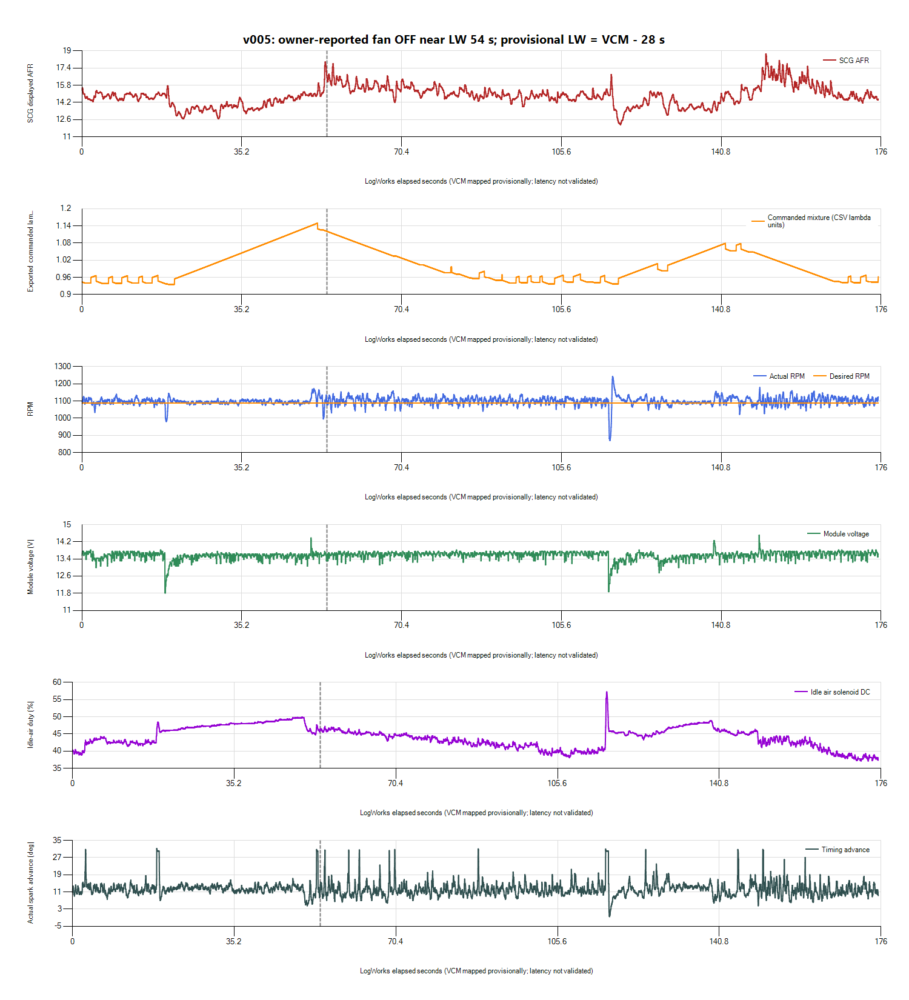

# v005 fan-off disturbance near LogWorks 54 seconds

**The owner-marked fan-off window includes a sustained lean displayed-AFR
excursion while closed loop remains active.** This warrants investigation of
load-removal/fuel-control recovery. A brief fan-start voltage dip alone does
not explain the full recorded fan-off behavior. No calibration was changed.

## Owner observations

- Fan turned off at approximately **54 s on the LogWorks timebase**, followed
  by noticeably abnormal running.
- Headlights were held longer than the proposed test; no perceptible idle
  change when switching them on/off.
- Interior blower produced a subtle idle change.

These are useful load labels, not measured current/voltage-drop tests.
Exact headlight/blower times and HVAC mode were not supplied. Their different
unmeasured loads cannot clear the battery, alternator or wiring as a whole.
The owner-marked fan-off event now takes priority over another unmarked
headlight repetition.

## Inputs and alignment

Native HPL/LOG and all-channel CSV are preserved under
`logs/2026-10-26-v005-load-step-01/`, with an input hash manifest, alignment
JSON and paired CSV. Scanner has **8,822 rows**, offsets **2.415-207.358 s**.
LogWorks contains one current session, **2,142 samples**, **0-175.39072 s**.
The paired overlap contains 7,550 Scanner rows.

VCM Creation Time is **20:16:28**, timezone unspecified. Native LogWorks Unix
candidates at byte offsets **31052/34296** decode to **20:16:56 UTC**. The
session-specific provisional mapping is:

`LW elapsed = VCM offset - 28 seconds`

The owner marker LW54 maps nominally to VCM82. Timestamp interpretation,
clock basis, acquisition latency/drift and exhaust/wideband transport delay
remain unvalidated. The marker is approximate; transient features begin
around mapped LW50-51. The mapping was not shifted to force those features
onto the owner's rounded marker. No earlier offset or file-save time was used.
Paired nearest-neighbor samples are contextual, not independent measurements
or a basis for pointwise MAF corrections.

## Event sequence

Before the marked transition, idle-air duty is around 48-50%. Around mapped
LW50-51, duty falls toward 45-47%, RPM briefly overshoots and dips, and a brief
module-voltage rise reaches approximately 14.38 V. The displayed AFR develops
lean excursions around LW53-60, followed by a slower return toward its earlier
range. The approximate timing and asynchronous sampling limit causal order.

| LogWorks window, provisionally paired | Displayed AFR | RPM | Module voltage | Exported commanded lambda |
| --- | --- | --- | --- | --- |
| 35-50 s | Mean 14.21; range 13.16-15.17 | Mean 1,095.7 | 13.06-13.69 V | Mean 1.091 |
| 50-54 s | Mean 15.41; peak 17.96 | 995.3-1,172.3 | 13.19-14.38 V | Mean 1.134; peak 1.150 |
| 54-60 s | Mean **16.05**; range **15.02-17.80** | 1,030.5-1,153.3 | **13.13-13.75 V** | Mean 1.103 |
| 60-80 s | Mean **15.52**; range 14.20-16.66 | 1,034-1,159 | **13.13-13.75 V** | Mean 1.029 |
| 80-105 s | Mean 14.83; range 13.80-15.83 | 1,040.5-1,140 | 13.13-13.81 V | Mean 0.955 |

Closed Loop Active stays **Yes**, Fuel Source **Stoich**, OL Conditions **No**
and throttle state **Closed** throughout the saved Scanner recording. This
event is not a logged return to open loop. Actual throttle ADC values were
unavailable, so the state label is not a reconstructed throttle position.

The commanded-mixture channel now populates and changes substantially: whole
recording range **0.9354-1.1495** in the CSV's lambda units. Around this event,
it ramps upward before the transition and then downward over tens of seconds.
This is materially different from interpreting Fuel Source = Stoich as proof
that all fuel commands are static or that measured mixture is correct.

**Working hypothesis:** a load-dependent fueling correction or airflow/fuel
model error built up with the fan running is taking time to unwind after
load removal. The trace supports investigating this, not a diagnosis of
integrator windup, a specific MAF error, or a validated definition of the
commanded-mixture channel's place in this controller's feedback calculation.
Confirm those semantics and obtain O2/trim/MAF data before changing gains,
bias, injector data or base fueling.

## Spark is responding too

Actual spark advance now records, spanning **-0.5 to 31.25 degrees** over the
whole recording. In the event window it is pulled back during overspeed and
advances during dips, with brief Base / MBT source intervals. That is consistent
with corrective torque control. Do not flatten the trace or lower its spikes
solely because they look erratic. The recording does not establish every source
transition's cause, optimal gain, or a knock diagnosis.

## Next concrete diagnostic step

No more unmarked headlight repetitions are needed for this comparison. Keep
v005 unchanged and obtain **upstream O2 voltage, B1 short-term fuel trim and
MAF flow/counts** through one labeled fan on/off cycle, with measured wideband
and the now-working commanded-mixture/spark channels. These are the observations
needed to distinguish feedback recovery from airflow/fuel characterization
or sensor behavior.

Prepared a separate
[Idle Fuel Recovery profile](../profiles/2004%20Focus%20SVT%20-%20Idle%20Fuel%20Recovery.Channels.xml)
containing 27 existing channel definitions, retaining their parameter types
and using moderate requested intervals. It concentrates on RPM/target,
mixture/trim/O2, MAF/load/TPS, idle air, spark, voltage and loop state. All IDs
come from the existing profile; no new identifiers/scales were guessed.
It is a **staged trial configuration, not loaded or live-validated**. Fewer
requests may help acquisition, but that has not been established as the cause
of intermittent data. The original idle/cruise profile is unchanged.

The current recording has commanded lambda and actual advance, but upstream
O2, raw TPS, STIT and usable B1 trims remain empty/absent. Blank samples are
missing observations, not proof of unsupported channels or sensor failure.
Verify actual saved coverage after loading the focused profile; do not repeat
long tests on the assumption that a configured channel is recording.

Retain the stationary-only/no-throttle/no-boost scope. The temporary fan bypass
and its repair/retirement plan remain active. Investigate the fan-off fuel/control
transient alongside the existing fan-start/cranking electrical observations,
without treating either category as a complete explanation for the other.

## Later focused-channel evidence

The [focused fuel-recovery review](2026-10-26-v005-focused-fuel-recovery-review.md)
records O2/STFT/MAF through a labeled cycle. It also finds the commanded-mixture
export equals `1 - STFT/100` to CSV rounding precision. Its ramp must not be
counted as independent evidence of a changing base lambda target.
