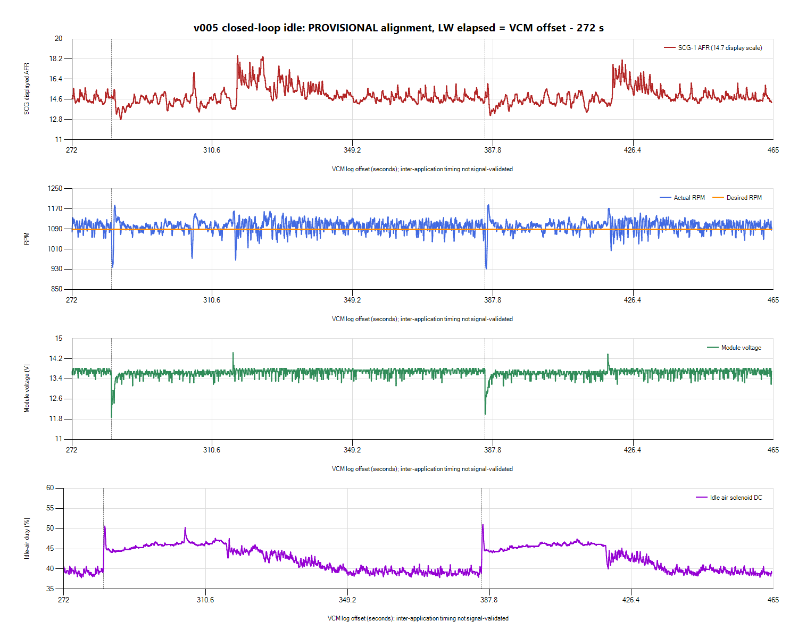

# v005 settled idle: next improvement target

**Steady idle is close to the nominal 1,100 RPM setpoint. The remaining
priority is repeatable load-transition recovery, with associated voltage and
mixture excursions.** Preserve v005 for a controlled load comparison; this
capture does not justify an arbitrary base-airflow, spark-gain or MAF edit.
No v006 was created and no calibration/ECU write was performed.

## Current recordings

Saved Scanner native HPL and Entire Log CSV under
`logs/2026-10-26-v005-closed-loop-02/VCM/v005-current.*`. The owner saved
LogWorks native LOG and CSV under the matching `LW3/v005-current.*` paths.
Source files and size/SHA-256 manifest are retained with alignment JSON and
paired CSV. This LogWorks export contains a single session labeled Session 1;
it is a new capture, not the historical v004 session from the earlier export.

Scanner Creation Time is **20:00:37**, without a CSV timezone. Native LogWorks
Unix candidates at offsets **33978/37222** decode to **20:05:09 UTC**. The
new session-specific candidate is:

`LW elapsed = VCM offset - 272 seconds`

Timestamp-field meaning, clock basis, latency/drift and wideband transport
delay remain unvalidated. No old offset was reused or signal manually shifted
to force alignment. No pointwise fuel corrections were calculated.

VCM has **22,925 rows**, offset 2.461-536.632 s. LogWorks has **2,351 samples**,
0-192.51199 s. Candidate overlap is approximately VCM **272.021-464.503 s**,
with 8,271 paired VCM rows. Repeated nearest wideband samples in paired rows
are not independent measurements.

## Results

| Measurement | Current result |
| --- | --- |
| CL Active / Ready | Yes throughout VCM |
| OL Conditions / Fuel Source | No / Stoich throughout VCM |
| Whole VCM RPM | Mean **1,100.86**, range **899-1,213.25**; reported desired 1,088 |
| Overlap RPM | Median **1,103.25**, central 90% **1,064-1,131**, range **932-1,186** |
| Overlap displayed AFR | Mean **14.889**, median **14.73**, central 90% **13.92-16.49**, range **12.80-18.49** |
| Whole VCM module voltage | **11.875-14.4375 V**, mean **13.652 V** |
| Whole VCM STIT | Mean **-0.054 lb/min**, range **-0.150 to +0.061** |
| Overlap STIT | Median **-0.0376 lb/min**, mean **-0.0287**, central 90% **-0.0731 to +0.0245** |
| Whole VCM idle-air duty | **37.49-53.78%**, mean **42.36%** |

The Scanner desired-RPM display remains 1,088 while the saved tune's nominal
setpoints are 1,100. Do not infer a needed correction from that approximately
12-RPM difference alone; the measured mean is close to the nominal target.
STIT is idle-air adaptation, not a fuel trim. Its smaller settled magnitude
does not support treating the earlier approximately -0.30 value as a permanent
base-airflow error.

Descriptive voltage dips below 12.5 V start around VCM **80.460, 180.244,
282.859 and 385.649 and 489.162 s**. One event also crosses the threshold again
at 283.557 s and is not a separate established physical load cycle. The broad
repetition is roughly 100-103 s. The 12.5-V threshold is an analysis choice,
not a specified electrical pass/fail limit.

The overlap again shows abrupt idle-air duty increases, voltage/RPM dips,
recovery and later duty reductions. Measured AFR has rich excursions after
the voltage-dip-like events and periods of displayed lean excursions around
the later duty reductions. Cross-application cause/delay is not established.
The approximately 100-s repetition and coolant cycling make fan operation a
plausible contributor, but no owner event labels or valid fan-state trace
establish every transition. Missing fan measurements are not proof the fan
was off. A controlled independent electrical-load step will help distinguish
general supply/load response from the fan-specific pathway.

## Calibration inspected, without edits

Official [HP Tuners idle guidance](https://www.hptuners.eu/help/vcm_editor_parameters_ford_eng_idle.htm)
describes base airflow versus desired RPM and its ECT/runtime multiplier.
The following values were read from the saved v005 calibration in Editor:

- **ECM 44242, Idle Airflow (P/N) vs. Desired Idle RPM:** 0.46 lb/min at
  1,000 RPM and 0.60 at 1,250. The interpolated base around the displayed/
  nominal idle is roughly 0.51-0.52 lb/min, before other corrections.
- **ECM 44243, Idle Airflow Mult (P/N) vs. ECT vs. ERT:** runtime rows
  2/30/72/120/165/200 s and ECT columns -20/20/50/75/120/200/210 F.
  At 200 F, multiplier falls from **1.60 at 2 s** through **1.50/1.40/1.40/
  1.30** to **1.00 at 200 s**. At 210 F, it falls from 1.40 to 1.00.
  This explains why startup and settled-airflow observations should be
  compared separately; it does not alone diagnose the failed hot-start catch.
- The exposed idle navigator includes base/multiplier, dashpot, target/adders,
  Fan High Speed Idle and spark settings. A separate low-speed-fan airflow
  adder or generator-load feed-forward table was not established as editable.
  Generic help is not proof a knob exists in this controller definition.

Do not reduce warm base airflow just because STIT is slightly negative, or
flatten spark feedback without a valid actual-advance trace. The large voltage
steps and transient AFR variation need a repeatable event comparison first.
The separate 7-V cranking observation remains an independent supply check.

## Concrete next test

Keep v005 and all SCG-1 settings unchanged. Stay stationary with throttle
untouched. With both applications recording:

1. Record **30 s** of baseline idle.
2. Switch headlights **on for 30 s** and note the PC clock time.
3. Switch headlights **off and record another 30 s**, noting the time.
4. Note any fan engagement/disengagement. A coincident fan event confounds a
   clean headlight comparison; label it rather than assigning all changes to
   the headlights. Preserve both native recordings and all-channel CSV in
   the new `logs/2026-10-26-v005-load-step-01/` session directory.

This is a diagnostic step, not an instruction to manipulate fan wiring,
disable cooling or exercise the throttle. If a small repeatable load produces
the same voltage collapse/RPM response, verify supply/cable/ground behavior
alongside controller response. If the problem is specific to the large fan
transition, prioritize its bypassed circuit, current draw and the available
fan compensation pathway. Select a new calibration change only from that
evidence; do not use a global fueling correction to hide the event.

Continue checking channel coverage. Current commanded lambda, actual advance,
upstream O2 voltage, raw TPS and usable B1 fuel trims remain absent/empty.
Do not classify that intermittent behavior as proven controller non-support.
