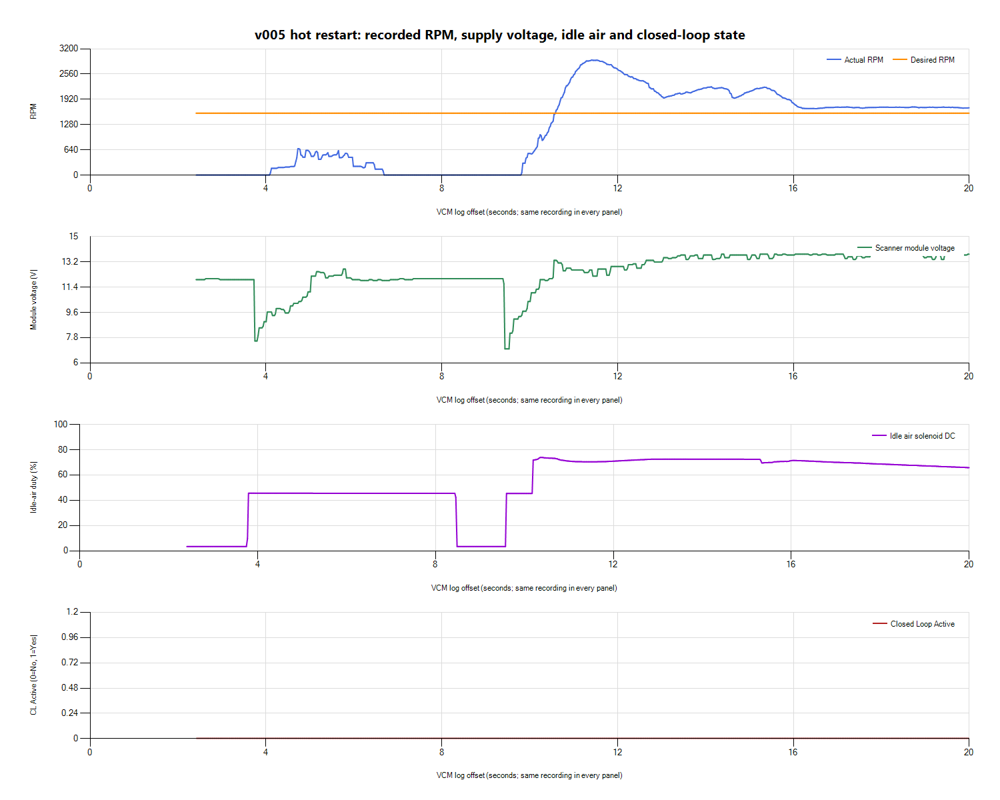
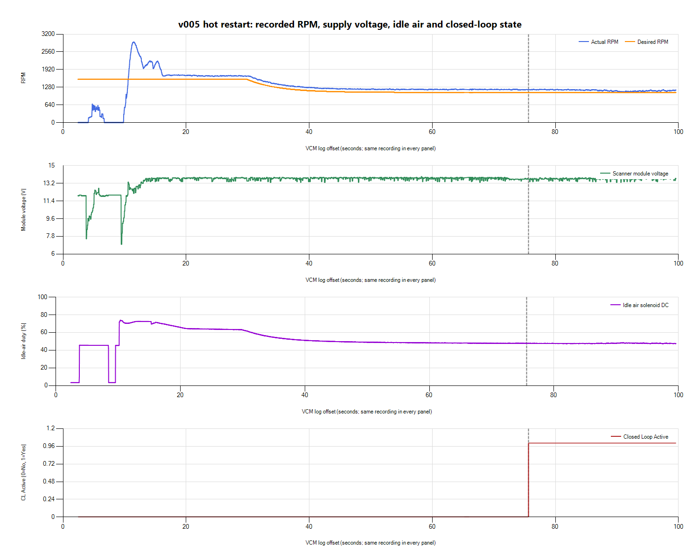

# v005 startup disturbance and first closed-loop entry

The startup recording shows an initial unsuccessful catch, a second start
with a large RPM flare, and low reported module voltage during cranking.
**Closed loop subsequently activates.** The startup disturbance precedes that
transition, so it was not caused by closed-loop activation itself. This does
not rule out effects of the changed TPS threshold while open loop, or prove
that the entire startup problem is electrical.

## Preserved input and ongoing recording

Owner reports the car running with a fresh log after the v005 handoff.
Calibration identity is owner/session-attributed, not an ECU readback.
Stopped Scanner briefly and saved native HPL and Entire Log CSV under
`logs/2026-10-26-v005-startup-01/VCM/v005-startup.*`. An input size/SHA-256
manifest is saved alongside them. Restarted Scanner for a separate warm-idle
recording after preservation; that second recording remains active at handoff.

The preserved recording has 4,192 exported rows from offset 2.409 to 99.596 s.
Creation Time is 2026-10-26 19:50:42 in CSV without a timezone; Scanner displays
15:50:42 locally. Only same-recording elapsed offsets are used here. There is
no paired LogWorks file for this review and no inferred measured AFR.
Exported rows can contain asynchronous/interpolated values and do not prove
sub-sample causality. Some channels populate late or intermittently, as the
owner reports; coverage was checked in this saved segment.

## First 20 seconds

| Log offset | Recorded behavior |
| --- | --- |
| About 3.7-6.7 s | First crank/catch: RPM reaches about 668, then returns to zero. Fuel source briefly changes from Cranking to Cold Eng. / Startup and back. Reported voltage drops to about 7.56 V during this first attempt. |
| About 6.7-9.8 s | RPM remains zero before the next catch. |
| 9.436 s | Minimum reported module voltage **7.00 V**, with exported RPM zero. Acquisition latency means the row does not prove no starter movement at that exact instant. |
| About 9.9 s | Second catch begins; Fuel Source changes to Cold Eng. / Startup. |
| 11.411 s | RPM peaks at **2,915.25**, against desired **1,568**: approximately 1,347 RPM above target. |
| About 10-16 s | Idle-air duty rises to roughly 71-74%. Fuel Source alternates briefly between startup and Power Demand Enrich. Idle mode progresses through PrePosition, Dashpot, Lockout, then RPM Ctrl. |
| About 16-30 s | RPM settles near 1,700 while target is about 1,568; duty decreases. |

Throttle-state label is Closed; raw TPS counts were unavailable, so this is
not a measured pedal/throttle-angle reconstruction. Coolant starts around
188 F, making this a warm/hot restart rather than a cold-start characterization.

The large flare is real in the recorded RPM trace and is accompanied by high
commanded idle-air duty. That supports reviewing startup/preposition/dashpot
air behavior once electrical conditions and mixture are understood. Duty is
a command, not measured airflow or proof of an IAC mechanical fault. The
recording does not distinguish a second deliberate key attempt from every
possible catch/stall/recrank sequence; owner observation should qualify it.

**The 7 V module reading needs independent confirmation.** Verify voltage at
the battery posts and ECU supply during cranking, including voltage drop in
the relocated battery's positive cable and grounds. This recording alone
cannot distinguish battery state, cable/ground loss, starter load, or a
measurement/acquisition issue. Do not compensate for an unexplained supply
collapse by changing fueling or spark.

## Closed-loop transition and later idle

At **75.636 s**, Closed Loop Ready and Active both change to Yes, and Fuel
Source changes from Cold Eng. / Startup to **Stoich**. Active remains Yes
through the end at 99.596 s. Open Loop Conditions reports No throughout this
recording; the separate Open Loop Active channel is empty throughout.

At entry, recorded engine runtime is **65 s**, coolant **186 F** and RPM
**1,198.5**. This is earlier than the nominal 254-second delay fields retained
in the saved calibration. The observed transition therefore does not validate
the earlier assumption that those fields behave as literal 254-second waits
in this session. Strategy/timer semantics and actual flashed correspondence
remain unresolved; no new delay edit is justified from this discrepancy.

From offsets 60 s to the end, RPM spans approximately **1,095-1,217** against
**1,088** desired, mean **1,177**; module voltage spans 13.31-13.81 V and duty
is about 47.3-48.4%. Closed-loop entry is an encouraging gate-state result,
not proof of settled idle, accurate fueling or an accepted calibration.

## Missing observations and conclusions

Commanded lambda, timing advance, upstream O2 voltage, MAF voltage, fuel
pressure, STIT, relative TPS, fan duty, A/C clutch and Open Loop Active are
empty throughout this saved segment. Absolute TPS is absent. Some other
calculated spark fields populate, but they cannot substitute for actual
timing advance. B1 fuel trims are absent. No measured AFR trace was supplied.
Do not label the catch/stall lean, rich, spark-caused or knock-related from
these missing channels. The private channel audit records exact coverage.

The v005 TPS-threshold hypothesis now has supporting loop-state evidence:
the recorded Open Loop Conditions flag clears and CL becomes active after
the sole table change. Sensor/adaptive conditions and different sessions
still limit a causal claim, and raw TPS did not populate here. Retain the
stationary-only restriction, with no throttle exercises, driving or boost.

Next priorities are to confirm cranking supply behavior, qualify the owner's
startup symptom/attempts and observed SCG mixture, then inspect the warm-idle
continuation with whatever channels have populated. Obtain recorded wideband
before fueling corrections or mixture-quality acceptance. Preserve v005
as an experiment; no new tune or flash was performed in this review. If
behavior is unacceptable, stop testing and use the documented v004 rollback.
