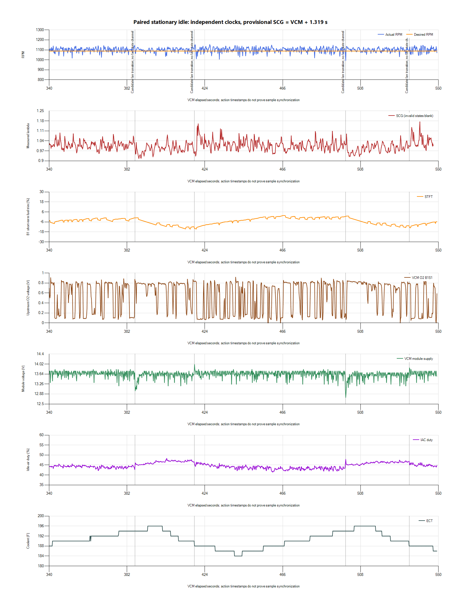
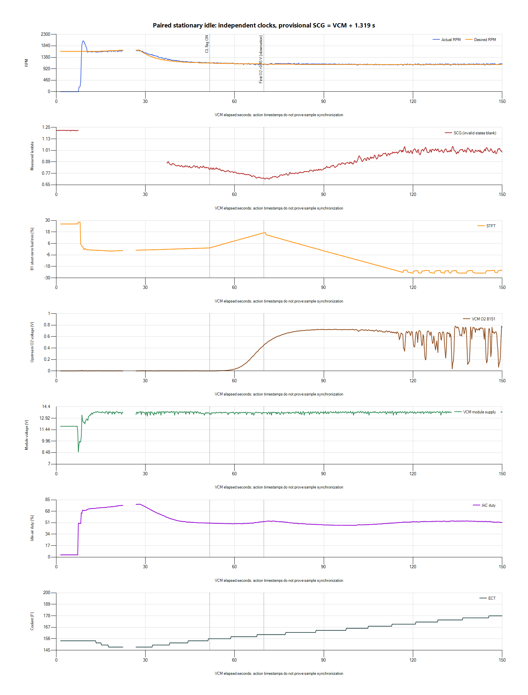

# Paired idle recovery and startup O2 review

Fully warm idle and the first recorded fan-off recovery look substantially
better than the earlier resistor-bypass tests. Retain the current fan baseline
and do not apply a global MAF or fuel reduction from the early negative trims:
the first complete recovery returns to nearly zero correction and lambda 1.0.
The next investigation is startup O2 readiness and the repeated cranking supply
observation. No HPT calibration or ECU write was made in this review.

## Session and coverage

The paired app saved both native files, both CSVs and its timing manifest with
no reported errors. The source is `paired-20261027-144048-c85b4ba7`, preserved
privately with input hashes and analysis under
`logs/2026-10-27-v006-paired-idle-01/`. The SCG database is finalized and passes
integrity checking; its 6,680 CSV rows match the database sample count.

VCM contains 23,191 rows over 1.526-549.277 s. Its throttle state remains Closed
throughout. Relative TPS, IAT and O2 B1 Fail are blank, so those channels do not
supply additional confirmation. SCG has 6,326 valid readings plus explicit gap,
sensor-error, warm-up and stop records. Invalid states are excluded from mixture
summaries. All seven cataloged tune files still match their hashes and sizes.

This follows the owner's v006-labeled post-repair run. Exact flashed filename,
fuel/water-meth confirmation for this particular capture, and ignition-cycle
history await the owner's response; none is inferred from a file open in Editor.

## Timing

The manifest records VCM start invocation at 18:40:50.164 UTC and recording
acknowledgment at 18:40:52.045 UTC. The CSV Creation Time is 18:40:50, matching
the invocation's whole second. SCG's receive timestamps give this provisional
relationship:

`SCG elapsed = VCM offset + 1.319 seconds`

SCG UTC minus monotonic elapsed varies by about 1 ms, supporting a stable host
clock during acquisition. Independent sample timing and sensor transport delay
remain uncalibrated; these are broad-window comparisons, not pointwise fuel
corrections. VCM continues about two seconds after SCG stops because its helper
issues Stop later, as recorded in the manifest.

VCM acquisition gaps are 22.303-26.948 s, 264.413-265.963 s and
299.987-302.948 s. Plots preserve gaps. There is no fan-state channel; the fan
cycle labels below are inferred from the repeated coolant, voltage and idle-air
changes rather than treated as exact command edges.

## Warm idle and fan recovery

Two repeating load/cooling cycles appear near 386-418 s and 500-534 s.
The first has more than 60 s of paired follow-up before the next cycle; the
second has only about 13 s before SCG recording ends.

| Window on VCM clock | Mean RPM | Mean B1 STFT | Mean measured lambda |
| --- | ---: | ---: | ---: |
| 350-380 s, before first cycle | 1,100.7 | -3.14% | 1.009 |
| 418-428 s, first 10 s after inferred off | 1,101.3 | -10.67% | 1.024 |
| 428-448 s, next 20 s | 1,102.8 | -5.58% | 1.020 |
| 448-478 s, 30-60 s after inferred off | 1,100.4 | -0.78% | 1.003 |
| 465-495 s, before second cycle | 1,100.3 | -0.80% | 1.005 |

During the first broad cycle window, minimum RPM is 1,025 and minimum module
voltage is 13.0 V. During the second, they are 978.5 RPM and 12.75 V. These
remain improved relative to the earlier bypassed-fan event's 854.25 RPM and
11.5625 V. Voltage extrema are Scanner module readings, not independent
battery-post or cable-drop measurements.

The first ten seconds after inferred off include brief lambda excursions up
to 1.176. The 30-60 s window returns close to its prior mixture and correction
levels. This is a recovering transient rather than evidence for a permanent
20-25% warm-idle fuel correction. It revises the concern raised by the shorter
[earlier post-repair recording](2026-10-27-v006-post-repair-review.md), whose
fan-off tail was too short to establish recovery. It does not establish the
cause of the transient or justify changing O2 gains or transport delays.

## Startup feedback deserves attention

RPM first exceeds 500 at VCM 8.213 s, with coolant about 154 F. The first catch
peaks at 2,051.25 RPM. Closed Loop Active changes to Yes at 51.621 s, about
43.4 s after that catch, and remains Yes for the rest of the recording.

During 52-60 s, upstream O2 averages only 0.0084 V while the status-valid
wideband averages lambda 0.802, approximately 11.79 AFR using the recorded
14.7 multiplier. STFT rises from about +1.75% to +8.69% in that interval.
During 60-70 s it reaches about +17.14%, while measured lambda averages 0.748.
The upstream O2 first exceeds 0.45 V at 69.805 s and 0.70 V at 82.098 s.
Those voltages are observations, not universal readiness thresholds.

The simultaneous low upstream signal, rich wideband and rising positive
correction are consistent with feedback being used before the upstream signal
properly represents mixture. Heater/sensor warming, wiring/ground effects,
sensor placement/exhaust effects and channel interpretation need to be
distinguished; this is not a confirmed failed sensor or heater diagnosis.

Correction subsequently falls to -25%. In 120-180 s it averages -23.43%, while
measured lambda averages 1.008. Later, with a longer warm runtime, it approaches
zero. Startup enrichment, feedback readiness and adaptive state must be separated
from the fully warm fuel model before choosing a calibration change.

The commanded-mixture field again duplicates `1 - STFT/100` to CSV rounding
precision. It is not an independent base-lambda target. The historical saved
v006 notes retain 254-second startup gates and a calculated O2-temperature gate,
yet this recording enters closed loop much earlier than 254 s after the catch.
Verify the installed calibration, relevant timer/reset behavior and controller
definitions before changing a delay based on the Scanner elapsed clock.

HP Tuners documents a
[Ford closed-loop delay indexed by startup temperature and a calculated O2-temperature gate](https://www.hptuners.eu/help/vcm_editor_parameters_ford_eng_fuel_loop.htm).
That describes the available control concepts, not a verified replacement value
for this controller or proof that a heater command supplies heater current.

## Cranking supply remains unresolved

Module voltage reaches 7.5625 V at VCM 7.240 s. SCG reports a gap, sensor errors
and warm-up during/after the start, with warm-up continuing to approximately
mapped VCM 37.1 s. The wideband does not provide a usable continuous cranking
mixture trace. Startup display values before the engine catches are not
combustion-mixture measurements.

Compare battery-post and underhood/module supply during cranking and verify
the relocated battery's supply/ground path as indicated by the measured drops.
The Scanner number alone does not identify a failed battery, cable or starter.
Improved fan behavior does not clear this separate startup observation.

## Next tuning step

Retain the current calibration while checking startup supply and upstream
O2/heater readiness. No global MAF scaling, injector characterization change,
feedback-gain change or arbitrary 100-second delay is supported here. The warm
fan recovery objective has now been captured; another identical long fan-only
test is not the main missing observation.

A separate
[Startup O2 Readiness channel profile](../profiles/2004%20Focus%20SVT%20-%20Startup%20O2%20Readiness.Channels.xml)
adds the previously recorded heater-command and heater-fault status channels
to the working focused profile. The existing channels and intervals are
preserved. It is prepared and XML-checked, but this combined profile has not
been loaded or live-validated. Heater command/fault bits should be compared
with the actual heater circuit and O2 response; they do not measure current.

Once startup behavior is explained and the installed parent is confirmed,
the next idle calibration experiment remains the separate 1,000-RPM target-only
stage. Keep fan thresholds, startup airflow, fuel, MAF and spark unchanged for
that trial. No v007 file has been created or flashed by this review.
