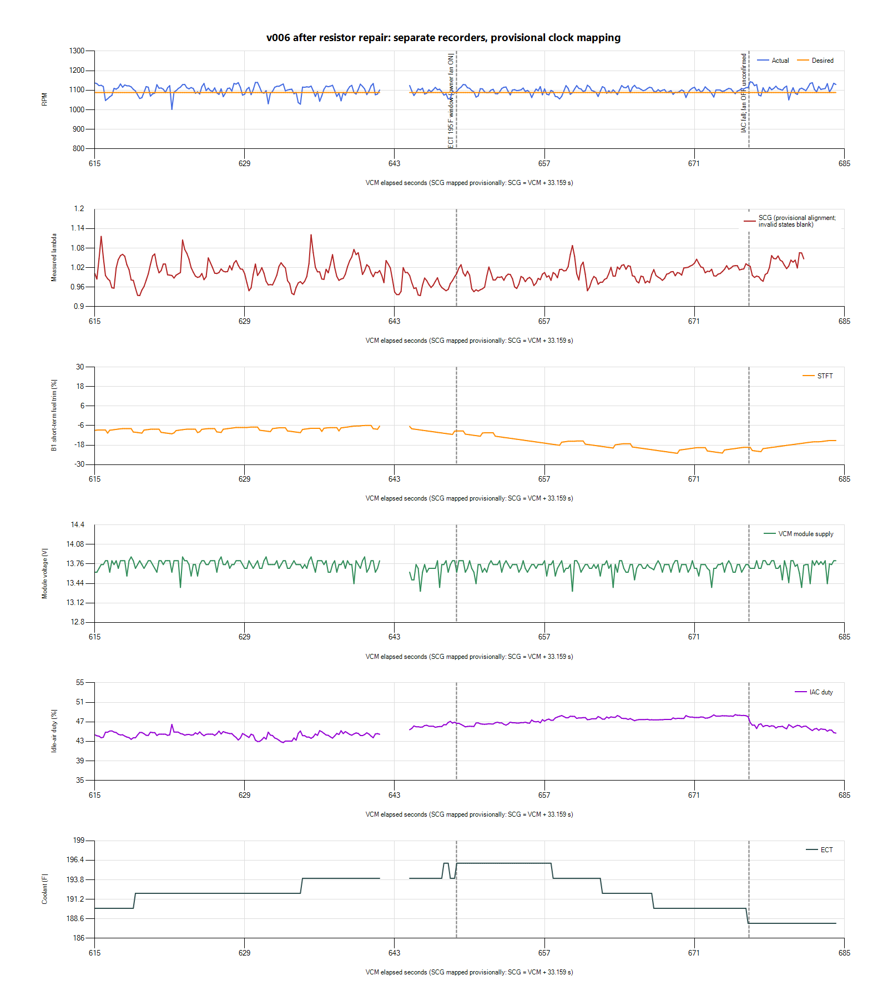
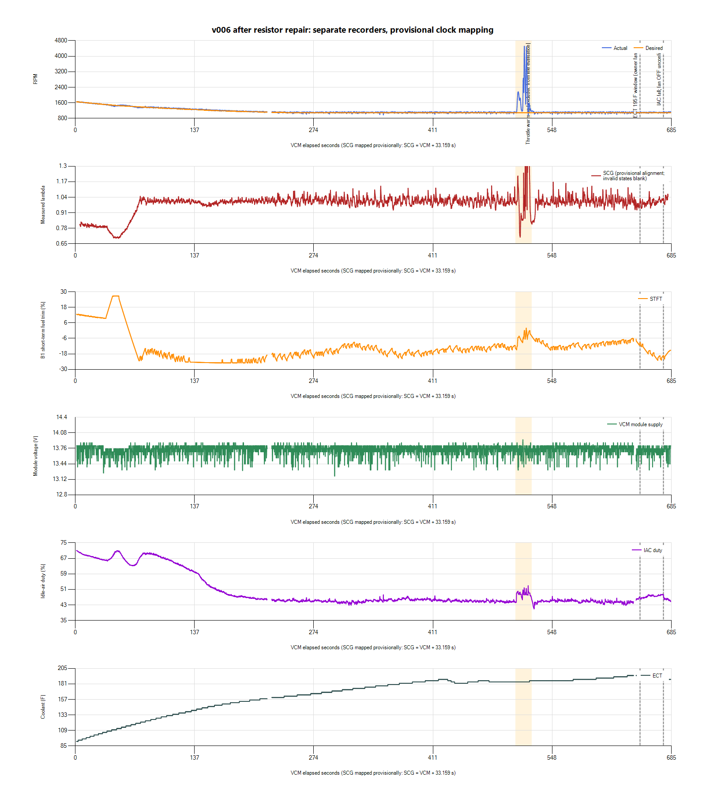

# Post-repair fan baseline: better load response, fueling still under review

Keep the existing 1,100-RPM nominal idle while investigating the remaining fuel
correction and completing a fan-off recovery capture. This recording supports
an improvement in fan-load response after the resistor repair. It does not yet
support a numerical MAF, injector, feedback-gain, startup-air, or idle-target
change. No calibration binary was edited or flashed during this review.

## Inputs and owner context

The owner identifies `scg1-20261027-134543-2612a79b` and the desktop VCM
`v006.hpl`/`v006.csv` as the latest recordings after the fan-resistor repair.
They report the same test conditions as before, fan engagement at 195 F, and
throttle use during warm-up before fan engagement. Previous conditions were
93-octane fuel and water/meth off. Exact flashed-file confirmation is pending;
the VCM filename is a label, not ECU calibration readback.

Native HPL, SCG database and both CSVs are preserved privately in
`logs/2026-10-27-v006-post-repair-01/`, with source hashes, context, analysis,
alignment notes and a provisional paired CSV. The SCG database was preserved
using SQLite's backup API, passes integrity checking, and was finalized.
All seven cataloged tune binaries still match their recorded hashes and sizes.

VCM has 29,027 rows over 1.522-684.311 s. SCG has 8,705 rows, including 8,325
valid readings, warm-up/status records and a stop marker. Early SCG acquisition
contains a gap, sensor-error reports and warm-up; these are excluded from
measured-mixture summaries. IAT is blank throughout VCM. Cranking is absent
from VCM, so this run cannot clear the earlier cranking-voltage concern.

## Timing and data limits

The applications were started separately. Interpreting Scanner's Creation Time
as UTC gives the provisional relationship:

`SCG elapsed = VCM offset + 33.159 seconds`

This uses SCG receive timestamps rather than file modification times. A
throttle/pressure feature cross-check favors about 34.059 s, roughly 0.9 s
different. Those are different physical signals; their response cannot prove
an exact clock correction. No long-term drift estimate is established. The
broad-window mixture comparisons below retain the metadata mapping and are
not pointwise fuel-correction inputs.

VCM has acquisition gaps of 5.626 s at 220.316-225.942 and 2.720 s at
641.635-644.355. Plots leave these unavailable rather than filling them in.
Reported extrema come from the original rows, not the plotted sampling grid.

## What improved at the fan event

The owner-observed 195-F fan-on point falls near VCM 648-649 s. There is no
recorded fan-command channel to identify its exact edge. The broader 630-660 s
comparison window covers the surrounding transition without claiming an exact
physical start time.

| Observation | Earlier v005, resistor bypass | Post-repair recording |
| --- | ---: | ---: |
| Fan-event window | Owner-marked 543-570 s | 630-660 s around the 195-F event |
| Mean RPM | 1,098.2 | 1,096.4 |
| Minimum RPM | 854.25 | 998.0 |
| Minimum module voltage | 11.5625 V | 13.25 V |
| Maximum idle-air duty | 60.37% | 48.43% |

These are separate tests with different startup histories and changed hardware;
they are not an isolated software comparison or a current/voltage-drop test.
The reduced disturbance supports the owner's repair observation. It does not
verify high-speed fan operation, motor current, or all wiring and grounds.

Near 676.1 s, idle-air duty falls as coolant reaches about 188 F. This is a
candidate fan-off/load-removal event, not an owner-confirmed edge. SCG coverage
ends near mapped VCM 681.3 s and VCM ends at 684.3 s: only about five seconds
of paired follow-up. That is insufficient to judge the tens-of-seconds recovery
seen in the earlier fan-off tests.

## Remaining fuel correction

| VCM window | ECT | Mean RPM | Mean B1 STFT | Mean measured lambda, provisional |
| --- | --- | ---: | ---: | ---: |
| 360-420 s, before throttle | 180-188 F | 1,100.4 | -17.21% | 1.011 |
| 550-600 s, settled after throttle | 186-190 F | 1,100.9 | -12.08% | 1.012 |
| 615-640 s, before fan | 190-194 F | 1,100.6 | -8.37% | 1.009 |
| 645-655 s, 195-F transition | 194-196 F | 1,096.4 | -11.27% | 0.979 |
| 660-680 s, hot fan-cycle window | 188-194 F | 1,101.1 | -19.83% | 1.007 |

STFT reaches -25% earlier in the run. Measured lambda near 1.0 with substantial
negative correction means the mixture is being maintained with correction;
it does not establish a correct underlying fuel model. In the earlier v005
190-194 F pre-fan window, STFT averaged +1.32%; this run's comparable pre-fan
window averages -8.37%. Reported MAF also differs, about 0.676 versus 0.744
lb/min. Startup temperature, adaptive state, load and sensor/model differences
must be considered before attributing the shift to one component.

The exported commanded-mixture field again equals `1 - STFT/100` to CSV rounding
precision across the recording. It is not independent evidence of a lean base
lambda target. Narrowband O2 is also not a measured wideband AFR channel.

The logs do not identify which MAF region, injector offset/short-pulse behavior,
pressure-reference condition, or sensor interpretation explains the correction.
Exact injector characterization and running fuel-pressure behavior remain
unconfirmed. A global fuel adjustment or an invented injector offset would
not resolve that ambiguity.

## Warm-up and scope

Throttle activity is concentrated near 507-521 s; RPM reaches 4,574. Scanner
reports part/WOT throttle and Power Demand Enrich during parts of those blips.
These intervals, and the following settling period, are excluded from steady
idle evaluation. Large overrun mixture excursions and SCG oxygen states are
not idle fueling errors. The overview's lambda axis is limited for readability;
out-of-range samples remain in the original recording.

The inherited low-RPM TPS experiment remains unvalidated for road/boost use.
Observing enrichment during unloaded throttle blips does not validate fueling
under load. RPM wiring and SCG boost-controller settings remain unchanged.

## Next step

Use the now-verified paired logger for one fully warm stationary capture,
with no warm-up throttle needed: 30 s before the next normal fan cycle,
through fan on/off, then at least 60 s after fan off. Mark the actual fan
events. Compare the settled negative trim and its return after load removal.
Keep the current calibration and recording profile so the comparison is useful.

Before a fuel-model revision, confirm the exact installed tune and injector
identity/characterization, and establish running regulator reference/pressure
behavior if the negative correction persists. Choose a specific affected
setting only when those observations distinguish the alternatives. The planned
1,000-RPM target-only stage remains available after fuel/load recovery is
repeatable; it is not included in this review.

HP Tuners describes the existing
[desired-RPM base-airflow lookup and temperature/runtime multiplier](https://www.hptuners.eu/help/vcm_editor_parameters_ford_eng_idle.htm).
Lowering the target already changes the base-airflow lookup; it would not be
appropriate to combine that future trial with an arbitrary airflow reduction.
