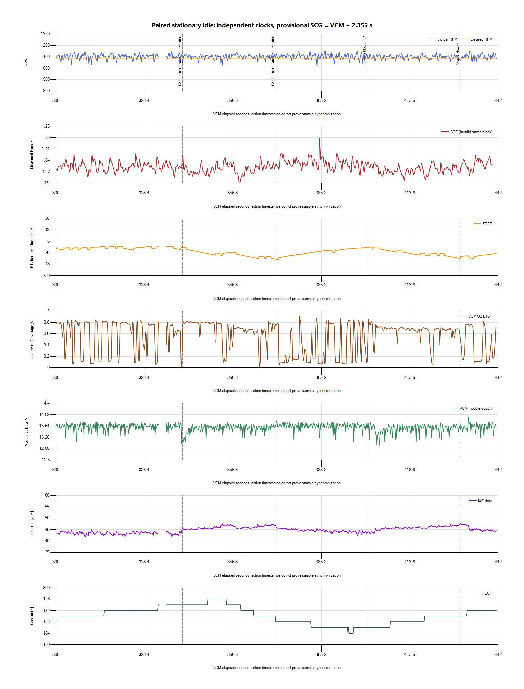
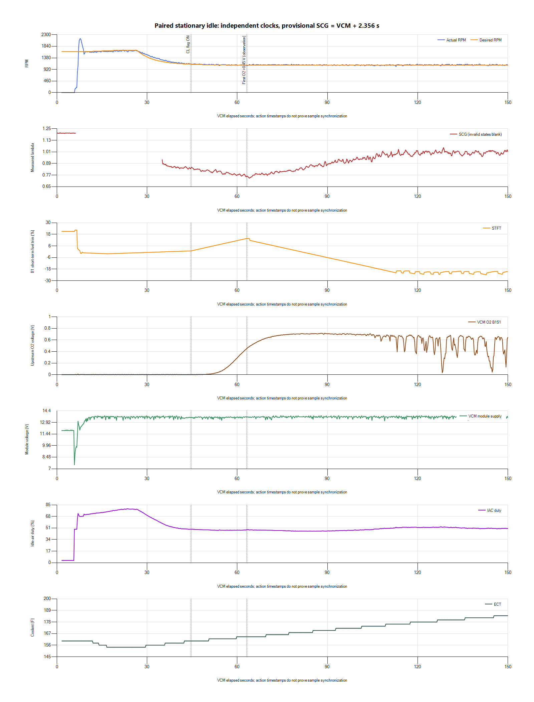

# Startup and blower comparison before the 1000 RPM trial

The warm stationary results support preparing a separate 1,000-RPM idle-target
experiment from the owner-confirmed v006 parent. The blower adds load without
a stall, and the warmed baseline again approaches zero fuel correction. This
does not justify a fuel-model or O2-readiness calibration change. The new
[v007 candidate](../tunes/v007-idle-1000.md) changes only the two idle targets
and Notes; it has not been flashed or tested.

## Recording and event labels

The source is `paired-20261027-152710-619daeb2`, exported cleanly with all four
outputs. It is preserved under `logs/2026-10-27-v006-startup-blower-01/` with
hashes, analysis and timing notes. The preceding unattended session is excluded
at the owner's request. The owner confirms that the ECU was running the exact
v006 post-repair file and reports blower ON at 6:40 and OFF at 7:10. Those
markers are interpreted as VCM elapsed 400-430 s, following the agreed test
instructions. Radiator-fan operation was reported in the expected temperature
window; its precise edges are inferred from the trace.

VCM has 18,808 rows over 1.579-441.499 s. SCG has 5,384 rows, including 5,042
valid readings; its database is finalized and passes integrity checking.
The new metadata mapping is `SCG elapsed = VCM offset + 2.356 seconds`.
Action times support this host-clock interpretation, but sensor timing/drift
remain uncalibrated. VCM has a 2.644-s gap at 332.864-335.508 s.

Both heater-status columns are blank throughout, despite their visible names.
They establish neither heater OFF nor a heater fault. Idle Adapt, IAT and O2
B1 Fail are also blank. Throttle state stays Closed; relative and absolute TPS
do populate in this run. This is a channel-coverage change from the preceding
capture, not a diagnosis of sensor support.

## Warm load response

| VCM window | Mean RPM | Minimum module V | Mean B1 STFT | Mean measured lambda |
| --- | ---: | ---: | ---: | ---: |
| 300-330 s, warm baseline | 1,100.2 | 13.125 | -0.91% | 1.005 |
| 335-375 s, broad radiator cycle | 1,099.7 | 12.625 | -6.92% | 0.994 |
| 380-400 s, before blower | 1,101.3 | 13.125 | -3.22% | 1.020 |
| 400-430 s, blower ON | 1,097.7 | 12.5625 | -5.99% | 0.982 |
| 430-439 s, early blower OFF recovery | 1,101.7 | 13.1875 | -9.44% | 1.016 |

The blower-on RPM minimum is 1,037.25. Mean idle-air duty rises from 44.26%
before the blower to 45.82% with it running. Module voltage reaches 12.5625 V
at 402.459 s, near the owner's switch-on marker. The radiator-cycle minimum is
1,025.25 RPM, and the broader post-radiator segment briefly reaches 998.5 RPM.
These observations support a bounded next idle experiment; they do not predict
the same numerical RPM loss at a lower target.

Only about ten seconds of paired blower-off follow-up remain. Long recovery
after this load is not established. The prior full fan-off recording remains
the longer recovery reference. Keep the next target test stationary and compare
the same load transitions rather than treating mean RPM alone as acceptance.

## Startup is a separate issue

RPM first exceeds 500 at 6.689 s. Closed Loop Active begins at 44.612 s, about
37.9 s later. During 45-65 s, measured lambda averages 0.794 while reported
STFT adds fuel, reaching +13.71%. The upstream O2 first exceeds 0.45 V at
63.194 s. This repeats the earlier readiness/signal disagreement but the blank
heater columns do not distinguish its cause. The commanded-mixture channel
again duplicates `1 - STFT/100`; it is not independent base-target evidence.

Cranking module voltage reaches 7.5 V. SCG again reports a gap, sensor errors
and warm-up around the start, so no continuous valid cranking-mixture trace is
available. Independent supply/ground and heater-circuit checks remain relevant.
A lower nominal idle target is not presented as a repair for these observations.

## Selected revision

Prepare v007 from the confirmed v006 parent as the documented first lower-target
stage: P/N and Drive 1,100 to 1,000 RPM. Retain airflow tables, startup controls,
fuel/MAF/injector data, O2 feedback settings, spark and fan thresholds. Target
selection itself changes the existing desired-RPM airflow lookup and can affect
total startup demand through retained adders; it is not strictly isolated to
already-warm operation. Saved-file comparison and the stationary test/rollback
conditions are recorded in the [v007 note](../tunes/v007-idle-1000.md).
