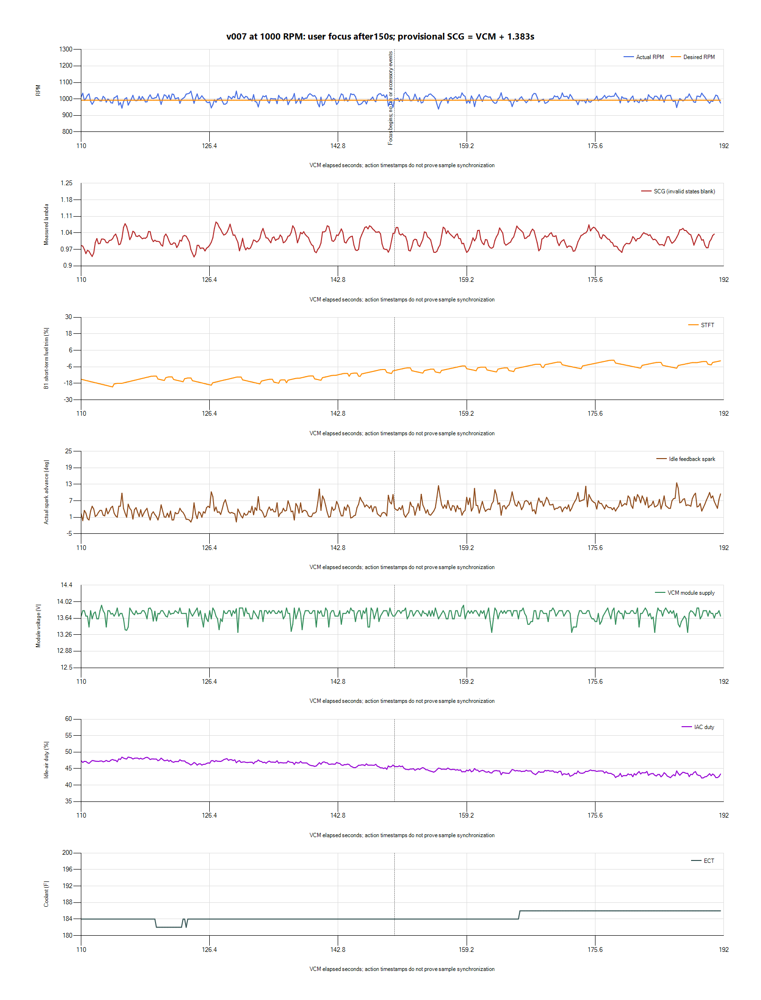

# v007 idle fluctuations after 150 seconds

The RPM fluctuation is measurable, but this short window does not identify a
specific airflow, spark-gain or fuel correction to apply. Preserve those
controls and continue the owner's staged target reduction with a separate
[950-RPM v008 trial](../tunes/v008-idle-950.md). Lowering the target is an
experiment, not a claimed cure for the fluctuation or proof of the engine's
minimum satisfactory idle.

## Recording and scope

The owner confirms v007-idle-1000.hpt, no added throttle/accessory changes, and
no radiator-fan operation in this log. The source is
`paired-20261027-161458-25c32a11`, preserved privately under
`logs/2026-10-27-v007-idle-01/` with native HPL/SQLite, CSVs, hashes and analysis.
The two preceding partial start attempts are separate recordings and were not
merged into this test.

The complete recording has 8,189 VCM rows over 1.549-191.788 s and 2,341 SCG
rows, including 2,340 valid readings and a stop marker. Both streams are gap-free
in this capture; SQLite integrity and finalization checks pass. The new
provisional clock mapping is `SCG elapsed = VCM offset + 1.383 seconds`.
Independent sensor timing/drift remains uncalibrated. The main comparison uses
VCM 150-190.4 s within paired coverage, interpreting the owner's 2:30 marker as
VCM elapsed time.

The recording begins with the engine already running. Coolant reaches only
186 F, and the fan never runs, so it does not complete the full warm/load test
originally specified for v007. Idle Adapt, IAT, O2 B1 Fail and both heater-status
columns remain blank. Blank heater fields are not evidence of heater OFF.

## What happens after 2:30

| Observation | 110-150 s | 150-190.4 s |
| --- | ---: | ---: |
| Native VCM rows | 1,725 | 1,738 |
| Mean RPM | 999.35 | 1,000.09 |
| Minimum / maximum RPM | 922.5 / 1,050.75 | 927.75 / 1,042.25 |
| Central 90% of RPM readings | 963.5-1,030.75 | 971.5-1,028.25 |
| RPM standard deviation | 20.93 | 17.98 |
| Reported desired RPM | 992, constant | 992, constant |
| Mean idle-air duty | 46.91% | 43.95% |
| Mean B1 STFT | -14.73% | -5.72% |
| Mean measured lambda, provisional | 1.013 | 1.014 |

The dips are real, including brief values below 950. The distribution narrows
slightly after the requested marker rather than showing a new sustained loss
of target control. The 992-RPM Scanner target is consistent with the earlier
reported-target resolution issue; the saved calibration scalar is 1,000 RPM.
Do not add an arbitrary eight RPM to compensate for that display difference.

Supply stays between 13.3125 and 13.9375 V in the focus window. Fuel Source is
Stoich, Closed Loop Active is Yes, and Spark Source is Idle Feedback throughout.
Idle-air demand and fuel correction are still settling across the recording.

## Control interpretation

Spark generally advances during RPM dips and retreats as RPM recovers. On a
0.1-s nearest-sample grid, contemporaneous RPM/spark correlation is about -0.88;
the asynchronous channel timing makes that a descriptive association, not proof
of causal order or an optimal gain. Example troughs recover toward target while
the feedback source remains active. Flattening spark would remove a response
that appears corrective without identifying the disturbance.

The modest IAC variation and trend do not establish that the base-airflow table
or integrator is causing the excursions. The trace also does not identify a
consistent supply event or a fuel correction to apply to individual dips.
The commanded-mixture field continues to duplicate `1 - STFT/100`, so it is not
independent target-lambda evidence.

HP Tuners describes
[desired-RPM base airflow and separate underspeed/overspeed integrator controls](https://www.hptuners.eu/help/vcm_editor_parameters_ford_eng_idle.htm).
Those control options do not supply a justified numerical gain change from this
40-second window. Neither their present tuning nor the complete fuel model is
declared optimal by the absence of a selected edit.

## Next experiment

v008 changes only the P/N and Drive targets from 1,000 to 950 RPM, plus Notes.
The existing feedback, airflow, startup, fueling, spark and cooling settings are
retained. This follows the documented 1,000/950/900/850 progression while keeping
the next comparison interpretable. Unknown camshaft details, hot oil pressure,
charging behavior and injector low-flow performance prevent declaring 850 or
800 RPM an established final target for this engine.

The next stationary test must include fully warm operation and normal fan/load
recovery, which this v007 capture did not establish. Compare both the central
RPM spread and worst dips, startup/restart, mixture and control margin. If 950
hunts more, stalls or recovers poorly, use v007 as the immediate rollback; v006
is the earlier 1,100-RPM load-tested fallback. Do not progress below 950 merely
because the average matches its target.
