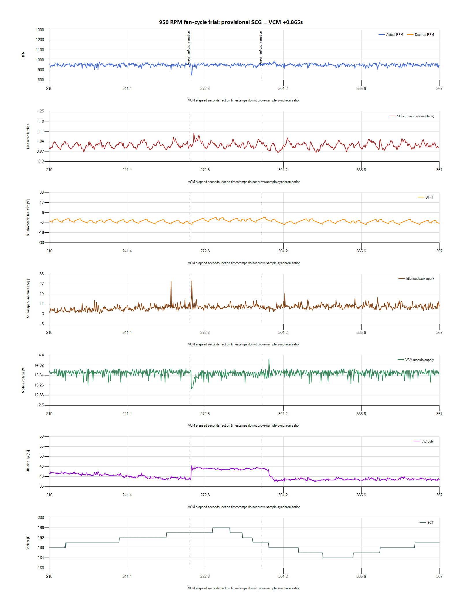

# 950 RPM fan cycle and next target decision

The monitored 950-RPM run supports a separate 900-RPM stationary trial. Steady
idle spread is modest, a brief fan/load dip recovers within seconds, and the
recording includes more than a minute afterward. Retain the present corrective
spark, airflow and fuel controls: this capture does not identify a justified
gain or base-airflow correction. The owner explicitly confirms the exact v008
file was installed for this run; no ECU readback was performed.

## Capture

The source is `paired-20261027-163856-296cf13d`, preserved privately under
`logs/2026-10-27-v008-idle-01/`. It was monitored live through a rise to 196 F,
cooling to the fan-off region, an idle-air duty reduction, and at least 65 seconds
of recovery. Both recorders stopped and exported cleanly, with the original
manifest and monitoring observations retained beside the source. The precise
fan command is not logged; cycle boundaries are inferred from coolant, supply
and idle-air behavior.

VCM has 15,753 rows over 1.566-367.191 s. SCG has 4,472 rows, including 4,143
valid readings. Its database is finalized and passes integrity checking.
The session-specific provisional mapping is
`SCG elapsed = VCM offset + 0.865 seconds`; independent sample/transport timing
is not calibrated. VCM has a 1.454-s gap at 153.519-154.973 s. Pre-start,
warm-up and sensor-error statuses are excluded from measured-mixture summaries.

Reported desired RPM and absolute TPS are blank in this recording. IAT and
idle-air adaptation do populate, unlike several earlier captures. Neither
heater-status channel supplies values. Missing fields are not inferred values
or proof of a new hardware fault.

## What the data shows

| Window | Mean RPM | Minimum RPM | RPM SD | Mean B1 STFT | Mean measured lambda |
| --- | ---: | ---: | ---: | ---: | ---: |
| 150-190.4 s, comparison with v007 | 949.59 | 908.25 | 13.90 | -4.58% | 1.013 |
| 210-250 s, before load transition | 951.94 | 900.75 | 13.30 | -3.92% | 1.013 |
| 250-280 s, load transition | 950.02 | 835.5 | 15.82 | -4.11% | 1.019 |
| 270-300 s, cooling/load interval | 952.99 | 912.0 | 10.16 | -2.44% | 1.015 |
| 330-365 s, late recovery | 950.30 | 894.0 | 12.71 | -5.03% | 1.016 |

For the same 150-190.4 s window, v007 at 1,000 RPM had an RPM SD of 17.98 and
central 90% 971.5-1,028.25. This run's central 90% is 925.75-972.0. The
observed spread did not worsen at 950. Startup histories differ, so this is
not proof that lowering the target alone improved the controller.

The main disturbance occurs near VCM 267 s. Module voltage reaches 13.0 V at
267.079 s; RPM reaches 835.5 at 267.291 s. Spark advances to about 29 degrees
with a brief Base / MBT source interval and IAC rises toward 45.8%. During the
next 1-3 s, mean RPM is about 944.6; over the following 3-8 s it is about 952.9.
This is a short recovered dip rather than a recorded stall or sustained hunt.
Asynchronous channel timing does not establish exact physical causal order.

Supply subsequently peaks at 14.25 V near 298.320 s and IAC returns toward
38-39%, consistent with load removal. Late recovery holds roughly 950 RPM,
with module voltage between 13.25 and 13.875 V. The mixture remains close to
lambda 1 with small transient excursions, without the earlier persistent
fan-off lean episode. No global fuel correction is selected from these windows.

## Next step

Prepared [v009](../tunes/v009-idle-900.md): ECM44218 P/N and ECM44217 Drive
**950 to 900 RPM**, plus Notes, from the confirmed installed 950-RPM parent.
Saved-file targets, preserved Notes and comparison against v008 are verified;
v009 has not been engine-tested or flashed by the agent. Leave the feedback gains, spark,
airflow, startup, fan, MAF/injector and O2 settings unchanged. Keep 950 as the
immediate rollback. The 835-RPM dip does not predict an identical numerical
loss at 900, so the next load test matters more than extrapolating that minimum.

Repeat fully warm stationary idle and a normal fan cycle with a minute after
off; add a separate blower load when its event can be identified. Compare the
spread, deepest dips, recovery, starting/restart, mixture and charging behavior.
Progress to 850 only if 900 remains satisfactory through those conditions.
Camshaft details, low-flow injector behavior and hot oil-pressure requirements
remain incomplete, so no final 800/850-RPM operating limit is established here.

HP Tuners describes the
[desired-RPM airflow lookup and separate idle-control corrections](https://www.hptuners.eu/help/vcm_editor_parameters_ford_eng_idle.htm).
Changing the target already changes the base-airflow lookup; an independent
airflow or gain edit would obscure the next target comparison.
