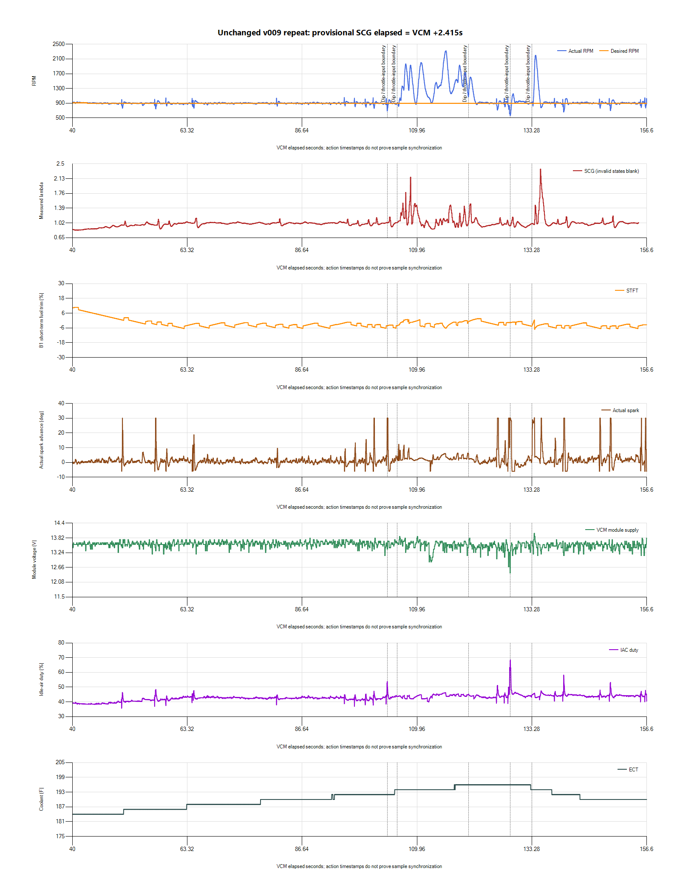
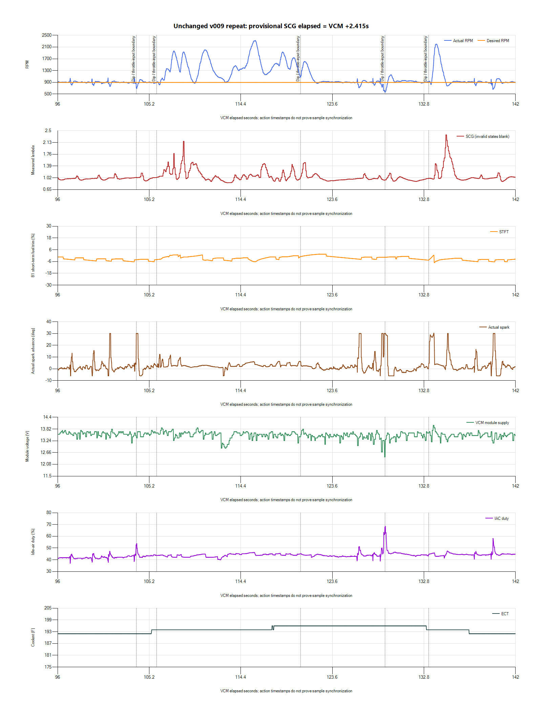

# v009 cross-session diagnosis: idle air, spark and load response

**The leading calibration hypothesis is an unstable idle air/spark balance or
handoff under the post-drive conditions, with load disturbances making some
events much deeper.** The evidence supports investigating that mechanism. It
does not yet identify a particular gain, MBT cell, dashpot value or hardware
component as the root cause. No calibration was changed during this review.

The latest run remains exact v009900 by explicit owner confirmation. It saved
and exported successfully as `paired-20261027-205952-414a073f`, with no manifest
errors. Originals, SQLite backup, hashes, owner context and analysis are retained
privately in `logs/2026-10-27-v009-repeat-idle-01/`. All10 calibration binaries
still match the revision catalog. The owner reports dips and some deliberate
throttle input in this run.

## What changed across runs

| Recording | Relevant observed minimum | Interpretation limit |
| --- | ---: | --- |
| v008950 fan run | 835.5RPM | One fan/load cycle; different target/history |
| v009900 before first drive | 810.75RPM during the fan/load event | Long parked run, different startup/accessory history |
| v009900 hot restart before drive | 798.5RPM | Short restart/fan capture |
| First drive return-to-idle | 639.5RPM at200.703s;390.75 at214.146s | Speed/clutch unavailable; latter follows throttle activity |
| Stationary after drive | 629.75RPM at201.494s;667.5 at211.988s | Owner confirms driveway idle; no throttle change at main dip |
| Latest unchanged v009 | 690.5RPM at103.911s;571 at128.900s;661.75 at139.722s | Manual throttle activity separated below |

The390.75RPM event deserves correction to the first-pass drive summary. At
214.146s it coincides with spark29.75/Base-MBT, IAC96.65%, voltage11.6875V,
closed throttle and Fuel Source Stoich. RPM recovers through777 at214.486s
and1112 at214.992s, where spark reaches−6deg. This precedes the end disconnect
and should not be dismissed as an end-of-file zero. Driver/clutch/key context
is unavailable, so its precise physical trigger is still unestablished.

The comparison supports deterioration under later operating conditions. It
does not isolate driving itself as the cause: temperature history, accessory
load, fuel level, restart state and learned airflow were not all controlled.

## Air/spark operating point

The following descriptive subset uses ECT187–191F, elapsed time beyond40s,
near-target RPM850–950 for900 runs, and closed-throttle evidence. Where the
throttle-state channel is blank, absolute TPS below190counts is an explicit
analysis proxy based on the observed182–185count closed region. This is not
a proposed calibration threshold. These subsets exclude the deepest dips and
are not fully load-matched causal experiments.

| 900-RPM recording | Mean RPM | Mean spark | Mean IAC duty | Mean MAF |
| --- | ---: | ---: | ---: | ---: |
| Before drive | 901.23 | 9.00deg | 38.50% | 0.6040lb/min |
| First stationary run after drive | 902.16 | 2.84deg | 41.12% | 0.6301lb/min |
| Latest repeat | 901.40 | 1.07deg | 43.14% | 0.6286lb/min |

The same nominal target is being held with a different balance: more commanded
IAC and more-retarded spark in later subsets. Possible explanations include
different load, airflow/adaptation, or the controller's response to instability.
IAC duty is a command, not measured valve position or proof of actual flow.
This table alone cannot establish excess base airflow or a sticking IAC.

The earlier900 run had populated LTIT P/N-A/C-off near−0.215lb/min in this
subset. That channel was removed from the later focused profile, and STIT was
already often missing. Consequently, the present logs cannot establish whether
learned idle-air correction changed after driving. Restoring and validating
idle adaptation/control-mode data is more useful than assuming a learned change.

## Latest run: separate throttle input from dips

Raw absolute TPS rises clearly above its closed region in several intervals
between105.942–120.422s, and again133.269–133.834s. These are consistent with
the owner's deliberate throttle inputs. The engine reaches2319.25RPM; this
portion is not steady idle and its mixture excursions are not a fuel-correction
dataset.

- The690.5RPM dip at103.911s occurs about2seconds before the first clear input.
  Earlier dips at50.127s(764RPM) and56.915s(745.5RPM) also precede those inputs.
  The problem cannot be attributed solely to the deliberate throttle blips.
- The571RPM event at128.900s is about8.5seconds after the preceding input ends.
  Its immediate TPS is steady near184.82counts. This keeps post-throttle air
  decay in consideration but does not prove dashpot is active or responsible.
- Coolant is196F, module voltage12.4375V, spark30deg/Base-MBT and IAC68.19%
  at that minimum. The surrounding cooling/load signature is consistent with
  a fan/load event, but fan command/current is not recorded. Low voltage may
  be a contributor, a consequence of low alternator speed, or both.
- At139.722s the recorded minimum is661.75RPM with spark10.25deg labeled
  Idle Feedback. Other source transitions occur nearby. The source label at
  one exported row does not capture the whole event or establish its cause.

## What the MBT pattern does and does not establish

The owner is right to focus on repeated source switching and deepening dips.
The [handoff inspection](2026-10-27-v009-idle-handoff-review.md) verified
ECM47996 Idle Spark Proportional Gain2.000 and ECM44582 Spark Idle Minimum−6deg.
Editor describes higher gain as more aggressive corrections. The latest
128s event again cycles through Idle Feedback, the−6deg minimum clip, Base/MBT
with large advance, then minimum clip after overshoot.

This is compatible with insufficient damping, a changing airflow/load state,
or repeated transitions between controller limits. It is also compatible with
the controller reacting to an external disturbance. Some earlier Base/MBT
entries recover without a deepening fall. Thus the label is neither proof of
a bad MBT table nor proof that the handoff is harmless. Reducing the whole MBT
table would alter more than the idle-control behavior and is not selected.

Dashpot remains relevant to return-to-idle. Verified desired-RPM air lookups
change when the target is lowered; speed gates and clips are also present.
But no commanded dashpot-airflow channel was recorded. Repeated dips after
long stationary intervals and before new throttle input weaken a single
post-lift decay explanation for every event. A throttle-potentiometer glitch
is weakly supported: raw TPS is stable through the large stationary dips.

## Fuel, ignition and data limitations

1. **Fuel pressure remains unknown.** The exploratory40psi fields and near5V
   sensor signal were not validated on this return-system conversion and were
   removed. Low fuel is a credible owner-supplied context, not a pressure
   diagnosis. Whether/how much fuel was added before the driveway logs was
   requested and remains unspecified in this report.
2. **Misfire is not excluded.** New counters report0/No; readiness Complete and
   no confirmed emissions DTCs do not independently prove combustion was stable.
   No cylinder-level validated misfire or dedicated knock-retard data exists.
3. **Do not fuel-correct against the displayed command.** In the reviewed logs,
   Equivalence Ratio Commanded follows `1−STFT/100` to rounding precision.
   Those are not independent signals. Exact open-loop semantics must be
   established before selecting a MAF/injector/base-fuel adjustment.
4. **Latest flag coverage is incomplete.** Air Load, Open Loop Conditions,
   Throttle State, CL Active, CL Ready and FMEM are blank. Raw TPS, torque source,
   speed and misfire fields populate. Driver Dem stays constant; its dynamic
   behavior is not validated by this stationary run.
5. **Subsecond order is provisional.** Latest VCM has6666 exported rows over
   1.656–156.636s with no gap over0.3s. SCG has1595 valid rows plus warmup/error/gap
   states excluded from mixture summaries. Host alignment is fresh:
   `SCG elapsed = VCM offset +2.4145s`. Cross-device delay/drift is uncalibrated.
   Many VCM rows contain intermediate fractional values and asynchronous
   updates. Turning off “Interpolate Data Gaps” does not establish synchronous
   ECU sampling or permit causal claims from a20–30ms row separation.

## Ranked next steps

| Hypothesis | Evidence supporting investigation | What would distinguish it |
| --- | --- | --- |
| Idle air/spark balance and handoff stability | Changed near-target air/spark operating point; repeated min-clip/MBT swings and overshoot | Validated idle-air adaptation/mode data; controlled single-variable comparison under matched warm conditions |
| Fan/electrical or other load disturbance | Large571RPM and391RPM events coincide with supply dips and large IAC response | Actual load/fan state and independent supply measurements; not just inferred coolant boundaries |
| Fuel delivery/combustion instability | Owner low-fuel report; transient wideband excursions; pressure unmeasured | Real pressure measurement under the observed condition and validated combustion evidence |
| Dashpot decay | First-drive/return-to-idle timing and some post-throttle events | Actual dashpot state/airflow; compare events without prior throttle input |
| TPS hardware glitch | Little support in these stationary windows | A repeatable raw TPS discontinuity; presently absent |

The existing950-RPM v008 comparison remains a useful reversible test of target/
airflow margin, not a claimed repair or an MBT diagnosis. A gain-only candidate
is another possible controlled experiment after these conditions are reconciled;
no particular replacement value is justified merely because the present gain
is2.000. Do not combine target, base airflow, dashpot, gain and fuel changes.

No further near-stall reproduction is needed to show the symptom exists. The
current deliverable is a preserved, cross-run diagnosis and a narrower test
plan—not a declaration that the cause is solved or a new tune to flash.
