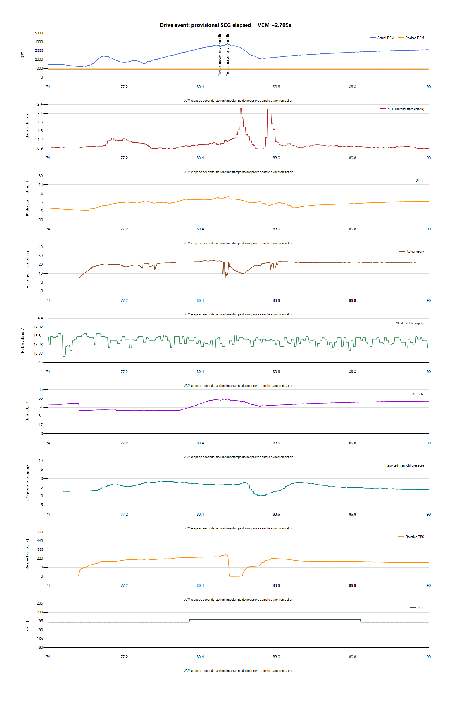
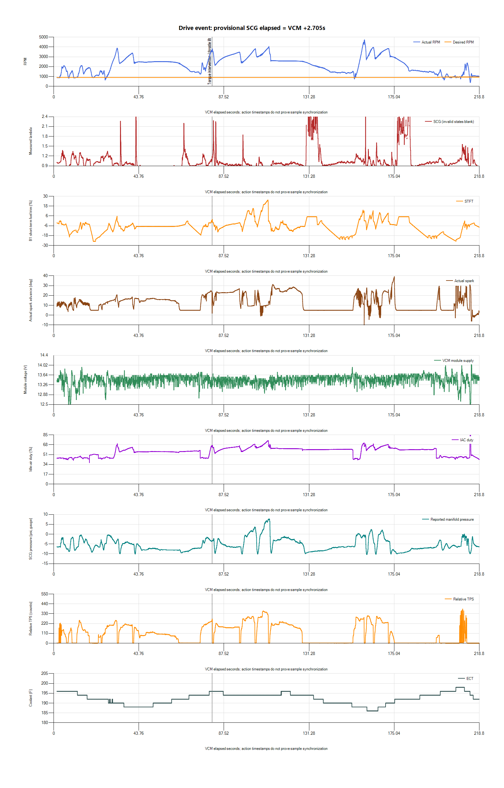

# First drive: disturbance near 1:22

The later [cross-session review](2026-10-27-v009-cross-session-diagnosis.md)
also identifies a390.75RPM dip at214.146s followed by recovery. This precedes
the end disconnect and corrects the first-pass emphasis on the639.5RPM event.

The owner-marked event coincides with a brief recorded spark reduction under
the `Torque Control` source before the throttle closes. The strongest next
step is to identify that torque request and check combustion/fueling evidence,
not disable torque intervention or add a guessed amount of fuel. Hold the idle
target at900 and pause further loaded testing until this event is understood.

This is a provisional v009 drive attribution from the previously confirmed
installed file and instruction to retain it; no ECU readback was performed.
Water/meth is OFF by standing owner instruction. The owner reports a weird
issue in low gear around4000RPM at approximately1:22. Exact symptom and whether
lifting/shifting was a response to the issue have been requested.

## Recording and timing

Source `paired-20261027-201529-d51d911e` finalized with no manifest errors or
missing files. Native HPL, SCG database, CSVs, hashes and analysis are preserved
privately under `logs/2026-10-27-v009-drive-01/`. All10 numbered tune binaries
still match their cataloged sizes and SHA-256 hashes.

VCM has9474 rows,1.597–225.304s; SCG has2719 rows with2671 valid,35 oxygen,
11 warmup,1 gap and1 stopped marker. SQLite integrity is `ok` and the session
is finalized. Near the end, VCM has a3.079s gap at218.839–221.918; SCG also
has end gaps/status changes. End zero values are not evidence of an in-drive
voltage or coolant failure. No VCM gap overlaps the1:22 event.

Fresh host metadata yields provisional alignment:
`SCG elapsed = VCM offset + 2.704958 seconds`. Thus an SCG1:22 marker maps
near VCM79.3s, whereas VCM1:22 means82s. The detailed review covers both
possibilities. Sensor/transport latency and inter-device drift are uncalibrated;
the aligned plots do not prove the exact sequence of exhaust and intake events.
Exported VCM rows can include interpolation/asynchronous channel updates.

## Event sequence

| VCM time | Recorded observation |
| --- | --- |
| 75.9s | Fuel source becomes Power Demand Enrich; closed-loop flag turns No. |
| 80.9–81.2s | About3537RPM, spark24.5 degrees, source Borderline, throttle Part. |
| 81.324–81.371s | Brief Torque Control source interval. |
| 81.414–81.556s | Another Torque Control interval; minimum spark2.0 degrees at81.437s, RPM3654.5, absolute TPS450.6counts, throttle Part. |
| Before closure | RPM reaches3821.25. Module supply during80.5–81.65s remains13.125–13.5625V; coolant196F. |
| Around81.6–81.65s | Absolute TPS drops toward183counts and throttle state becomes Closed. |
| 82.0–83.0s | RPM falls through3433 to2189, then throttle is reapplied. No speed/clutch data establishes the gear or confirms a shift. |

The recorded spark intervention precedes the closed-throttle state, making it
more relevant than attributing the whole disturbance to normal lift-off. The
source label does not establish why torque reduction was requested, whether
it caused the driver's sensation, or whether combustion also became unstable.
No knock-retard, misfire counter, vehicle-speed, clutch, torque-requestor,
fuel-pressure or injector-pulse channel is recorded.

Over the provisionally aligned80.5–81.65s window, SCG reports vacuum of about
−3.73 to−3.27psi,0% commanded WGDC and lambda1.023–1.176. Over81.25–81.65s,
only four valid SCG rows are available, averaging lambda1.138. This is
a lean-side observation around the disturbance, not a demonstrated fuel-table
error. The much larger lean excursion after throttle closure must not be used
as a steady-load fueling correction. Unburned oxygen from misfire can also
produce a lean wideband indication; measured lambda alone cannot distinguish
fuel shortage from combustion failure. See the manufacturer's
[wideband guidance](https://www.gtechpro.com/manual/EGS1.0.pdf).

The event is above the1500–2000RPM region altered in the inherited ECM32731
experiment; higher cells were unchanged. It is also not in Idle Feedback spark
control. Neither the low-RPM threshold edit nor the900-RPM target is proven
to be the cause. Earlier state transitions remain relevant to review.

## Other findings in the drive

- Maximum recorded RPM4727.75. Coolant remains at or below198F before the
  end disconnect/zero values; no overheating episode is shown in this capture.
- The run includes positive SCG pressure. Peak reported pressure is7.7815psi
  near provisionally mapped VCM110.571s, with lambda0.761 and commanded
  WGDC5.963%. SCG pressure and nonzero WGDC scaling have not had an independent
  reference comparison. Treat this as reported boost, not a precise verified
  pressure measurement or proof that operation without water/meth is validated.
  The marked81s event itself is in reported vacuum.
- Return-to-idle needs attention: the195–205s window includes a639.5-RPM
  minimum, with closed throttle/deceleration logic prominent and B1 STFT
  averaging−18.0%. Vehicle speed and clutch state are missing, so clutch/load
  release, moving idle and dashpot behavior cannot be separated reliably.
- Closed-throttle deceleration at185–195s has spark near5 degrees with the
  source Closed Thr.Decel. That is a different control state from stationary
  idle; do not flatten its spark based on an idle trace.
- STIT, IAT and three O2 fault/heater fields are blank. No scan of current or
  pending DTCs was performed; the prior no-CEL report does not establish that
  no pending faults exist after this drive.

The exported Equivalence Ratio Commanded channel equals
`1 − B1 STFT/100` throughout all9474 rows, within5e−11. These are not
independent fuel-command observations. Its exact meaning in open loop requires
verification before interpreting it as base commanded lambda or calculating
MAF/injector corrections. STFT reported during open loop is not assumed active
feedback solely because values are present.

## Next action

1. Reconcile the owner's sensation and pedal/shift action with the81s sequence.
   Preserve this recording; another loaded reproduction is not the first step.
2. Read current/pending faults without clearing them. Inspect controller-supported
   knock/misfire, torque request/source, vehicle-speed and clutch-state logging;
   validate actual recorded values before relying on a larger profile.
3. Inspect the corresponding v009 torque/spark controls and compare relevant
   inherited settings with the original baseline. HP Tuners documents
   [spark retard as a torque-reduction method](https://www.hptuners.eu/help/vcm_editor_parameters_ford_eng_tm.htm),
   but its generic reference does not identify the requestor in this SVT event.
   Do not disable protective torque/knock logic to suppress a source label.
4. Separate combustion/ignition/fuel-delivery checks from calibration guesses.
   The previous coil-tap reset history is context, not evidence of a current
   coil fault; the purple RPM wire stays disconnected.
5. Address moving return-to-idle before another idle-target reduction. Keep900
   for comparison; v008950 is the prior tested stationary rollback, not a
   guaranteed cure for this driving event. No new tune or ECU write was made.
