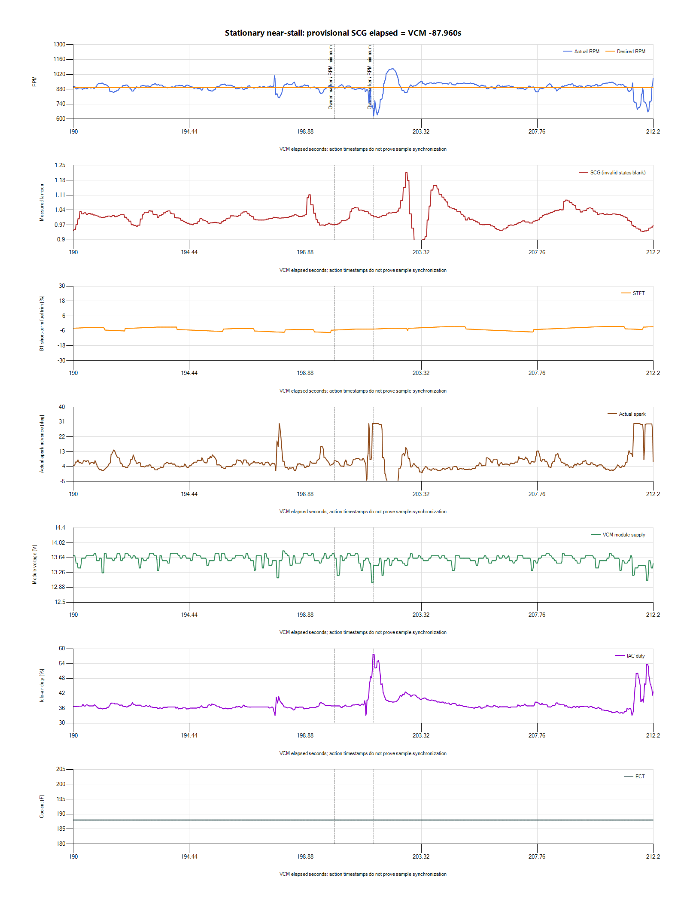

# Stationary near-stall at the 3:20 marker

The [handoff reassessment](2026-10-27-v009-idle-handoff-review.md) investigates
the owner's repeated Base/MBT observation, pre-dip spark/IAC reduction and
verified gain/dashpot controls. Advance during recovery does not establish
that the handoff is harmless or that no control interaction contributes.

The requested log captured **629.75RPM at VCM201.494s**, against desired896RPM.
Speed is0mph and throttle is closed. Spark advances to30degrees and IAC rises
to57.7%, rather than showing the Torque Control spark reduction seen in the
first drive. These are distinct events; neither is diagnosed by its source
label alone. The owner reported several near-stalls while sitting in the driveway.

## Capture and timing

Native HPL, both CSVs, finalized SCG SQLite, hashes and analysis are preserved
privately in `logs/2026-10-27-v009-idle-dips-01/`. VCM was already recording
when paired start was requested. Its recording was preserved and SCG started
separately at20:41:04 local. No paired timing manifest exists for this capture.

VCM contains8634rows over1.945–212.219s. Fresh host metadata gives provisional
alignment `SCG elapsed = VCM offset −87.960260s`. SCG does not cover the first
roughly88seconds of VCM, but does cover the marked dip. Sensor/exhaust transport
delay and inter-device drift are uncalibrated. The SCG database finalized,
passed integrity checking and exported; VCM also saved and exported successfully.

## Findings

- Dips below750RPM occur near87.7,119.0,201.5 and212.0s. The final dip reaches
  667.5RPM. Initial0RPM/cranking-source rows are separate from settled idle;
  their meaning needs owner context rather than assuming another running stall.
- At201.494s: coolant188F, voltage13.4375V, absolute TPS182.82counts,
  Torque Source Driver Dem, Spark Source Base/MBT, Fuel Source Stoich.
  Spark and IAC rise strongly. The next1–3s average921.2RPM: recovery occurs,
  but the depth and recurrence do not support declaring stationary idle finished.
- Over195–205s, mean901.7RPM masks the629.75 minimum and1072.5 maximum.
  Coolant stays188F in the detailed interval, without a temperature transition
  establishing fan engagement at this dip.
- The same ten-second window includes a wideband excursion up to lambda1.216
  followed by richer readings. Provisional timing and oxygen measurements alone
  do not select a fuel, airflow, injector or spark-gain correction.
- Torque Source stays Driver Dem, Total Misfires0 and Misfire Detected No.
  Counter behavior/sensitivity is unvalidated; these observations do not exclude
  combustion instability.
- Pressure channels remain exactly40psi with sensor voltage near4.995V; MAP
  reads0psi. None establishes actual fuel-pressure health on this return-system
  conversion. Borderline Knock and four loop-state fields are blank. Fuel
  Source Stoich alone does not establish active closed-loop feedback.

The owner reports substantially smoother low-end driving on the preceding trip
and low fuel as a possible explanation for its isolated blip. Pressure was not
independently measured, and current refueling amount/level is not recorded.
Water/meth remains OFF. No tune changes or ECU writes were made for this test.

## Template validation

The exploratory33-channel capture used actual Scanner selector entries and
Scanner-saved IDs, types and address attributes. The original configuration
and33-channel capture configuration are backed up privately.

The reusable [28-channel template](../profiles/2004%20Focus%20SVT%20-%20Drive%20Torque%20Diagnostics.Channels.xml)
is loaded. It retains core RPM/TPS/spark/fuel/airflow plus Torque Source,
Total Misfires, Misfire Detected, Vehicle Speed, Brake Pedal and Trans In Gear.
Unvalidated pressure/MAP and blank Borderline Knock fields were removed.
Loop-state intervals returned to their previous500ms values after failed
population in this capture. The final28-channel combination still needs a
saved-log coverage check. Speed0 at rest does not validate moving scaling;
Trans In Gear is not a dedicated clutch switch.

No dedicated knock-retard or clutch-switch leaf was exposed in this selector.
Borderline Knock is a spark-table value, not knock retard. The pre-capture
read-only diagnostics result was0confirmed emissions DTCs, MIL False and
No DTCs detected; pending coverage was not separately identified. No codes
were cleared. Misfire readiness Complete is not proof against later misfires.

## Decision

Keep the vehicle parked instead of repeatedly reproducing near-stalls. Preserve
corrective spark while investigating the air/fuel/load sequence. v008950 is
the available previous stationary rollback if the owner needs to revert the
lower target under normal write conditions; it is not a proven cure for the
separate driving disturbance. v009 is retained for analysis, not accepted for
driving or further idle reduction. No new tune was prepared or flashed here.
