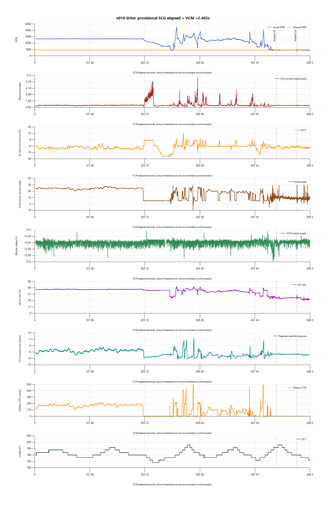
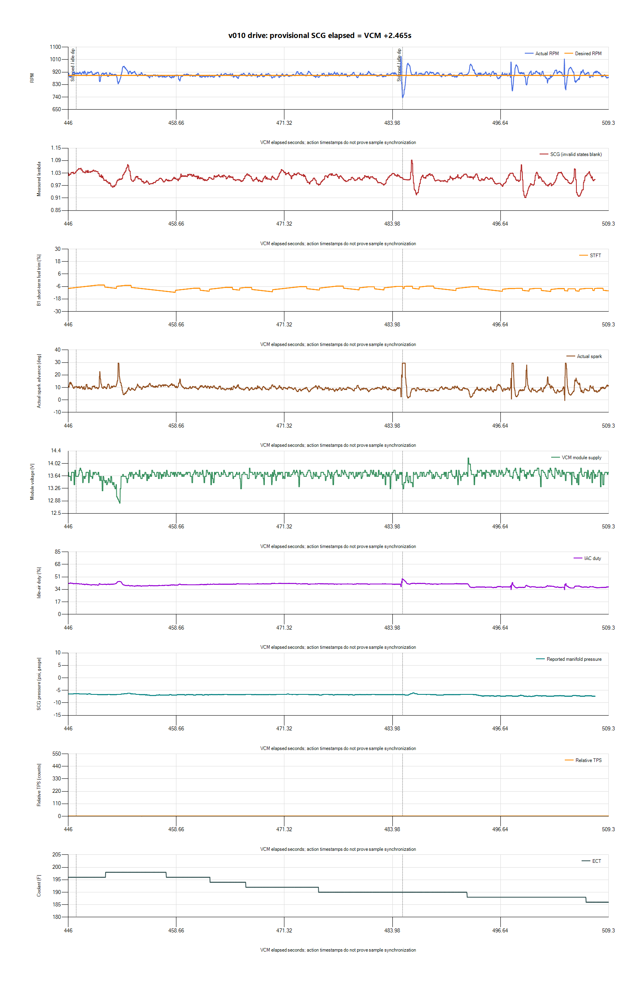

# v010 cruise, acceleration and return-to-idle review

The owner explicitly confirms v010 and reports very good cruise, good
acceleration without the previous hesitation, and remaining idle dips. The
recording supports a smaller next idle-gain experiment. It does not establish
that gain alone caused the improvement or that fuel delivery/boost is validated.

## Source and validity

`paired-20261027-221039-985bf46e` saved and exported without manifest errors.
Native HPL, CSVs, SQLite backup, hashes and analysis are preserved privately in
`logs/2026-10-27-v010-drive-01/`. SQLite is finalized and integrity checked.
All11 existing calibration binaries match their recorded hashes and sizes.

VCM has21,202rows over1.626–509.315s. Fresh provisional host alignment is
`SCG elapsed = VCM offset +2.464829s`. Independent sensor/transport timing and
drift are not calibrated. A3.923s VCM gap occurs at240.078–244.001s, so that
part of the deceleration cannot be assessed continuously. Exported rows are
asynchronous and can contain intermediate values, not independent synchronized
samples. Invalid SCG statuses are excluded from mixture statistics.

## Cruise

The first190seconds are steady cruise around61mph. Mean RPM2678.64, range
2643–2717.75, SD10.77. ECT188–196F. Measured lambda averages1.0186, with
transient range0.871–1.116. This agrees with the owner's smooth-cruise report,
but it is not a calibrated fuel-error measurement.

Fuel Source reports Power Demand Enrich throughout that interval. CL Active,
CL Ready, Open Loop Conditions and FMEM are blank; Air Load is also blank.
Do not infer actual closed-loop operation from smooth running or use the
displayed commanded-equivalence/STFT relationship as independent command data.
The prior inherited open-loop TPS change remains in scope for review; no fuel
table or injector correction is selected from this capture.

## Acceleration and torque signals

Torque Source now changes between Driver Dem, Oscillation, TipOut Limit and
TipIn Limit, so it is not simply constant in all operating conditions. At
292.791s, timing reaches−14.5deg with Spark Source Torque Control and Torque
Source Oscillation, around3276RPM/42mph. The owner did not feel the old
hesitation. This establishes the recorded label and intervention, not the
precise physical requestor or proof that every reduction should be removed.
Retain these driving controls.

The recording includes brief WOT-state observations and reported positive
SCG pressure, peaking6.307psi at provisionally mapped VCM294.485s with
lambda0.911 in the same SCG sample. Pressure scaling lacks an independent
reference comparison, and exhaust/intake timing differs. This transient is
not boost/fueling acceptance. Water/meth stays OFF and the OEM fuel-pressure
sensor installation remains pending. No boost or fuel correction is bundled.

## Return-to-idle

Stops are recorded at247.782–256.525s and446.932–509.315s. The first stop's
minimum is811.75RPM. The final stationary interval has:

| Measurement | Result |
| --- | ---: |
| Mean RPM | 900.91 |
| RPM SD | 22.62 |
| Minimum / maximum RPM | 737.25 /1032 |
| Coolant range | 186–198F |
| Mean measured lambda | 1.0035 |
| Measured lambda range | 0.912–1.092 |

The worst dip is485.190s: closed throttle,0mph,190F, spark29.5/Base-MBT,
Torque Source Driver Dem and IAC47.93%. RPM reaches845.25 at485.493s,
965.75 at485.997s and approximately895 at487.004s. Additional minima are
784.5 at498.011s and792 at504.289s. No zero-RPM/stall is recorded in this run.
Reported misfires remain0/No; that does not independently validate sensitivity.

The earlier v009 drive included639.5 and390.75RPM events, and later parked
v009 captures reached629.75 and571. The present shallower minimum and quicker
recovery are encouraging and consistent with owner feedback. Different loads,
history and event counts prevent assigning the entire difference to gain.
Coolant rises and falls in the fan range, but no direct fan command verifies
the exact load cycle. Actual pressure remains unknown because the inherited
sensor transfer is flat40psi.

## Next iteration

Prepared [v011](../tunes/v011-idle-spark-gain-1p25.md): only ECM47996 idle
spark proportional gain1.500 to1.250 plus Notes. This16.7% step tests remaining
correction/overshoot while retaining900RPM, spark limits, MBT, dashpot, airflow,
fueling and torque controls. It is an experimental value, not a proven optimum.

Validate stationary warm idle and natural fan/load recovery first. Stop/revert
to v010 if dips deepen, recovery slows, near-stalling returns or hunting grows.
Compare minimum RPM and recovery as well as timing smoothness. If it fails to
help, retain v010 and investigate air/adaptation and actual pressure rather
than continuing to reduce gain automatically. No agent ECU write was performed.
