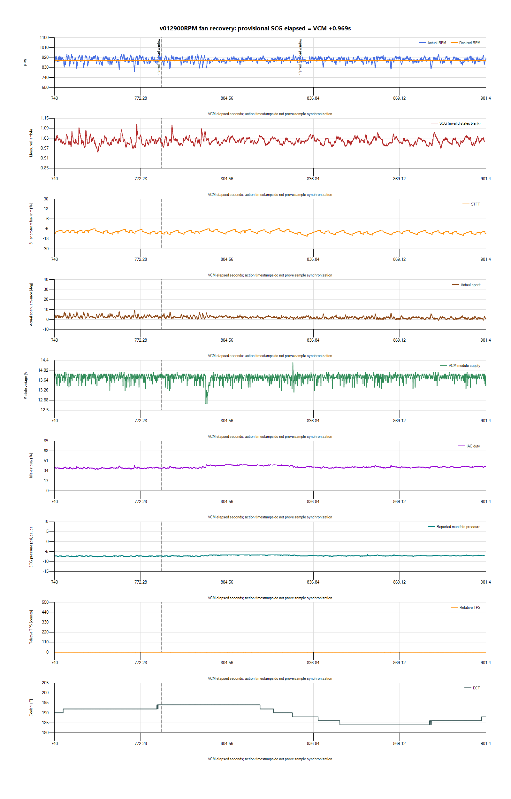

# v012 fan/load recovery: retain 900 RPM

Owner confirms exact v012 with no other tune/hardware changes. The requested
recording was monitored through an inferred fan/load cycle and at least
65 seconds of recovery, then stopped and exported successfully. Owner reports
steadier running, shallower dips and tighter timing; the following measurements
are the basis for the decision.

**Retain v012: 900 RPM, spark proportional gain 1.000.** The owner now prioritizes
stability and drivability over lower idle speed. The started 875-RPM draft was
withdrawn without flashing; its unsaved target edits were discarded and Editor
was restored to verified v012. No new calibration is justified by this result alone.

## Capture

Source `paired-20261028-084107-cb5de745`, preserved privately in
`logs/2026-10-28-v012-fan-01/`, includes HPL, finalized SQLite, both CSVs,
manifest, monitoring samples and owner confirmation. SQLite integrity passed;
both exports completed. VCM contains 38,343 rows over 1.600–901.497 seconds.
Every requested channel has at least some data; that does not validate every
sensor or guarantee constant coverage. Direct fan command is not requested.

Fresh host alignment: `SCG elapsed = VCM offset +0.969128s`. Cross-device drift
and sensor/transport latency are uncalibrated. VCM gaps occur at
169.888–172.429, 307.336–310.341 and 734.094–738.777 seconds, outside the chosen
fan/recovery windows. CSV rows are not independent simultaneous sensor samples.

## Results

| VCM interval | Mean RPM | Minimum RPM | RPM SD | Mean spark | Mean measured lambda |
| --- | ---: | ---: | ---: | ---: | ---: |
| 150–901.5 s, warm-period review | 900.33 | 751.00 | 30.33 | 6.78° | 1.0098 |
| 300–600 s, earlier steady interval | 900.42 | 792.00 | 33.04 | 9.01° | 1.0091 |
| 600–780 s, approaching fan temperature | 899.87 | 760.00 | 30.00 | 4.89° | 1.0061 |
| 780–833 s, inferred load/cooling window | 900.08 | 817.75 | 19.21 | 2.48° | 1.0157 |
| 833–901.5 s, recovery | 899.80 | 816.00 | 19.68 | 1.62° | 1.0139 |

Coolant reached a reported 194°F, IAC increased from roughly 40% to 44%, and
coolant fell through 188°F to 184°F as IAC eased back. This supports an inferred
fan/load cycle, not a directly measured command or motor-current confirmation.
Accessory-state clarification was requested but not received; do not silently
assume all cabin/electrical loads were off.

The lowest warm-period event was 751 RPM at 189.894 seconds, with 182°F coolant,
closed throttle, 0 mph, 30° Base/MBT and 13.625 V. Base/MBT occurs in only six
exported rows after 150 seconds; the fan and recovery windows remain entirely
Idle Feedback. No near-zero RPM/stall event is present in those warm windows.
This supports the owner's report of improvement but does not make the residual
dip or wider earlier RPM variation disappear.

The v010 drive’s last stopped minute averaged 900.91 RPM, minimum 737.25 and
SD 22.62. Today’s fan/recovery windows are encouraging relative to that record,
but different history, ambient conditions and unknown accessory loads prevent
attributing the whole difference to gain. The v012 result is not yet a
post-drive stability result.

## Decision and remaining gaps

Keep the 900-RPM target and gain 1.000 unchanged. Do not lower gain just because
the timing trace looks tighter, and do not lower the idle target against the
owner's updated priority. Preserve MBT, dashpot, torque, fuel and fan controls.
The next useful comparison is hot restart/ordinary load response and the same
v012 returning to idle after a gentle drive.

Actual fuel-pressure behavior remains unmeasured; the ECU’s flat-40-psi transfer
is not pressure evidence. Adaptation/dashpot-state history is incomplete.
Misfire counts and source labels do not independently exclude combustion issues.
These gaps constrain future edits; they do not erase today's observed recovery.

See the [stability and drivability roadmap](../docs/stability-and-drivability-roadmap.md)
for the complete history, measurement plan and conditional v013 decisions.
