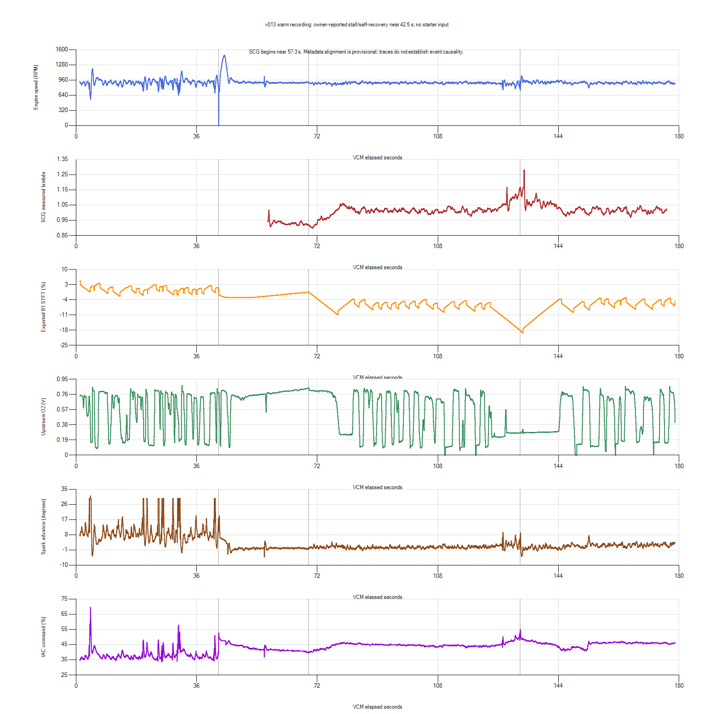

# v013: stall recovery and fuel-feedback review

## New evidence: owner reports pending P0320

**Further clarification:** the owner confirms the engine genuinely stopped,
then recovered without starter use, and suspects P0320 is incidental. Accept
the actual stall observation. The zero-RPM channel by itself cannot be used
to infer an electrical dropout. P0320 is still unresolved: no occurrence-time
evidence establishes it as the cause or a consequence of that stall. Earlier
signal-first emphasis is moderated; review the preceding air/fuel/spark
disturbance alongside this code. No parts replacement or closed-loop-disable
experiment is justified by this clarification.

After this review, the owner supplied `0x10: P0320 - Ignition/Distributor Engine
Speed Input Circuit (Pending)`. This is owner-reported code evidence, not an
independent tool read or confirmed MIL illumination. Occurrence time and
freeze-frame are unverified; do not claim it was set at the42.5s event.

Ford's [DTC description](https://www.fordservicecontent.dealerconnection.com/pubs/content/~WVX2/~MUS~LEN/14/VX24002.HTM)
associates P0320 with erratic PIP pulses and lists wiring/connectors and arcing
secondary ignition among possible causes. That reference is a1999 Ford PCED,
not this car's verified2004 SVT pinpoint procedure; no threshold or pinout is
transferred from it. The code strengthens the priority of signal/ignition
diagnosis alongside the exported RPM/run-state discontinuity. It does not prove
which component failed or establish that every idle dip has one cause.

Preserve all current/pending codes and available freeze-frame before clearing.
Inspect engine-off CKP/CMP wiring, coil/HT leads/plugs, power/grounds and the old
tach-tap area; keep purple RPM disconnected. Use exact vehicle wiring data and
qualified CKP/CMP/power waveform testing before component replacement. Pause
routine tune iterations and deliberate closed-loop-disable experiments.

The owner suspects narrowband-driven fuel hunting and wonders whether that
motivated its earlier disabled state. Biased/delayed feedback remains possible,
but normal voltage switching alone is insufficient evidence. Previous-owner
intent is unknown. Diagnose this alongside the specific P0320 evidence rather
than treating open loop as a repair or blaming the sensor from its swing alone.

**Decision: no v014 calibration change selected.** v013 remains experimental.
An owner-observed stall with self-recovery and later fuel-feedback excursions
are unresolved. Read fault memory and investigate engine-speed/run-state
continuity before changing gain, idle target, base air, MAF or injector data.
Nothing is recording; no ECU write, reset, DTC clearing or tune edit was made.

## Owner clarification and full-record correction

The owner clarifies that the engine **stalled and recovered by itself, without
starter use**. Earlier wording describing only a stumble is superseded. This
does not establish that crankshaft rotation physically stopped. The short
zero-RPM report and state changes need corroboration; the CSV alone cannot
distinguish transient loss of combustion, an engine-speed signal issue,
controller run-state behavior or an acquisition/reporting problem.

The earlier quoted minimum745RPM applies only to the later wideband overlap.
The full manual VCM capture includes much deeper earlier dips:

| VCM elapsed | Observation | Context |
| --- | --- | --- |
| 4.284s | 544.5RPM, timing31 degrees, IAC69.57% | Base/MBT; CL Yes; STFT+1.64%; no SCG coverage |
| 30–31s | Minimum638.5RPM | Multiple spark-source transitions; no SCG coverage |
| 42.504s | 835.5RPM | Idle Feedback;13.75V |
| 42.525–42.585s | Four exported zero-RPM rows | Fuel changes Stoich to Cranking; Spark to Crank/Runup |
| 42.606s | 751.25RPM | Cranking, then startup fuel state |
| Following recovery | RPM reaches1480.75 | Cold-start spark/fuel states despite ECT186F |
| 69.404s | CL returns Yes; Fuel Source Stoich | End of approximately26.84s reported open-loop interval |
| 132.619s | 745RPM, IAC54.99%, timing9.25 | Idle Feedback; CL Yes; STFT-18.22% |
| 133.395s | Exported STFT-19.30% | RPM909.25; O2 approximately0.325V |
| Nominal133.684s | SCG lambda1.281 peak | Metadata-based mapping; not a causal timestamp |

RPM already falls during Idle Feedback in the earlier event sequence. All
later overlapping Spark Source rows are Idle Feedback. MBT is therefore neither
a sufficient explanation for every dip nor established as its initial cause.
IAC duty is command, not measured valve position or delivered airflow.

## Fuel feedback: separate normal switching from this excursion

Much of the O2 trace switches between low and high voltage. Switching-type
sensors have a sharp response near stoichiometric, so that behavior can coexist
with much smaller measured mixture changes. It does not justify replacing the
sensor or flattening its signal. [Bosch sensor description](https://www.bosch-mobility.com/en/solutions/sensors/switching-type-lambda-sensor/).

The complete trace also has longer low-voltage intervals and correlated
wideband excursions. At nominal VCM130–133.5s, wideband lambda averages1.118,
RPM reaches745, and the exported trim averages-17.07%. At134–138s, lambda
averages1.068, while O2 remains near0.284V and trim averages-14.00%. These
are not adequately described as harmless rapid rich/lean switching.

Do not convert these numbers directly into a fuel correction. Historical
commanded-mixture exports duplicate `1 - STFT/100`; their algebraic agreement
does not provide two independent observations. Verify Scanner definition/sign,
the controller's fuel-feedback behavior and any relevant O2 switching/bias
settings before treating the trim display as an independent corrective command.
The original upstream sensor and SCG LSU are separate, owner-confirmed sensors.
Their positions, response delays, exhaust integrity and current measurement
accuracy have not been independently checked in this review.

The startup-state interval at nominal57.3–69.4s averages lambda0.931. After
return to closed loop,70–176.4s averages lambda1.020, RPM898.48 and exported
STFT-7.23%, with persistent dips. Averaging all of these intervals together
hides both the state transition and lean excursion.

## Comparison with unchanged-v012 evidence

| Session/window | ECT F | Mean/min RPM | Mean SCG lambda | Mean exported STFT |
| --- | --- | --- | --- | --- |
| v012 pressure-video150–182.7s | 184–186 | 898.14 /763.75 | 1.0165 | Missing |
| v012 post-drive225–274.5s | 188–196 | 901.31 /708.5 | 0.9913 | -5.73% |
| v013 manual70–176.4s | 186–196 | 898.48 /745 | 1.0201 | -7.23% |

These windows have overlapping temperatures, but different preceding runtime,
adaptation, loads and durations. They do not establish improvement or regression
from the single v013 scalar. In particular, comparing only the v013 period
after the self-recovery would exclude its worst behavior.

The historical scan of preserved files named `vcm.csv` found v012's confirmed
stationary stall remaining at zero, and its moving-off stall with a longer zero
interval before low-speed cranking. The v013 warm zero interval returns directly
to751RPM. A v009 initial cranking capture also has a brief zero interval, but
that is a different starting condition. This inventory is not proof that every
historical log format or native record has been exhausted.

## Diagnostic order

1. Read and preserve stored/pending DTCs and any available freeze-frame before
   clearing anything. Prior absence of a MIL is not a current DTC reading.
2. With the engine off, inspect CKP/CMP connectors and accessible harness,
   engine/ECU power and grounds, and modified ignition wiring for damage,
   looseness or heat exposure. Leave the SCG RPM wire disconnected. Do not
   replace a sensor from this CSV alone. A qualified scope capture of CKP/CMP
   and relevant power during an event is stronger evidence than sampled scan
   RPM. [HELLA diagnostic guidance](https://www.hella.com/techworld/en/technical/sensors-and-actuators/crankshaft-sensor/).
3. Verify the Scanner trim/command definitions and inspect applicable fuel-loop
   switching/bias/delay calibration read-only. Do not infer a replacement value
   or disable feedback to mask the event.
4. If a further running capture is appropriate after those checks, use the
   [focused test card](../docs/next-stationary-test.md). Both recorders must be
   confirmed active before the event; the previous first57s lacked SCG.
   A short, supervised parked capture ends at the first severe stumble/stall,
   rather than repeatedly reproducing it or waiting for a fan cycle.

The next profile is prepared only: existing13 fuel/core fields plus the saved
Engine Run Time2131 definition at1s. Runtime historically saturates at255s;
it is context, not a high-speed CKP test or proof of an ECU power reset. Restore
the existing13-field profile if acquisition degrades. No profile was loaded.

## Preservation and plot

Native HPL/CSV, SCG SQLite/CSV and original context are preserved. SCG database
integrity/finalization passed. Updated owner clarification is recorded here;
original capture context was not overwritten. Fourteen cataloged tune hashes
and sizes remain the identity baseline; no numbered binary was edited.

SCG begins near VCM57.3s. Metadata mapping is SCG elapsed = VCM elapsed
-56.581945s; drift, actual exhaust delay and subsecond synchronization remain
unverified. Plot alignment is for context, not pointwise tuning or causality.
