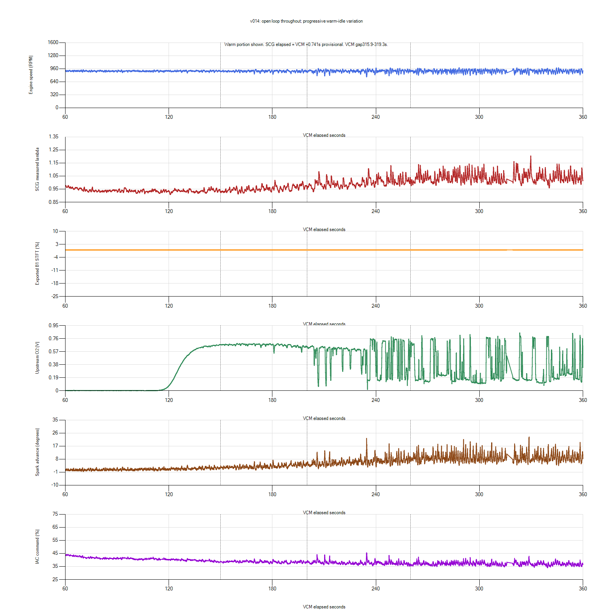

# v014 open-loop isolation result

**The isolation worked, but progressive idle variation remained.** Closed Loop
Active is No in all17,897 VCM rows. After cranking, Fuel Source is Power Demand
Enrich; exported STFT is exactly0 throughout60–362.6s. No zero-RPM event appears
after startup in available VCM data. This is not a successful permanent repair
or evidence that feedback must be disabled for ordinary driving.

## Capture quality

Owner confirmed v014 installed before start. Source:
paired-20261029-185239-7271be01-v014. Both recorders stopped/exported automatically
after the six-minute acquisition window. Manifest saved, no errors/missing
files; SCG SQLite integrity and finalization passed. All15 cataloged tune hashes
and sizes match. Native files, CSVs, profile snapshot and context preserved in
private logs/2026-10-29-v014-idle-01. No new calibration or ECU write performed.

All13 requested VCM channels have data. VCM span1.080–362.616s, with a3.422s
gap315.895–319.317s. Do not infer continuous coverage in that interval.
Metadata gives SCG elapsed = VCM elapsed +0.741371s; this remains provisional
and does not establish exhaust/sensor delay or subsecond causality. Pre-start
and invalid wideband data are excluded from the warm comparison.

## Progression at the same desired idle

Desired RPM reports896 throughout the windows below, consistent with the900
calibration target and observed export quantization. Spark Source is Idle
Feedback throughout these settled windows; closed-loop fueling remains off.

| VCM seconds | Mean/min RPM | RPM standard deviation | Mean lambda | Mean IAC duty | Mean timing |
| --- | --- | ---: | ---: | ---: | ---: |
| 60–150 | 901.0 /851.3 | 11.2 | 0.938 | 40.81% | 0.99 degrees |
| 150–200 | 898.4 /823.8 | 18.9 | 0.952 | 38.46% | 2.97 degrees |
| 200–260 | 900.1 /756.0 | 32.1 | 0.999 | 37.75% | 6.29 degrees |
| 260–315 | 900.6 /794.8 | 35.5 | 1.038 | 37.11% | 9.12 degrees |
| 320–360 | 900.5 /797.5 | 36.1 | 1.043 | 36.92% | 9.23 degrees |

These are sample-weighted descriptive statistics, not independent repeated
experiments. Early ECT164–184F differs from later184–192F, but deterioration
continues through a near-steady184F period. Mean module supply stays near13.7V.
TPS remains essentially closed. Fan command and injector pulse width were not
recorded; no fan-state attribution is made from ECT alone.

The strongest dip is756RPM at234.565s with IAC45.49% and22.25degrees under
Idle Feedback. Short dips become more frequent after approximately200s.
The run does not reproduce the earlier full stall, but does reproduce later
roughness/variation while feedback is inactive.

Mean measured lambda drifts from rich0.94 toward lean1.04 with zero short-term
correction. Late instantaneous lambda reaches1.204; combustion irregularity,
exhaust oxygen and alignment limit interpretation as fuel starvation. Mean MAF
declines from approximately0.595lb/min at120–150s to0.552 at300–360s, alongside
falling IAC command and rising spark advance.

## What this changes

Closed-loop feedback is **not necessary for the progressive dips captured here**.
This does not prove the narrowband system healthy or rule out feedback
amplifying a separate disturbance. It does mean that permanent open loop or
an arbitrary O2 gain change is not supported as the remedy.

The smooth initial OL interval is richer. Comparing that alone with leaner CL
would overstate improvement. Later OL lambda approaches/exceeds the prior CL
mixture and variation increases despite STFT stayingzero. v013's shorter
follow-up showed mean900/min827 over30–150s; v014's early comparison is similarly
stable, then deteriorates during the longer observation. Different temperatures,
runtime and prior states prevent a clean whole-session superiority claim.

## Next evidence to target

Astra's independent raw-log review also identifies upstream O2 near0.005V
through much of30–110s, despite provisionally aligned rich SCG lambda. Mean O2
is about0.009V at90–120s, then0.285V at120–130s,0.587V at130–140s and0.656V
at140–150s. This is a separate sensor readiness/heater/input-validity lead,
not proof of a failed sensor. Verify heater supply/control, wiring and sensor
response using correct vehicle data; do not treat the early voltage as valid
lean evidence or assume normal-looking later switching validates early feedback.
No heater measurement exists in this run.

Prioritize the underlying warm-idle air/fuel/runtime drift:

1. Record Engine Run Time and short/long-term idle-air adaptation alongside
   the existing fuel/core channels. IAC duty alone cannot tell us whether base
   airflow decay, learned correction or another command is driving the trend.
2. Review the already-verified165–200s base-air multiplier decline against
   actual runtime. First RPM above650 occurs atVCM16.244s, so that runtime
   region would approximately fall aroundVCM181–216s if the clock starts
   with the catch. This is a hypothesis, not a measured runtime or proof:
   mixture/variation continues changing after that region.
3. Obtain usable injector pulse width/command information if the controller
   exposes it; otherwise do not invent an identifier. Pressure-gauge video
   covering the same interval, referenced against manifold pressure, would help
   distinguish delivery changes from command/model changes. The existing flat
   ECU40psi channel remains invalid as measured pressure.
4. Retain the P0320 investigation and actual-stall history. No occurrence-time
   evidence ties that pending code to this capture.

No v015 selected from these aggregate trends. No new recording has been started.
The prepared16-field Fuel Air Runtime profile preserves all13 current definitions
and adds exact previously saved Engine Run Time2131, STIT2240 and LTIT2231
definitions; it is XML-checked only. Validate actual coverage before using it.
Runtime historically caps at255s. More configured fields do not guarantee data.

v014 remains a stationary diagnostic, not an accepted road/boost tune. The
documented rollback is exactv013, which itself retains unresolved instability;
no automatic flash/rollback has been performed.

The VCM gap is documented above; plotted lines are visualization, not evidence
of measurements during a missing interval.
