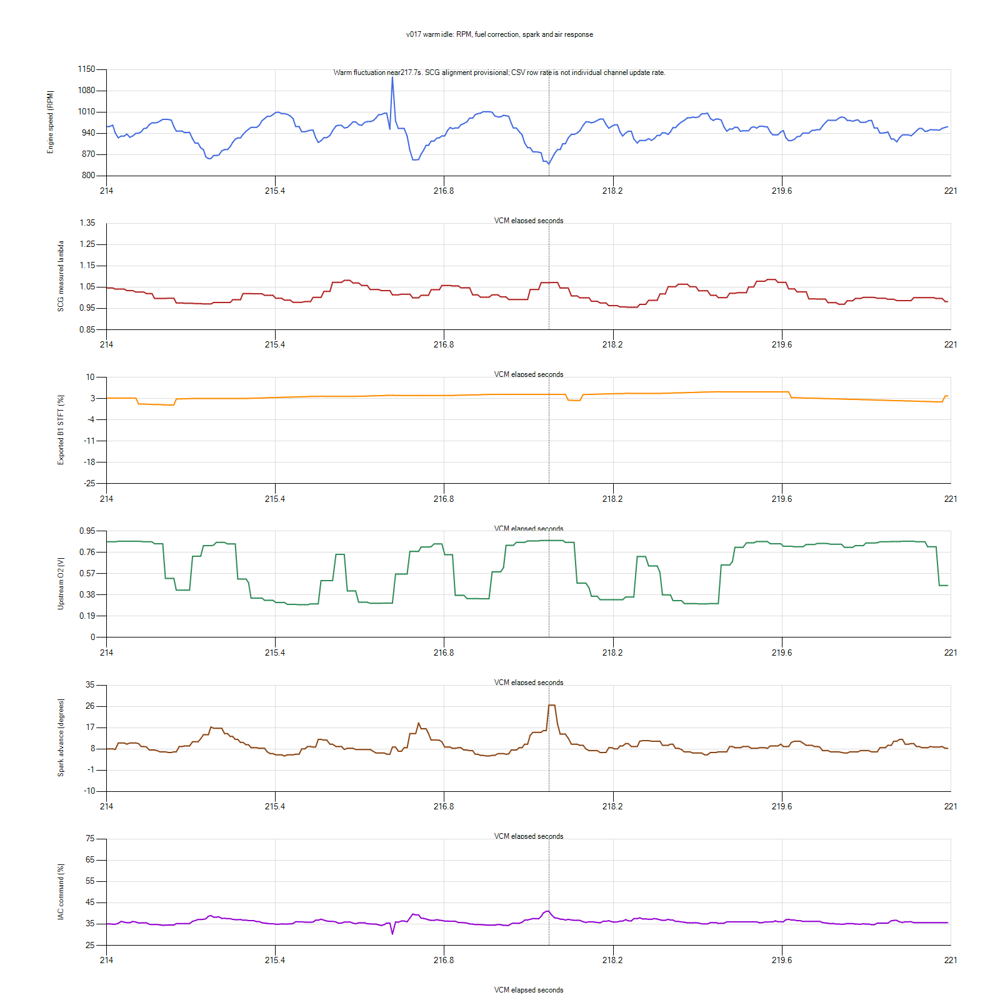

# Warm fluctuations: air, spark and fuel interaction

The warm oscillation is a separate unresolved problem from the rich closed-loop
entry event. Concentrating on entry temperature did not address the owner's
primary complaint. This review examines the three deepest separated warm dips
in each of v016 and v017, using existing recordings rather than another run.

## What the traces establish

Example v017 event at217.666s, well after closed-loop entry:

| VCM elapsed | RPM | STIT lb/min | IAC duty | Spark | STFT |
| --- | ---: | ---: | ---: | ---: | ---: |
|217.170|1011|−0.2011|34.49%|5.0deg|+4.370%|
|217.419|946|−0.2095|35.35%|8.5deg|+4.376%|
|217.666|839|−0.1920|41.00%|26.5deg|+4.376%|
|217.924|949|−0.1833|36.72%|9.5deg|+2.356%|
|218.189|964|−0.1886|36.07%|8.5deg|+4.584%|

Before this dip, measured MAF falls from0.5675 at216.668s to0.4907 at217.170
and0.4855 at217.419. It rises to0.5781 by the RPM minimum. The relative timing
is from asynchronous exported channels, not synchronized combustion measurements.
Still, reported STFT remains essentially unchanged through a substantial RPM
decline. A fresh fuel-trim command is not necessary for every observed dip.
That does not exclude changing injectorPW, pressure or earlier fuel effects.

At v016161.137s, an earlier small overspeed of971RPM coincides with IAC35.4%
and STIT−0.195. RPM then drops to827; IAC rises41.6%, STIT becomes−0.173,
and spark increases6.5->17.75deg. It recovers to997RPM about0.5s later.
At v016109.515s, RPM821 coincides with IAC45.6% and increased spark; STIT
continues toward less-negative values during recovery, reaching about−0.143
afterward versus−0.195 before the fall. Similar correction/rebound sequences
occur in the other examined dips.

These observations support an air/spark feedback loop that repeatedly removes
and restores torque, potentially with inadequate damping or delayed/nonlinear
air response. They do not prove STIT is the initiating cause. An external torque
disturbance can start a cycle that corrective control then amplifies. Spark often
responds while STIT is still changing; the data do not establish a universal
serial chain of STIT first, spark second. Both can respond to the same RPM error.

## Research and why the distinction matters

Ford's [intake-air system description](https://www.fordservicecontent.dealerconnection.com/pubs/content/~WVX2/~MUS~LEN/15/VX21026.HTM)
describes an IAC duty command controlling bypass air in response to RPM. The
command is not valve-position feedback. Thus an appropriate duty response does
not prove that the valve delivers the expected air promptly. This is general
Ford architecture, not an exact UJAHAS3 algorithm specification.

Ford [TSB03-3-5](https://cdn.imagearchive.com/sporttrac/data/attach/6/6024-TSB-03-3-5---DRIVEABILITY---IDLE-AIR-CONTROL-IAC-VALVE-DIAGNOSTIC-SERVICE-TIPS.pdf)
describes short-term idle-air correction transferring toward learned air trim,
and cautions against attributing every underspeed to the valve. Its engine-specific
test thresholds are not SVT specifications and are not applied here. It supports
checking the whole air/load system rather than buying an IAC from duty alone.

HP Tuners' [Ford idle controls](https://www.hptuners.eu/help/vcm_editor_parameters_ford_eng_idle.htm)
separate base air, runtime/temperature compensation, integrator response and
accessory airflow. Generic documentation is not proof that all those controls
are exposed for this car. STIT in the logs is an idle-air correction inlb/min;
STFT is fuel correction inpercent. Treating them as the same feedback quantity
would misdirect tuning.

Trent's Tuning's [Black Oak SCP definition listing](https://www.trentstuning.com/FordBlackoak1472KSCP.php)
includes separate idle-air proportional/integral controls, integrator filtering,
deadband and adaptation timing, as well as spark controls. This is evidence of
potential research targets, not a verified mapping for this exact UJAHAS3 binary.
The page itself uses mixed1472K/2048K wording; do not import addresses/scales or
claim compatibility. No paid definition was purchased or binary modified.

Fresh Editor Navigator searches for Integral, Integrator, Deadband and
Proportional returned fuel-pump gains/deadband and idle-spark proportional gain,
but no verified idle-air equivalent. Earlier searches have similar limits.
This does not establish that the firmware lacks these controls.

## Ranked working hypotheses

1. **Air/spark control interaction or IAC flow response.** Repeated overspeed,
   falling duty/airflow, underspeed, air/spark rescue and rebound support this
   branch. Distinguish excessive control action from valve hysteresis or a poor
   duty-to-airflow model. The ~1100RPM hang also keeps the air-control path relevant,
   although dashpot hang and parked oscillation need not share one cause.
2. **Underlying torque/air disturbance.** Unlogged cam phase, purge flow, intermittent
   combustion or a mechanical/electrical load could initiate the dips. Current
   captures lack validated cam tracking, purge, injectorPW and actual pressure.
   Similar-looking recovery cannot identify the initiating disturbance.
3. **Fuel-feedback interaction.** Some events include trim changes and delayed
   mixture swings, so it may contribute. But the near-constant-STFT dip prevents
   identifying excessive fuel-feedback gain as the universal explanation. The
   cold rich-entry problem remains real and separate.

## What to change in the investigation

Stop repeating ordinary warm idle or adjusting the O2-entry threshold as a
treatment for warm fluctuation. Keep the950RPM margin as a separate provisional
choice; v016 rollback from the unsuccessful v017 remains recommended.

The next calibration targets to obtain/verify are **idle-air proportional and
integral response, overspeed air-removal behavior, integrator limits/filtering,
and IAC airflow characterization**. Ask HP Tuners whether those exact UJAHAS3
controls and commanded idle-air components are available. A measured air-loop
oscillation could justify a smaller air correction or slower overspeed removal,
but numerical direction depends on parameter semantics. Do not change fuel-pump
gains or call the existing spark gain an idle-air gain.

If those controls are unavailable, a controlled IAC response test using a
verified service output-control function and physical signal/current evidence
can distinguish command/model behavior from a sticking or nonlinear actuator.
No supported output-control function has yet been verified here; do not substitute
unplugging the valve or changing the throttle stop for that test. A targeted cam/
purge/air-demand profile is useful only for those missing causes, not another
unmodified recording of the same20 channels.

Do not reduce base airflow solely to zero a negative STIT: corrections include
other contributions and a changed base may be learned out. Do not reduce spark
gain merely because spark reacts; damping depends on the coupled system and
previous reductions did not remove dips. No new numeric candidate is asserted
from this research alone, and no further engine run or ECU change was performed.

## Analysis limits and reproducibility

Scripts and event samples: `.local/warm-dip-sequence.py` and
`.local/warm-dip-sequence.json`. Selection: v016after90s/v017after120s, RPM below
desired by75RPM, separate groups when qualifying samples are more than1s apart;
inspect deepest three groups per run. These are selected severe examples, not
a prevalence estimate or proof of causality. Actual channel acquisition is
asynchronous and some CSV values are interpolated. MAF is quantized and may
change because RPM changes; it is not an independent valve-position measurement.
Wideband alignment remains provisional and exhaust delay unknown. The single
sharp RPM spike in the plotted region could be a real event or acquisition/signal
artifact; it is not assumed to be physical acceleration. Use broad sequence
evidence rather than subsecond phase estimates to choose the diagnostic branch.
